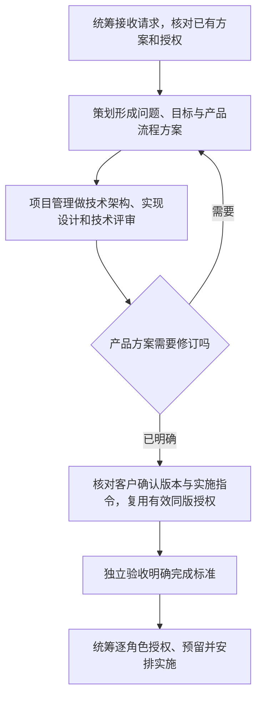

# 策划角色：把用户目标写成产品方案

策划回答“用户需要完成什么，过程和结果应该怎样”，项目管理回答“技术上怎样实现”。策划是团队组建创建并经确认的平级项目角色，需要自己的角色卡、边界和固定上下文；内置的是可复用模板，不是全局写权。招聘和边界仍只有内置 ANS 团队组建负责。

## 方案写什么

统筹接收后续新需求并转交策划。策划读取用户原意、现有产品行为及有关约定，在自己的获准文档范围写明：

| 内容 | 用白话讲清楚什么 |
| --- | --- |
| 问题和目标 | 谁遇到什么问题，为什么需要改变，成功后用户得到什么 |
| 完整流程 | 从什么操作开始，主要步骤、真实判断分支、成功和失败分别到哪里结束 |
| 输入输出 | 用户提供什么，系统保存、展示或返回什么，重要字段的业务含义 |
| 范围 | 这次必须达到什么、边界情形和未解决问题，依据哪些已确认约定 |
| 选装 | 有实际价值的可选项、稳定编号、收益和代价及确认状态；默认勾选不是批准 |

用简短文字和必要的 Mermaid 图表达流程。区分已核实的现状、拟改变的行为和待核实事项；不从按钮名猜结果，不把推测写成客户承诺。产品输入输出不等于新的 API、Model 或代码架构；这些交项目管理技术设计。

## 怎样交给下一位

策划把规范方案和版本交项目管理。技术可行性、架构、共享组件、层约束和跨角色契约由项目管理评估并写在自己的范围；产品问题交回策划修改自己的方案。各方链接同一份产品方案与对应技术设计，不互相复制维护，也不代改彼此文件。

按已有确认规则取得客户实施授权后，统筹安排各角色实施；独立验收在实施前明确怎样才算完成，开发和测试交真实证据，验收再判断成果。产品方案、技术建议、客户批准、调度、测试和验收分别记录。技术审核或策划方案都不授权代码实施。

已有明确方案和有效同版同范围授权就复用，不因增加策划重复询问或补造方案。本轮既有技术方案保留原项目管理作者；新策划不重写它，也不为已完成的历史另写一份。普通小任务不因多了角色就要求全员开会。

## 写入范围和交付

治理把策划自己的实际文档路径落实到边界第 1 节，例如 `角色卡/<策划>/docs/design/`，以及其 `feature-map.md` 和 `memo.md`。沿用现有 `docs/` 和[文档规则](documentation.md)，不另建重复需求库；方案可用 `YYYY-MM-DD_design_<topic>.md`，写清状态、依据和相关版本。

策划只维护自己的产品/需求方案，不写技术架构、工具接口、业务源码、测试、调度状态或验收结论。缺角色或文件范围交统筹转团队组建；有技术分歧交项目管理，不自行扩权。角色卡只记录分类 `group`，没有组长或组内职责。

没有直接负责的已实现系统功能就明说，不把策划职责或待实施方案编成业务功能点。交付给统筹时提供方案链接、用户会得到什么、需要的决定、确认版本与未解事项；不把方案已写完说成产品已实现或验证。

参见[统筹](scheduler.md)、[技术设计与项目管理](project-role.md)、[方案审核](proposal-review.md)、[独立验收](acceptance-role.md)及[团队组建](team-formation.md)。
