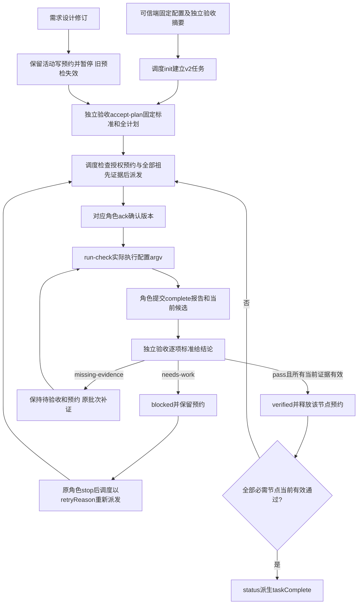

# 用独立凭证派发和验收任务

统筹可把已批准工作直接派发给对应角色，但只能由独立验收决定阶段是否通过。工作者的完成反馈仍是待验收；只有全部必需节点和独立测试节点都具有当前有效通过结论，工具才显示任务完成。本轮已由[固定测试原报告](../../../测试/docs/change/2026-10-19_change_role-authority-split-validation.md)独立验证，并由[独立验收](../../../验收/docs/acceptance/2026-10-19_role-authority-split-result.md)按标准v2 C1–C8判定通过；此处引用其结果。当前命令字段以[任务操作指南](../../../../references/task-operations.md)和 `scripts/task_ops.py` 为准。

可信端在调度之外提供验收秘密，已审核配置只存 SHA-256 摘要及验收角色卡、边界的实际摘要。初始化只返回调度秘密；不能生成、覆盖或重置验收秘密。角色名、批准引用和摘要本身不能认证客户身份；同 OS 操作者仍处于信任边界内。

`accept-plan` 由验收核对需求、设计、标准、全部节点和独立测试覆盖，绑定当前状态与计划版本。跨角色任务必须有批准为 `independent-test` 的角色覆盖全部开发节点；测试候选包括被测输入和依赖闭包。初始可并行复现问题，但测试阶段pass必须等待被覆盖开发节点当前有效pass。标准的同一criterionId可以预先定义不同节点的阶段条件；每次verify必须逐项回答，开发阶段pass只证明自己的交接条件。没有N/A捷径，标准变化须重新审核建任务。

`run-check` 从认证批次取得生产角色、worker、node和attempt，无shell执行审核argv，保存前后候选、实际命令、环境、起止时间、退出码、超时与日志摘要。环境与真实执行共享合并env和项目cwd，包含实际可执行文件路径/摘要、平台、Python版本、相关变量摘要与声明env；不自动发现外部服务或隐藏依赖，脚本、fixture及相关输入须列入readSet。历史失败保留在checkHistory和事件链中。

验收pass要求当前完成报告、规定产物和检查都有效，并递归检查全部祖先的验收与日志；直接依赖候选未变也不能掩盖祖先日志丢失。验收记录绑定标准、预检、候选、批次、报告、检查和依赖验收摘要。缺证或返工可以正式记录祖先缺项，不会放行；返工后同批次不能再次complete，须stop和新授权批次。stop只确认停止并释放写预约，不能完成任务或真实终止进程。

需求/设计revise使新预检成为必要条件，影响集向下游传播，活动角色保留预约直至stop。明确非影响理由也须由新预检复核，才能保留对应阶段的旧证据。重复同一有效预检返回duplicate；调度不能修改必需节点或标准绕过验收。

单份Markdown同时保存可读结果和事件链，由Store锁与原子替换单写。v2保存schedulerCredentialHash和assignmentCredentialHash，不保留旧认证字段及历史别名。status递归脱敏认证字段，重新核对taskComplete；记录中的提交时完成值不是永久有效。旧Markdown沿用v1原渲染/校验，旧JSON只读显示plan/state；旧通过不追认为独立验收，所有旧任务写入口拒绝。recover仅认证后读取已有完整v2记录，不重置凭证或修复冲突。

| 日期 | 类型 | 状态 | 变化 |
| --- | --- | --- | --- |
| 2026-10-19 | 修改 | 独立测试与验收通过 | [独立凭证与验收门禁](../change/2026-10-19_change_task-authority.md)；[批准设计](../../../项目管理/docs/design/2026-10-19_design_role-authority-split.md) |
