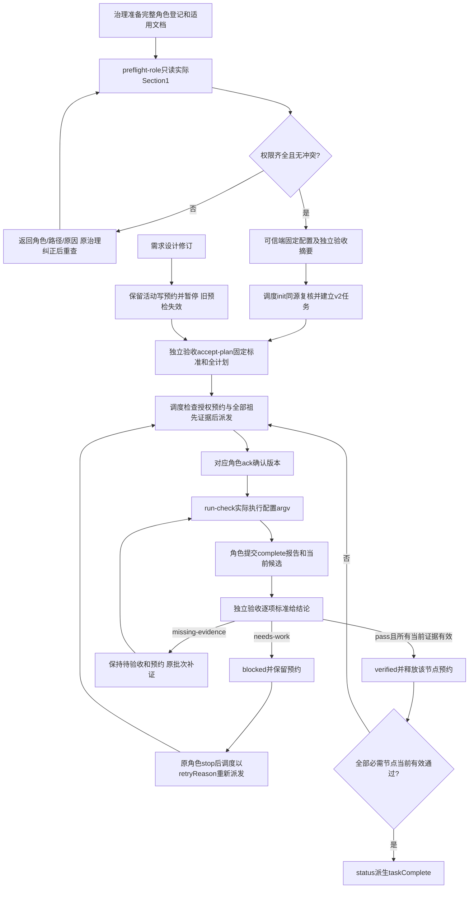

# 用独立凭证派发和验收任务

统筹可把已批准工作直接派发给对应角色，但只能由独立验收决定阶段是否通过。工作者的完成反馈仍是待验收；只有全部必需节点和独立测试节点都具有当前有效通过结论，工具才显示任务完成。2026-10-19 的分权版本已由[固定测试原报告](../../../测试/docs/change/2026-10-19_change_role-authority-split-validation.md)和[独立验收](../../../验收/docs/acceptance/2026-10-19_role-authority-split-result.md)确认；2026-10-20 的[工作流修复](../fix/2026-10-20_fix_workflow-gaps.md)已实施，开发69项通过，仍待本轮固定测试与独立验收。当前命令字段以[任务操作指南](../../../../references/task-operations.md)和 `scripts/task_ops.py` 为准。

可信端在调度之外提供验收秘密，已审核配置只存 SHA-256 摘要及验收角色卡、边界的实际摘要。初始化只返回调度秘密；不能生成、覆盖或重置验收秘密。角色名、批准引用和摘要本身不能认证客户身份；同 OS 操作者仍处于信任边界内。

`accept-plan` 由验收核对需求、设计、标准、全部节点和独立测试覆盖，绑定当前状态与计划版本。跨角色任务必须有批准为 `independent-test` 的角色覆盖全部开发节点；测试候选包括被测输入和依赖闭包。初始可并行复现问题，但测试阶段pass必须等待被覆盖开发节点当前有效pass。标准的同一criterionId可以预先定义不同节点的阶段条件；每次verify必须逐项回答，开发阶段pass只证明自己的交接条件。没有N/A捷径，标准变化须重新审核建任务。

形成或调整角色后，使用 `python3 scripts/task_ops.py --root <项目根> preflight-role --request -`，请求仅为 `{"configPath":".ans/project.json"}`。这条命令不需要task或凭证，不构造Store、不创建runtime/锁/日志，也不运行检查；权限齐全退出0，缺项或冲突退出2。结果逐角色列出具体路径、是否存在和是否有许可，文件未写但已获权可显示 `exists=false, permissionGranted=true`，不冒称内容完成。

配置中的可选 `roleDefinitions` 登记全部实际角色，包括非执行角色；每项包含实际card/boundary、精确requiredWorkDocuments和apiSpec/apiSpecReason。core为feature-map、memo、functional-description；实际提供接口的角色要求api-spec，纯协作角色按具体职责声明不适用。清单只检查许可；Section 1才授予权限。角色根从同父的实际card/boundary解析，不能按roleId拼目录。预检读取表格路径列，不把用途文字中的反引号当额外授权。

登记启用后，init与其他范围校验复用预检：先建立全部角色保护集合及所有权，再允许自身有限根工作文件或自身docs内获准的精确Markdown进入writeFiles/writeSet。有界docs目录不等于任务文件清单；未来日期文件可按目录许可精确入选。全部登记治理MD/YAML/changelog、他角色、跨角色重叠、穿越和symlink均拒绝。统筹的原runtime/scheduling管理范围可登记核对，普通执行writeFiles仍拒绝状态路径。旧配置没有登记时保持原代码范围语义，不自动获得角色文档写权；全角色是否真实完整仍由治理交接及统筹、验收核对。

`run-check` 从认证批次取得生产角色、worker、node和attempt，捕获一次实际env，按项目cwd与其PATH解析并固定实际可执行程序，无shell执行审核argv；保存前后候选、执行对象、起止时间、退出码、超时和日志摘要。新证据为environmentVersion=2，私密最少快照仅采集PATH/PYTHONPATH/NODE_PATH/NODE_OPTIONS/LANG/LC_ALL/TZ/PYTHONDONTWRITEBYTECODE及check.env声明键，包含值或明确absent；不采全部os.environ。工具生成快照路径在 `.ans/runtime/check-environments/<task>/`，目录0700、文件0600。任务及status只保留快照路径/摘要、执行文件身份与环境摘要，v2不再保存明文declaredEnvironment。失败仍保留checkHistory和事件链。

status、verify与依赖消费都使用原快照跟踪值重核实际程序路径/字节和批准声明，不使用查询者PATH或LANG替换执行环境。相同实际检查对象下换终端可继续有效；快照缺失/改变、执行程序变化、配置/源码/readSet资源或日志改变仍失效。未知环境版本拒绝，v2异常不回退；仅无environmentVersion的旧证据继续原环境比较，不能从旧hash补造快照。脚本、工具源码、fixture及相关资源须列入readSet，未声明外部服务或隐藏依赖不在自动检测范围内。

同批次补查仅限现有状态机允许的活动assignment，沿用candidate/attempt的完成报告门禁，由独立验收对新证据重新verify。verified节点已不活动，不能原批次重开；更换批准配置或重新核验已通过节点使用新审核任务。私密快照丢失也不能猜值恢复。

验收pass要求当前完成报告、规定产物和检查都有效，并递归检查全部祖先的验收与日志；直接依赖候选未变也不能掩盖祖先日志丢失。验收记录绑定标准、预检、候选、批次、报告、检查和依赖验收摘要。缺证或返工可以正式记录祖先缺项，不会放行；返工后同批次不能再次complete，须stop和新授权批次。stop只确认停止并释放写预约，不能完成任务或真实终止进程。

需求/设计revise使新预检成为必要条件，影响集向下游传播，活动角色保留预约直至stop。明确非影响理由也须由新预检复核，才能保留对应阶段的旧证据。重复同一有效预检返回duplicate；调度不能修改必需节点或标准绕过验收。

单份Markdown同时保存可读结果和事件链，由Store锁与原子替换单写。v2保存schedulerCredentialHash和assignmentCredentialHash，不保留旧认证字段及历史别名。status递归脱敏认证字段，重新核对taskComplete；记录中的提交时完成值不是永久有效。旧Markdown沿用v1原渲染/校验，旧JSON只读显示plan/state；旧通过不追认为独立验收，所有旧任务写入口拒绝。recover仅认证后读取已有完整v2记录，不重置凭证或修复冲突。

| 日期 | 类型 | 状态 | 变化 |
| --- | --- | --- | --- |
| 2026-10-19 | 修改 | 独立测试与验收通过 | [独立凭证与验收门禁](../change/2026-10-19_change_task-authority.md)；[批准设计](../../../项目管理/docs/design/2026-10-19_design_role-authority-split.md) |
| 2026-10-20 | 修复 | 已实施，开发69项通过；待独立验证 | [工作文档与环境有效性修复](../fix/2026-10-20_fix_workflow-gaps.md)；[D1-final-1](../../../项目管理/docs/design/2026-10-20_design_workflow-fixes.md) |
