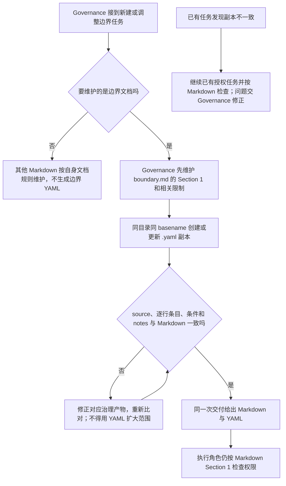

# 边界文档的同名 YAML 副本

YAML 副本让需要结构化读取的工具更容易处理边界条目，同时保留熟悉的 Markdown 表格。每个边界的 Markdown 文件仍是唯一维护和授权来源。YAML 只能同步表达同一范围，不能授予额外权限。

## 实际流程

Governance 创建或调整角色边界时，在同一交付中维护 Markdown 和相邻的 YAML 副本。例如 `boundary.md` 对应 `boundary.yaml`；如果文件名是中文，只替换扩展名。普通格式指南、README 等其他 Markdown 文件不因此都生成 YAML。技能内置 Governance 边界也采用同一套格式。

YAML 指明 Markdown `source`，并按 Markdown Section 1 表格原顺序逐行列出 `type`、`path` 和 `purpose`。字段去掉 Markdown 展示反引号，保留其他原词、替代路径或占位路径；不能把单文件变成目录，也不能拆分或改写成更宽的范围。源文件明确给某一项的条件时，可在该项写可选 `condition`；表格外影响权限的说明放在 `notes`，按源文件顺序保留原句。内置边界的职责和覆盖优先级也写进 `notes`。

如果不一致，治理交付不能按一致副本验收；先由 Governance 修正对应产物，再重新核对。已有获准任务继续依据 Markdown 工作，不从 YAML 推导权限。YAML 解析失败或遗漏条件时也不能扩大范围。现有 `task_ops` 仍读取 Markdown；本功能没有修改执行程序、测试代码、依赖或 CLI，也不代表工具已经接入 YAML。

## 历史

- 2026-10-16 · 五组边界副本内容一致、十个失配例被拒绝、同步更新正例通过；检查范围与限制见[独立测试报告](../../../测试/docs/change/2026-10-16_change_boundary-yaml-validation.md)。依据[项目管理方案](../../../项目管理/docs/design/2026-10-16_design_boundary-yaml.md)，规范改动见[变更记录](../change/2026-10-16_change_boundary-yaml.md)。该报告不证明 CLI 或文件系统权限拦截行为。
