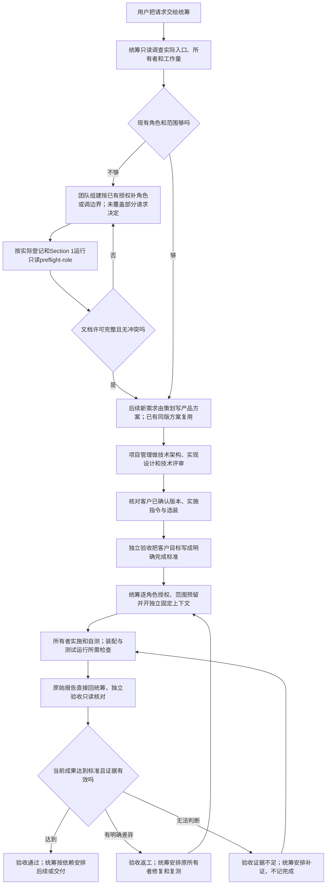

# 团队组建、策划、统筹与独立验收

使用者把请求交给统筹后，后续新需求先由策划写产品方案，项目管理承接做技术架构、实现设计和技术评审，再由文件真正的所有者按客户授权实施，由测试实际运行检查，再由独立验收判断是否达到事先约定。安排工作的人不能自己宣布验收通过；需要新角色或改文件边界时，交独立内置团队组建角色。

本页的 `implemented-unverified` 表示规范文本已同步，独立测试和验收尚待交付。任务程序的分权接口见[本轮设计](../../../项目管理/docs/design/2026-10-19_design_role-authority-split.md)与按实际代码核对的[任务操作指南](../../../../references/task-operations.md)；开发和独立测试原报告提供实际执行事实，最终结论由独立验收自己的报告给出。接口存在、文本交付与验收通过分别记录。

## 使用时怎样交接

| 使用者遇到什么 | 谁处理，交出什么 |
| --- | --- |
| 新项目缺角色，或已有角色范围不足 | 内置 ANS 团队组建（原 ANS Governance）按授权建立或调整角色卡和边界 |
| 新请求不清楚影响谁、要先做什么 | 默认统筹调查入口、受影响角色、工作量和依赖，直接逐角色安排 |
| 需要说明问题、用户目标、完整产品流程与范围 | 独立策划在自己的文档范围形成产品/需求方案，交技术设计 |
| 技术架构、抽象或共享代码需要改变 | 项目管理承接产品方案做实现设计、技术评审，并维护自身 shared 和对应测试 |
| 要知道实现是否真的运行 | 开发、装配和测试按各自职责做真实检查，交原始证据 |
| 要判断这次能否算完成 | 独立验收先明确标准，再核对当前版本与证据，判通过、返工或证据不足 |

每个上下文固定一个角色。团队组建承接原治理身份，不是新组长或 PM 附带职责；其他职责模板须在项目中落成具体卡与边界。`group` 只分类，不保留组长、组内职责或中间汇报层。统筹直接派发并收每个角色原始反馈；小任务不要求全部角色开会，也不要求一直并发运行所有角色。

## 文档权限先检查，再按任务精确选文件

建立或调整角色后，团队组建提供完整roleDefinitions登记内容与权限定义（包括不执行的统筹、策划、PM与验收），已接受统筹在自身边界内落候选配置，原owner按真实职责核对requiredWorkDocuments。默认是自身feature-map、memo、functional-description；有实际对外程序/shared能力或装配接口才要求api-spec，否则明确有据不适用。没有系统功能或代码就直说；协作角色说明真实交接与文档位置，不虚构代码层。

新项目先接受统筹定义，由独立固定统筹上下文仅做配置准备；已有项目由原统筹写候选配置。配置具备后运行只读预检，齐全后再交接/派发其余实际工作；治理不取得配置写权。按此顺序运行[实际preflight-role入口](../../../../references/task-operations.md)，读真实card/boundary共同父目录与Section 1，不按roleId拼路径，不创建任务、runtime、锁或日志。返回具体角色、文件和问题；缺权交治理修正并重查。尚未创建的文档可报告exists=false，不等于没有创建许可，也不意味着已写完。成功不代替客户批准、派发或验收。工具核登记，团队组建/统筹/验收另对照实际角色清单核完整性。

清单只检查许可，不授予写权。执行文件仍取自身有限根工作文件或有界docs、实际Section 1、审核配置精确writeFiles、节点精确writeSet的交集。目录许可不等于本次允许修改整个目录；未来日期文档不必全在初始化清单中。card/boundary/YAML/根changelog由治理独占，owner历史写自身docs/change或fix；其他角色、.ans与调度状态继续保护。统筹合法管理范围参与所有权核对，状态实际变化仍只通过task_ops。旧配置申请新增角色文档能力须新审核配置及新任务。

## 查询时核对原检查环境

新环境证据v2把最少原执行环境保存在私密runtime快照，任务只存摘要和执行身份。status、verify和依赖消费重核该快照、实际程序、候选/readSet和日志，查询者无关PATH变化不推翻相同实际对象。真实程序、批准环境/配置、源码资源或证据变化仍失效，快照缺坏也直接当前无效；不能回退查询者环境或补造快照。

没有environmentVersion的legacy仍保留原比较语义，不追认旧哈希。仍active的获准assignment可真实补检查并接受独立重新verify；verified批次要换环境须新审核任务，不新增状态或通用报告绑定系统。动态未声明外部依赖并未自动覆盖，必要变量和资源仍显式放check.env/readSet。字段、私密权限及局限以[任务操作指南](../../../../references/task-operations.md)为准。

## 可照做的请求

> 使用 $ans-governed-construction，调查保存草稿失败，先写方案。请按现有角色直接安排，明确怎样才算完成。

统筹先定位真实路径和负责人；后续新需求交策划写问题、目标、完整产品流程分支、输入输出、范围和选项，再交项目管理评估技术实现与契约，相关所有者写自己的具体提案。已有同版方案和授权直接复用，本轮原技术方案不补造成策划产物。核对用户已有确认和实施指令后，独立验收明确必要成功/失败场景与证据，统筹再给具体角色授权和预留。失败或缺证据原样保留，由正确的角色补做；不用统筹换身份修代码或验收。

新项目由团队组建先建立适用角色再交接。旧项目须显式盘点角色、配置、活动任务和凭证并迁移；旧 PM 上下文不能默默变成统筹或验收，旧完成记录也不追认为独立验收通过。详情见[团队组建](../../../../references/team-formation.md)、[统筹](../../../../references/scheduler.md)、[策划职责](../../../../references/planning-role.md)、[架构职责](../../../../references/project-role.md)及[独立验收](../../../../references/acceptance-role.md)。

## 验证与历史

本轮规范、策划路由及实际 API 说明已交付。文档检查和接口核对事实见[本轮变更](../change/2026-10-19_change_role-authority-split.md)；skill-creator 快速验证因当时环境缺少 PyYAML 未运行。

[开发者原报告](../../../任务工具/docs/change/2026-10-19_change_task-authority.md)与[固定测试原报告](../../../测试/docs/change/2026-10-19_change_role-authority-split-validation.md)分别记录实际命令、受测候选、结果和限制。最终是否通过，以独立验收自己报告中的候选、标准和原证据判断为准；本页不代作结论。开发自测与文档检查不代替独立 QA，timer 回放不代表浏览器或 TypeScript 编译验证。

- 2026-10-19 · 规范、实际接口与独立策划路由已落文档；实际执行和最终结论由各原报告负责 · [本轮变更](../change/2026-10-19_change_role-authority-split.md)、[平级角色当前说明](role-groups.md)。

- 2026-10-20 · 按客户已确认D1-final-1同步工作文档适用性、只读交接预检、精确任务范围、治理保护和环境v2/legacy语义；规范轻量核对由[修复记录](../fix/2026-10-20_fix_workflow-gaps.md)记录，程序与独立验收结果待原owner交付。
