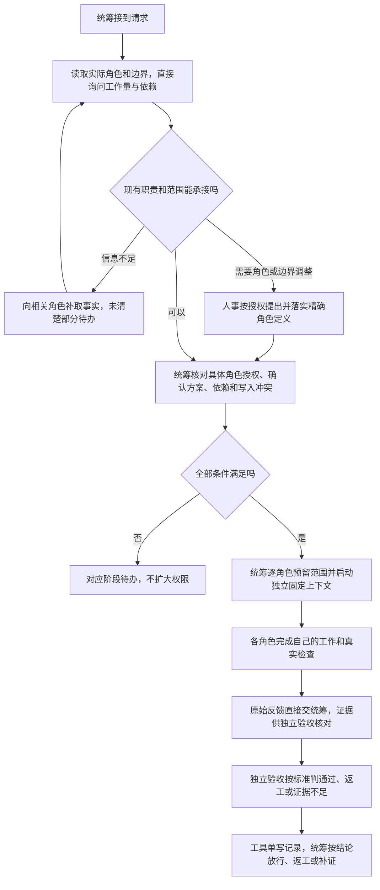

# 平级角色与组别分类

组别帮助读者看出哪些角色常合作，只保留 `group` / 组别分类字段。当前不设置组长对象、组内职责或组内派发/汇报层级。每个角色保持平级，文件权限仍只看各自边界第 1 节。

## 当前过程

人事（原团队组建/招募）角色按已获准的职责和文件范围建立角色卡、边界及其同步 YAML。已有角色改组只改分类，不新增权限，也不按组迁移目录。角色数按已确认定义计数，同一 `roleId` 多个上下文不算增员。

统筹直接读取角色定义，询问每个受影响角色的现有任务、剩余工作、依赖和阻碍。缺信息就标待评估，不编造工时；任务确有讨论需要时才组织最小必要角色。现有职责能承接就复用，确需招聘或边界调整时交人事，核对已有授权覆盖后落实角色定义。

执行者只取得自己的工作凭证，统筹只持调度凭证，独立验收只持验收凭证。所有操作走同一个单写工具；组别、父子代理关系或读取他人卡都不能替代授权。没有工具也遵守逐角色授权、边界、依赖和独立上下文；无法新建上下文就报告待办，不切换身份。

同组不等于共享私有 common、Model、公开契约或 shared 写权。实现者保留自己的真实报告；测试实际执行检查，验收判断交付，统筹不能修改他人报告或自行判通过。更详细的当前规则见[人事](../../../../references/team-formation.md)、[统筹](../../../../references/scheduler.md)和[独立验收](../../../../references/acceptance-role.md)。

## 历史

- 2026-10-14 · 组别字段、角色平级与逐角色范围规则验证通过；详见[上轮变更](../change/2026-10-14_change_role-groups.md)与[上轮测试报告](../../../测试/docs/change/2026-10-14_change_role-groups-validation.md)。
- 2026-10-14 · 本轮文档一致性核对和三项独立只读情境判断通过；依据[当时项目管理方案](../../../项目管理/docs/design/2026-10-14_design_group-leadership.md)，规则变化见[变更记录](../change/2026-10-14_change_group-leadership.md)，检查范围与限制见[测试报告](../../../测试/docs/change/2026-10-14_change_group-leadership-validation.md)。

- 2026-10-19 · 当前流程按权责拆分更新，待本轮独立验证；见[拆分功能](role-authority-split.md)与[变更记录](../change/2026-10-19_change_role-authority-split.md)。
