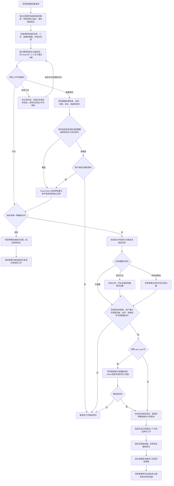

# 平级角色与组内协作

组别说明哪些角色经常协作；组长则是其中一个现有角色额外承担的协调职责。角色仍然平级，每个角色仍只修改自己边界第 1 节允许的文件。组别和组内职责是普通 Markdown 文字，不是工具授权字段。

## 实际流程

治理角色在已获准的角色定义里维护 `group` / “组别”和 `groupDuty` / “组内职责：组长／组员”。组人数按已接受的项目角色定义计算，不按运行中的代理上下文计算；同一 `roleId` 启动多个固定角色上下文仍是一个组员。单角色组默认这个角色是组长。增加组员时保留现有组长。更换组长时，Governance 只在有效客户授权或已批准配置覆盖该变更时维护角色卡。多角色组没有唯一明确的组长时，项目管理负责理清；组内协调先保持待办，不抢当组长，也不影响项目管理其他已获准工作。

项目管理收到新需求后，先看受影响组的现有任务、剩余工作、人手、依赖和阻塞，再听组长报告实际情况。缺少信息就标“待评估”，不编造工时，也不要求每个小需求开会。确需增员时，项目管理写清新角色职责、非重叠边界、交接和验证、收益与成本，并先核对现有有效授权或明确批准的配置是否覆盖这份角色定义和边界；未覆盖时才请求客户授权。新角色由 Governance 建立为独立平级角色，按原方案确认和任务授权规则实施。

组长继续负责自己的业务，只能组织已经分配且获准的组内任务。普通组员不能派工；组长不模拟组员身份、不修改组员文件、不扩大组员边界。同组不等于共享私有 `common/`、Model、公开契约或 `common/shared/` 写权限，原有文件所有者和复用规则继续有效。

`task_ops` 场景中，项目管理或可信操作端先为每个具体 `roleId` 完成授权与范围预约。成功后，组长可以启动被指定的独立角色上下文，或由项目管理按组长计划启动。`coordinatorToken` 留在项目管理或可信端；成员令牌只交给对应成员；全局任务记录和全局阶段验证仍由项目管理单写。没有 `task_ops` 时也要逐角色核对授权、方案确认、边界、依赖和写入冲突，保持独立上下文。组长职责、父子代理关系和多个运行上下文都不能代替这些检查。

项目或跨组会议由项目管理主持，组内会议由组长主持。实际主持人只能在自己的 `docs/meetings/` 授权范围写纪要；未获路径时先保留聊天草稿。会议意见不授权代码、测试或权限变更。组员向组长汇报进展、阻塞和原始证据；组长完整转交证据给项目管理。独立测试角色保留自己的报告，组长不得改写、隐藏或代替其验收。

## 历史

- 2026-10-14 · 组别字段、角色平级与逐角色范围规则验证通过；详见[上轮变更](../change/2026-10-14_change_role-groups.md)与[上轮测试报告](../../../测试/docs/change/2026-10-14_change_role-groups-validation.md)。
- 2026-10-14 · 本轮文档一致性核对和三项独立只读情境判断通过；依据[项目管理方案](../../../项目管理/docs/design/2026-10-14_design_group-leadership.md)，规则变化见[变更记录](../change/2026-10-14_change_group-leadership.md)，检查范围与限制见[测试报告](../../../测试/docs/change/2026-10-14_change_group-leadership-validation.md)。
