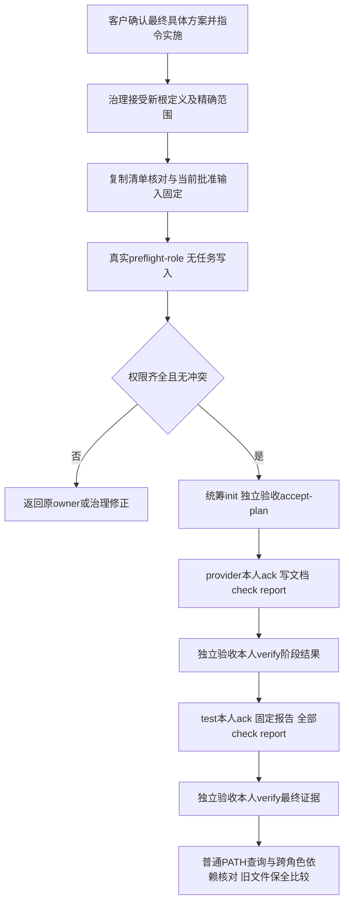

# 工作文档受限任务与实际执行环境的独立验证设计

版本 **QA-T1-draft-1**。角色自己的文档已获边界许可时，应能作为精确文件走完真实任务；漏权时，应在交接前指出实际缺项；其他人换终端查看时，应核对原检查使用的运行对象。测试将分别验证这三件事，并检查原凭证、依赖、失败历史及旧库存资料没有因此退化。

本文由源仓库固定【测试 / qa】上下文撰写，只写本文件。当前是供客户审阅的计划，**未修改测试或程序，未复制验证载荷，未初始化任务，未运行测试，未作验收判断**。实际执行依赖客户确认具体方案并指令实施、治理接受精确边界、统筹交付任务与可信凭证。本文不预定真实taskId、attemptId或token。

## 1. 输入、范围和已知事实

- 源仓库基线 `main d95d0068d219c2a8870d585364af2b34999bec3c`。工作区已有本轮治理和其他角色文档，均是只读输入，不属于QA成果。写权来自[测试角色卡](../../role-card.md)及[Section 1](../../boundary.md)；适用[工程法案](../../../项目管理/docs/project-rules.md)的DOC-01、TASK-01、ROLE-01。
- 产品依据：[P1](../../../策划/docs/design/2026-10-20_design_workflow-friction-product.md)，本次读取SHA-256 `29b9a4c5c7e8a7b48d1f875d7f55964fae50a90bb354a88974c46219fe6f849b`。
- 技术依据：[PM D1](../../../项目管理/docs/design/2026-10-20_design_workflow-fixes.md)，本次读取SHA-256 `2850eeda827c3fdfa1136ae32b7f19ea576aa942b837b99dccaab41b4f5bea15`；已采用第7节B方案，即复制20文件及必要角色、根内绑定源工具并重跑原60项。D1仍标not ready，不能把它当实施指令。最终批准版本须重新绑定，本文不冻结PM后续修订。
- 独立标准：[C1-draft-1](../../../验收/docs/acceptance/2026-10-20_workflow-fixes-criteria.md)，读取SHA-256 `cef4ae7e40a1e84bf505184e0ad76f1a3715a435b99bd46d8487dc83ed4720bf`。其形成于D1交付前，WF-01结构检查及两节点阶段语义待原验收按下述意见对齐。
- 已读[工具owner评估](../../../任务工具/docs/fix/2026-10-20_fix_workflow-gaps.md)、[规范owner评估](../../../技能规范/docs/fix/2026-10-20_fix_workflow-gaps.md)、[库存观察](../../../../../ans-full-trial-2026-10-19-bqf0vjof/角色卡/scheduler/docs/handoff/2026-10-19_trial-observations.md)、[库存最终交接](../../../../../ans-full-trial-2026-10-19-bqf0vjof/角色卡/scheduler/docs/handoff/2026-10-19_final-handoff.md)及其最终候选清单和原配置。只定点查看原边界、检查argv与集成测试定位方式，未重复全源码调查。

旧库存最终交接记载revision93、六节点有效、taskComplete=true、20个交付文件、60个测试方法、77次进程调用。根/PM提供了在真实私密跟踪环境下的只读复核事实；本文引用，不冒称QA本轮已复核。旧PATH查询失效的观察和原失败历史同样保留。

源测试当前只有一个QA可写文件：[scripts/tests/test_role_authority_flow.py](../../../../scripts/tests/test_role_authority_flow.py)，现有25方法，以真实子进程CLI测试，不导入生产operate或开发测试helper。本轮拟在此文件增加必要用例，保留原断言；不取得整个scripts/tests目录。工具owner单测仍为其独占的test_task_ops.py。当前[任务工具功能](../../../任务工具/docs/feature/task-authority.md)与[角色分权说明](../../../技能规范/docs/feature/role-authority-split.md)由原owner维护。

## 2. D1可执行性评估与必要闭合项

**判断：B方案在既有工具安全边界内可实施；以下四处须在客户审阅的D1/标准中明确，不能留给实施者临时扩大范围。** 不需要新源测试模块、常驻检查脚本或放宽safe。

| 编号 | 实际不一致或缺口 | 最小处理与责任 |
| --- | --- | --- |
| Q1 | 角色输入称逐字节复制并冻结，同时新根boundary/YAML又须增加夹具等路径 | 准备报告记录“复制时原件=副本”基线；治理仅对副本获准治理文件作显式差额，按治理规则同步YAML/changelog，记录接受后的第二份摘要。执行基线以接受后版本为准，不声称其仍等于原件。原20源码/测试及不需改的输入继续冻结。PM写清顺序，治理实施，QA核对。 |
| Q2 | 复制清单具体列的是旧库存P1/D1/R1/C1/T1，新任务仍需绑定本轮workflow批准内容 | PM明确现有新根计划/标准如何完整承接本轮确认的P1、D1、C1和QA-T1版本及摘要，再由统筹配置requirement/design/criteria的根内实际路径。旧库存五文件只是回归合同。不能引用root外文件后宣称readSet覆盖，不能用旧库存D1冒充本轮设计。优先使用已列新根计划/标准承接；若确需新增快照路径，先精确列入D1并由治理处理，不在QA临时补文件。 |
| Q3 | 新根run-check若比较父库存原件，会再次发生root外读取而未绑定 | 获准准备/收尾角色在工具任务之外只读原件，作前后清单摘要比较；根内检查只读冻结copy-manifest及根内载荷。明确两者证明范围，根内检查本身不能独自证明父根始终未变。保全摘要不输出秘密。PM/统筹落实，QA报告两种证据。 |
| Q4 | document-check唯一writeSet是自身报告；六项检查之后改报告会改变候选并使先前证据失效 | 同一最终报告必须先固定，全部正式run-check随后执行，本人report和独立verify最后进行；不得追加结果后沿用旧检查。可先实际独立运行形成报告，冻结后正式重跑六项及报告断言；或由原验收明确报告是固定输入/方法，结果由工具原证据与源QA报告承载。PM须选定一种，成本和实际命令如实记录。 |

上述问题已交统筹转PM。QA不代PM决定技术合同，不另写签审文件。两节点的真实执行角色分别是新根provider-json和test；源QA、隔离项目test是不同项目固定上下文，源QA不能通过读取副本卡切换身份。原治理、验收、统筹分别接受/维护新根定义、标准、计划和配置，不要求激活九个执行上下文。

**WF-01须区分工作文档预检与原层检查。** 现有test_task_ops.py的`test_overlapping_directory_and_file_ownership_is_rejected`、`test_directory_grant_does_not_cover_sibling_or_broad_root`、`test_directory_scope_rejects_traversal_and_symlinks`覆盖原授权保护；库存test/integration/test_architecture.py两方法核对既有生产源码无三元及相邻层public导入。它们均不是Provider/Service缺abstract/public/impl三目录或缺契约的通用机器检查器。QA计划复跑这些实际断言、检查合法副本未变；不宣称已有结构遗漏负例机器证据。C1应由原验收把工作文档预检与现有层/合同检查不退化分开，不能扩大preflight为新架构扫描器。API适用声明/缺少必要api-spec许可则仍在本轮工作文档预检范围。

## 3. 源CLI独立测试：可观察结果与边界

所有新增自动化场景写在原QA测试文件，用独立临时项目和真实CLI；沿用原记录方式并保护私密快照。命令形状以最终实码为准，拟议预检为`python3 scripts/task_ops.py --root <fixture> preflight-role --request -`，请求只给configPath，无task或凭证。旧任务命令及批准门禁保留。

| 用例组 | 准备、动作及预期 | 所需原始证据 |
| --- | --- | --- |
| T01 无副作用预检 | 对权限齐全、缺core、缺本轮docs、重叠四种实际Section1配置分别调用。齐全退出0；失败退出2并定位角色/路径/原因。调用前后递归文件清单、字节、权限模式相同；无runtime、忽略文件、锁、日志或任务记录新增；不只比较任务Markdown。 | argv、脱敏请求/响应、退出码、前后树清单；预检不调用checks。 |
| T02 必要清单不授予权限 | requiredWorkDocuments列出但Section1漏权应拒绝；获权但文件未写可permissionsComplete=true并exists=false；未来日期docs已获目录许可可精确入选，即使不在必要清单中。协作角色apiSpec明确不适用、有依据，不强制代码层/功能页；适用API未声明/漏权拒绝。 | 实际卡/边界/配置、缺项输出、存在与许可两个结果。 |
| T03 全角色登记 | 登记覆盖执行者、scheduler、planning、PM、acceptance及fixture实际其他角色；roles/authority与登记不一致拒绝；card/boundary不同父目录、重复或嵌套根拒绝。roleId与中文/英文/自定义目录不同的合法正例通过。工具只验证给定完整登记，不能声称发现未登记角色。 | 根内精确登记及实际保护路径；登记之外角色文档写入拒绝。 |
| T04 合法精确文档任务 | 根core有限文件、自己的docs精确文件和已获有界docs子树内新文件分别进入writeFiles/writeSet；真实init、accept-plan、dispatch、ack、写文件、run-check、本人report、fixture verify，并检查producer/attempt及最终状态。清单、Section1、配置、节点四层不互相替代。 | 全过程CLI原记录、候选与checked候选一致、真实读文档断言输出。 |
| T05 保护集合优先 | 跨角色core/docs、标准治理MD/YAML/changelog、自定义登记治理文件（包括docs/common/test内）、.ans和docs/scheduling均拒绝；包括只读非执行角色。登记自定义治理文件不因名称不同而放行。 | 退出2及具体路径，正式任务拒绝前后记录字节一致。 |
| T06 目录和规范路径 | 整角色根、目录writeFiles/writeSet、未选进writeFiles的跨角色文件/目录包含式重叠均拒绝；自己目录内精确文件合法；docs/a不覆盖docs/ab。覆盖绝对/非规范/反斜线/点段/穿越、叶symlink、现有父目录symlink及尚未创建叶文件的父目录symlink。 | 独立fixture、完整边界而非仅当前任务清单；不扩safe。 |
| T07 v2 PATH正例 | 同候选实际完成检查与fixture verify后，以绝对且相同的CLI解释器路径调用普通status，查询者PATH用两种真实不同写法；无需overlay执行端环境。原执行文件canonical路径/内容不变、快照摘要不变。status有效，跨角色verify同一逻辑有效，依赖dispatch可消费；不是只比较environment函数。 | 两次PATH不同的摘要（不输出原值）、执行对象摘要、原check标识与执行次数未增加、valid/taskComplete/依赖结果。 |
| T08 真实环境与资源失效 | 分别更改实际可执行文件内容、解析目标、声明env/批准命令/配置、readSet配置/资源/源码、日志、报告、snapshot内容或删除snapshot；每项独立fixture，旧通过失效，verify或依赖消费不能继续放行，指出变化对象。只改查询者环境的正例不代替这些负例。 | 原候选/原证据与变更摘要、状态理由、拒绝记录；不重算证据hash伪造有效。 |
| T09 实际捕获环境 | check显式env覆盖和强制PYTHONDONTWRITEBYTECODE=1仍生效；PATH选择的对象即实际执行的对象；declared/absent键与同一捕获映射一致。执行中候选/执行文件变化、超时、非零、snapshot写入失败不能产生有效通过，保留原失败。 | 子进程真实输出及私密摘要/权限检查；执行前后对象身份。 |
| T10 隐私与旧格式 | snapshot父目录0700、文件0600；任务/status/报告不含v2明文跟踪值；不额外采集未跟踪的合成秘密。旧hash-only证据在实际旧语义中核对，换PATH仍可失效，不补snapshot或升级证据。v2缺snapshot不得降级查询者环境。 | 用合成标记断言不泄露，真正私密值/快照不进入transcript；legacy字节/事件保持，原旧基线六命令不能写v2继续验证。 |
| T11 全部原回归 | 原25方法继续验证凭证分权、标准/边界/配置固定、失败/缺证/返工/stop、候选/报告/日志/祖先失效、readSet独立覆盖、旧格式、锁/原子/Git/Dashboard等。新增v2必要断言不删除旧安全断言；需迁移格式断言时保留原语义并新增legacy对应。 | 原方法列表与最终完整发现日志；新增用例数、重复运行数分开。 |

T04等自动化测试使用**明确标注的fixture凭证和fixture客户批准来源**。同一测试进程可模拟不同CLI身份以检查工具门禁，这不证明真实职责分离，也不能冒充库存项目的独立验收。T07须在同一候选分别证明status、verify、依赖消费；需要不同生命周期状态时用相同输入的独立fixture，不能重写已完成任务制造可dispatch状态。

环境负例不得改真实旧库存、源Python可执行文件或正式成功日志；使用新根指定可执行夹具或源测试临时项目。恢复字节不等于抹除历史；保留负例记录，需重新收集证据的情形真实重跑和重新报告/verify。实际换check.env/批准配置须用合法新配置/新任务，不修改configHash绕门禁。

## 4. 源回归命令和最小文件方案

实施后先由工具owner运行自己的开发单测。源固定测试独立运行：

```text
python3 -m unittest discover -s scripts/tests -p test_role_authority_flow.py -v
python3 -m unittest discover -s scripts/tests -v
```

用已存在ANS_QA_LOG_DIR能力保留隔离项目和脱敏CLI记录，指定获准私密临时证据位置；首次失败原输出也保留。完整发现包含原test_task_ops、Dashboard及既有回归，实际数量以发现结果为准，不能把历史201项直接写成本轮结果。相关Python/Node、Git、基线6a7d4fe不可用则标“无法运行/证据不足”，不缩小断言使其通过。timer及其他原测试若已在完整发现覆盖，不无依据重复运行。

**拟议最小确切新增文件**仅为D1已有第7节清单中的新根载荷、manifest、两角色文档、验收/计划/配置、三个夹具及工具原输出；源侧无新增测试模块。三个夹具是：

```text
test/workflow-fixes/runtime-resource.txt
test/workflow-fixes/probe-config.txt
test/workflow-fixes/tools/check-probe
```

前两者用于真实readSet输入变化，第三者用于实际执行文件字节/解析目标变化；仅在副本test边界明确增加这些精确路径后准备。不把它们放进库存业务源码，不授整个test根。文档检查复用批准`python -c`，显式读取节点唯一文档并断言固定标记、批准版本/范围等实际内容；不能只`assert True`、只测存在或计数。源码工具副本为validation-tools/task_ops.py及coordination_store.py，均逐字节核对源候选并进readSet；无需另造验证脚本。源候选变化后重新复制并复测，不只更新manifest摘要。

## 5. 库存独立新根的真实完整流程

拟议根为`ans-full-trial-2026-10-19-bqf0vjof/validation/workflow-fixes-2026-10-20/`。此为D1提案中的获准目标，当前尚未创建。准备角色先完成Q1—Q4、治理差额与明确实际许可，独立验收接受标准、统筹选定新taskId和配置；不得沿用inventory-full-trial、旧token或旧批准。



1. 获准准备角色按D1精确展开复制原20文件、九角色必需输入、旧冻结合同/API/最终清单、源工具两文件。读取真实原件并比对复制字节；manifest冻结后纳入readSet。新登记含全部九角色，不能只登记两个执行者。checks的cwd、模块定位均为副本根，不导入父根；原集成测试ROOT来自自身__file__，可以随原布局复制使用。
2. 真实preflight-role核对实际Section1及完整登记；工具执行init同源复核。根外批准资料如何承接按Q2落实，只将真实根内精确文件放readSet。独立验收本人accept-plan，independentTests的document-check覆盖document。
3. 统筹真实dispatch `document`，provider-json本人ack，唯一writeSet为`角色卡/provider-json/docs/change/2026-10-20_change_document-probe.md`，读取批准合同后写真实说明；run-check读取这份实际文件作内容断言，owner本人report complete；独立验收依据该节点阶段语义verify。不得由QA代写Provider文档或代用其token。
4. 有效前置结果后dispatch `document-check`，新根test本人ack。唯一writeSet为`角色卡/test/docs/change/2026-10-20_change_workflow-fixes-validation.md`；readSet覆盖document write/read并集及自身全部检查载荷。按Q4选定顺序固定报告，再完整执行六项库存回归和文档/manifest断言，本人report complete。动态结果指向工具生成原日志，不编辑日志。
5. 独立acceptance本人逐项verify；scheduler没有验收秘密。provider阶段pass只证明其阶段交接，最终test阶段及源修复完整证据齐全才可判断最终目标。C1的两节点WF-01—WF-06实际语义由原验收提前落定，QA不填写未运行项目的pass。
6. 真实完成后用普通不同PATH及另一角色查询，同一原check/候选仍有效；负例在允许夹具/独立fixture运行，保留失败历史。源QA收取同候选源回归、库存原日志、复制与保全事实，写源QA实际报告，交独立验收判断。

副本root内六条原argv（每项原配置timeoutSeconds=120，是否调整由批准配置明示）：

| check | 实际命令（副本cwd） | 历史预期方法数，待本轮真实核对 |
| --- | --- | --- |
| regression-model | `python3 -m unittest discover -s test/inventory-service -p test_product_model.py -v` | 7 |
| regression-provider | `python3 -m unittest discover -s test/provider-json -p test*.py -v` | 7 |
| regression-service | `python3 -m unittest discover -s test/inventory-service -p test_inventory_service.py -v` | 10 |
| regression-cli | `python3 -m unittest discover -s test/inventory-cli -p test*.py -v` | 21 |
| regression-assembly | `python3 -m unittest discover -s test/assembly -p test*.py -v` | 6 |
| unit-integration | `python3 -m unittest discover -s test/integration -p test*.py -v` | 9 |

以上使用argv数组传递pattern，不由shell展开星号；每次退出码、Ran计数、方法/子情形、原输出都核对。合计60个方法不按重复回归累加；历史77进程调用也不能直接冒成本轮调用数。原20文件全部进两个节点readSet，源工具两文件及实际配置/夹具/标准等额外输入也逐项列入；safe不跨根，不接收“外部输入由人承诺”代替候选绑定。

## 6. 旧文件字节保全与报告证据

准备前只读记录旧库存完整文件清单和摘要，至少覆盖：原`.ans/project.json`、docs/scheduling/inventory-full-trial.md、原runtime/inventory-full-trial全部原日志/失败输出/相关资料、私密observed-check-environment.json、旧冻结P1/D1/R1/C1/T1、四API、最终清单20文件、九角色治理/工作输入。私密摘要记录留私密位置，报告只给数量、匹配结论和非敏感摘要，绝不输出原值/凭证。

收尾再比较旧文件集合和每文件字节，包括原日志目录是否增删；唯一新增区域是批准的新根。revision93和旧任务字节不变；如需旧status只读复核，由获授权可信端使用实际已观察跟踪环境、unset absentKeys，不补旧snapshot。保全发现差异先停止并报告差异，不回写原件掩盖。根内检查和根外前后比较的界限按Q3在报告中分别列明。

源QA实际报告的获准路径是`角色卡/测试/docs/change/2026-10-20_change_workflow-fixes-validation.md`，本回合不创建。实施后应含：当前候选Git/diff及工具/测试摘要、最终批准输入版本、所有实际命令/cwd/运行身份、任务/节点/attempt、通过/失败/无法运行/未测、全部原日志引用、复制/治理差额/readSet覆盖及保全结果。secret和snapshot原文不进入报告。源测试、库存60项、真实角色流程、独立验收是四种事实，各自有原证据；文档阅读和本计划不是其中任何一项的测试通过。

本轮不证明OS用户级恶意攻击隔离、自动发现任意隐藏依赖、跨机器环境复用、浏览器/性能/断电恢复，也不安装、改public、发布或推送。没有选装实现。当前交付仅为可审阅测试计划与上述可执行性意见；待PM/验收一次性对齐并由客户确认后，再由统筹安排实际执行。
