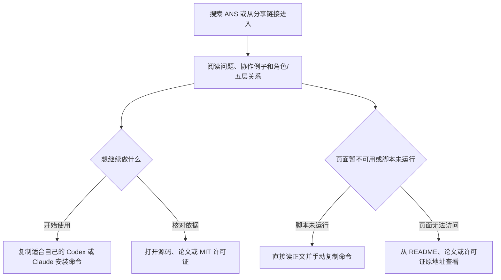

# ANS 公开介绍页产品方案

方案版本：P1。

## 用户目标

第一次听说 ANS 的开发者，希望通过 Google 等搜索找到一页清楚、可直接阅读的介绍，判断它解决什么协作问题、怎样开始使用，并能继续查看源码、论文或复制安装命令。页面拟部署到用户已选的 GitHub Pages；预期地址为 `https://wangzhongren.github.io/ans-skill/`，目前 Pages 尚未配置，具体站点方案待确认。

## 页面内容和使用流程

页面以中文为主，按这个顺序回答读者的问题：

1. **ANS 是什么、解决什么问题：** AI 能读懂多处代码，不代表它自然知道谁负责结果、谁可以修改；ANS 用角色责任、文件边界和明确交接来组织协作。
2. **一个具体协作例子（示意）：** 保存工单草稿时，工单角色负责从接收输入到业务规则，存储角色负责读写记录；Model 由指定所有者维护并供各层共享。一个角色可以跨多个代码层，代码层也不等于角色。
3. **角色与五层：** 角色说明谁对功能负责，Interface、Pipeline、Service、Provider 说明代码怎样配合，Model 供各层共享；不是一层一个角色。
4. **怎样安装：** 提供可复制的 Codex 命令（`~/.agents/skills/ans-governed-construction`）和 Claude Code 命令（`~/.claude/skills/ans-governed-construction`），并说明按 README 使用 Git 安装。
5. **常见问题：** 阅读是否要启动服务、角色是否能随意改其他角色文件、测试通过是否等于最终验收，以及如何查看五层和功能流程。
6. **继续了解：** 链到公开源码、Role-First Software Governance 论文和 MIT 许可证。

读者可从搜索结果进入页面，直接阅读正文，再跳到源码/论文或复制安装命令。页面即使浏览器不运行 JavaScript，也应保留完整正文和可手动复制的命令。若页面暂时无法打开，读者仍可直接访问源码仓库的 README、论文和许可证；不宣称搜索引擎一定收录、排名或展示摘要。

## 范围、依据与可选项

必需范围：中文介绍、上述内容路径和来源链接；主要信息不能依赖脚本才出现。页面语气具体清楚，以说明和协作例子为主，不堆空泛卡片。GitHub Pages 是用户已选的平台，不代表其余站点行为和发布细节已确认；发布前仍须客户确认具体方案。

README 可核实的验证事实只按原口径介绍：截至 2026-10-20，源仓库 236 项验证，其中开发 69 项、CLI 40 项（均包含在 236 内，不另行相加）；隔离库存项目另有 60 种测试方法。它们说明做过这些检查，不作为速度、提效或未来可靠性保证。不得编造用户数量、客户评价或提升百分比。搜索可见性、收录和排名不作保证。

- [x] **OPT-EN：完整英文页**（默认推荐，待用户明确确认）。可让英语读者直接阅读并复制安装命令；代价是整页翻译，以及之后与中文内容同步维护。未确认前不纳入必需范围。

## 状态

这是 P1 产品草案，不是发布授权。GitHub Pages 已由用户选定，但预期网址当前尚未启用。技术实现与发布方案交项目管理评审；客户确认具体方案及是否包含 OPT-EN 后，才进入实施与发布安排。本轮未建站、未改 workflow、未测试或发布。
