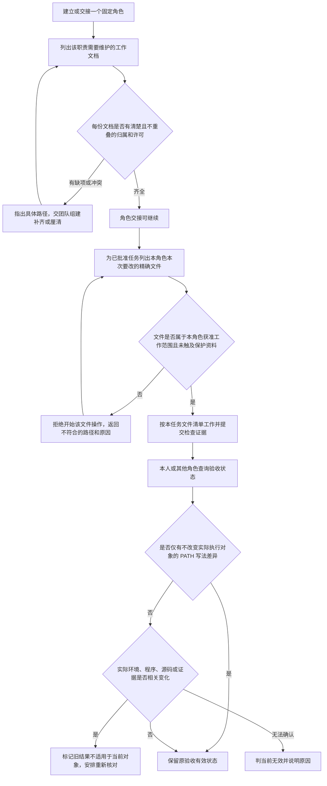

# 修复角色文档交接、任务文件范围与验收结果误失效

方案版本：P1。

## 用户遇到的问题

在库存项目的真实交接中，接手检查发现统筹自身三份伴随文档未获边界明确授权，因此先退回团队组建补齐边界，再继续交接；没有在缺权时先写。另一次已批准的角色工作需要修改本角色的文档，但任务工具把角色卡目录下一切路径都挡住，连精确的工作文档也不能进入任务。任务完成后，另一位角色从自己的普通终端查询状态，因为 `PATH` 写法不同，即使实际选中的 Python 及内容相同，也看到先前验收结果失效。相关记录见[实测观察](../../../../../ans-full-trial-2026-10-19-bqf0vjof/角色卡/scheduler/docs/handoff/2026-10-19_trial-observations.md)和[最终交接](../../../../../ans-full-trial-2026-10-19-bqf0vjof/角色卡/scheduler/docs/handoff/2026-10-19_final-handoff.md)。

这次希望每个角色能在交接前查出自身工作文档权限是否齐全；已获批准的任务能包含该角色确实负责的精确文件；普通查询和跨角色查看不会因无关的环境写法变化丢掉有效结果。真实环境、程序、源码或检查记录发生相关变化时，旧结果仍应失效并要求重新核对。

## 拟议的用户可见行为

### 1. 交接时能查出角色自身工作文档缺权

形成或交接角色时，检查该角色实际需要的工作文档是否有明确、非重叠的维护归属和写入许可。例如功能导航、备忘录、功能说明，以及该职责确实会维护的接口说明等，应由对应角色逐项纳入可核对的工作范围。交接检查应指出缺少授权的具体文档，让团队组建角色补齐边界后再完成交接。

每个角色只获得其职责需要的文件或有界子树。不能因为方便而开放整个角色根目录，也不要求所有角色都维护与职责无关的代码层文档。治理卡、边界文件、权限副本、变更记录和他角色的资料仍按各自所有权保护。

### 2. 获准任务可纳入角色的精确工作文件

在一项真实任务中，执行者需要读写本角色获准的工作文档时，可以把这些具体文件纳入本任务的读写范围。任务文件清单应清楚列出本次允许碰触的文件；获准目录只是判断某个文件是否可能入选的边界，不能自动代表本任务中的全部文件。

治理角色卡、边界及其同步副本、角色变更记录、其他角色资料，以及 `.ans` 和统筹状态资料继续受保护。申请路径不属于当前角色、不是获准工作资料，或超出该任务精确范围时，应在任务开始前拒绝并说明哪一项不符合。由角色 owner 在自己的文档职责内维护资料，不会因此获得修改他人文件或治理规则的许可。

### 3. 普通查询与跨角色消费保持已验收结果有效

角色在自己的普通终端查询任务，或另一角色读取任务状态时，若变化仅是调用者如何写 `PATH`，且实际执行环境和已验收对象没有变化，应继续显示当前有效的验收结果。用户不应因为换了终端或由另一个角色查看，就被要求重跑原检查。

如果实际使用的程序或运行环境发生变化，或相关源码、任务所依据的文件、检查日志等证据发生变化，状态应明确显示此前验收不再适用于当前对象，并指出需要重新核对的内容。无法判断变化是否相关时，可保守地将旧结果视为对当前对象无效，并说明触发原因及需重新核对的内容；不要求新增第三种状态，也不追认旧哈希证据。

## 主要流程与失败去向

## 范围与交接

本方案只覆盖三种用户体验：交接时发现本角色工作文档授权缺项；已批准任务按精确文件清单使用本角色获准的工作文档；不同调用者查询时按实际环境与证据判断验收结果是否仍适用。

不改变角色职责边界，不整体开放角色目录，不给任何角色增加跨角色写权，也不要求所有角色维护不相关的代码层资料。工具和状态仍需保留任务授权、证据可核对及真实变化触发重核的现有要求。不会把“目录获准”解释为任务已获准修改其中每个文件。

根据库存全流程实测记录，既有旧库存任务为状态版本 93、`taskComplete=true`，60 项测试方法、77 次进程调用记录和 20 个库存源码及测试文件均为实测证据。它们用于说明摩擦来自真实工作过程；本方案不修改该项目、已验收旧任务、原始日志、已安装技能或公共镜像，也不要求为本方案重新初始化该库存任务。

## 怎样验证产品行为

以下均为待验证情形，当前没有实施或测试：

- 角色交接前检查能列出自身必要工作文档的缺项，并在权限齐全时允许继续；相邻角色或治理资料不会因同一检查而被错误并入本角色许可。
- 一个获准任务可包含本角色有权维护的精确工作文档；只给出宽泛目录、混入治理卡或其他角色文件、或请求范围超出任务清单时，能说明具体拒绝原因。
- 在实际 Python 和相关内容不变时，从不同 `PATH` 写法执行普通状态查询及跨角色状态读取，先前验收保持有效；实际可执行程序、相关环境、源码或证据变化时，旧验收不会继续被描述为当前有效。
- 对无法明确判断的环境或证据变化，旧结果按对当前对象无效处理并说明原因和需检查对象；不把不确定结果伪装成通过，也不要求新增第三种状态或追认旧哈希证据。

## 当前决定状态

这是策划产品方案草稿。尚待项目管理完成技术设计和实质评审，并待客户确认方案后，才能据此安排程序或测试修改；本轮没有实施、没有运行测试，也没有验收。
