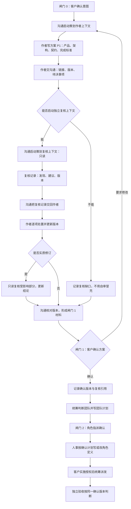

# 在闸门 1 前增加策划方案复核，防止过度设计与漏重点

方案版本：P1。

## 0. 这份方案回答什么

客户在闸门 0（2026-10-22）已确认：在策划方案交客户确认（闸门 1）之前，增加一次独立复核，专门检查方案是否过度设计、是否遗漏重点；复核意见交策划修订，客户确认仍是最终依据；保持五个内置管理角色；小任务按相称的轻量复核。确认记录见[闸门 0 意图记录](../../../../docs/communication/2026-10-22_communication_planning-proposal-review.md)。

本方案给出复核者、复核时机、复核清单、复核结论如何回到策划并避免变成第二套审批，以及需要修改的文档和角色定义。它自身是策划方案草稿，尚未经闸门 1 客户确认，不是实施授权，也没有实施或测试。

与现行策划写作规则的关系：当前分支已经确认“所有实施方案和调研方案由策划写”。本方案不改变这一点。复核由同一策划角色的独立只读上下文执行，复核者不写实施方案或调研方案，作者上下文仍是方案的唯一写作者；本方案不产生第二作者，也不把写作权交给沟通、统筹、验收或任何人。

## 1. 问题与目标

### 1.1 用户遇到的问题

策划方案是闸门 1 的确认对象，也是后续实施和独立验收的基线。方案写多了，客户会为不必要的能力、抽象和兜底承担实现与维护成本；方案写少了，实现缺依据、验收缺标准，最后返工。现有审核只覆盖应用代码或测试的实现提案（见[方案审核](../../../../references/proposal-review.md)），发生在团队建立后、申请客户实施批准前，不能代替闸门 1 前的方案质量检查。客户提出：

> “如果策划的文案也需要有审核来审一下呢，防止过度设计，以及忽略重点呢。”

### 1.2 目标

1. 每个新写或实质修订的策划方案，在提交闸门 1 之前，至少经过一次独立只读复核，专门检查两类风险：**过度设计**和**漏重点**。
2. 复核意见回到策划作者，作者逐项处置；客户在闸门 1 能看到方案、复核记录和处置结果，再决定是否确认。
3. 复核只提高方案质量，不新增客户闸门、不新增内置角色、不授予实施权限、不替代独立验收。
4. 小任务按相称的轻量复核；已有同对象、同版本、同范围的确认和授权直接复用，不重复写方案或复核。

### 1.3 成功后的行为（用白话讲）

- 客户在闸门 1 拿到的材料里有一份独立复核记录，能看出复核查了哪些点、发现了什么、策划采纳了什么、没采纳的理由是什么。
- 过度设计会在客户确认前被指出：不必要的必做、没有分开的选装、重复已有能力、超出非目标的范围、没有记录的被否决备选。
- 漏重点会在客户确认前被指出：目标不清楚、完整流程或失败分支缺失、输入输出说不清、共有契约缺失、完成标准不可核对、风险和未决事项没写。
- 复核结论只写“建议提交”“建议修订后提交”或“暂不建议提交”，不是批准，不是客户确认，也不是实施授权。

## 2. 对闸门 0 五个问题的回答

| 问题 | 本方案的回答 |
| --- | --- |
| 1. 复核者是谁 | **默认由同一策划角色在独立只读上下文中执行**，由沟通启动。复核上下文只接收角色、边界或默认范围、授权、闸门 0 记录、方案链接与版本、复核清单和交付要求；不继承作者对话，不改方案正文，只写复核记录。**不新增第六个内置管理角色。** 新增角色的备选及代价见第 11.3 节。 |
| 2. 何时复核 | 在策划把方案交沟通之后、沟通提交闸门 1 之前。策划作者先把方案和版本交沟通，沟通再启动复核；复核记录交回作者，作者修订并处置后，沟通才形成闸门 1 材料。方案实质修订后只复核受影响部分；同对象、同版本、同范围已有复核结论且方案未变的，不重复复核。 |
| 3. 复核清单是什么 | 两类检查：过度设计查最小方案、必做与选装、复用、非目标、被否决的备选（OD-1 至 OD-5）；漏重点查目标、完整流程与失败分支、输入输出、契约、完成标准、风险与未决事项（MK-1 至 MK-6）。小任务使用其中的轻量子集；完整清单见第 4 节。 |
| 4. 结论如何回到策划、如何防止第二套审批 | 复核记录由沟通交回策划作者上下文；作者在方案中逐项记录“采纳、部分采纳或不采纳及理由”，并更新版本。复核结论只有三种建议，没有阻断权；不新增客户闸门，不替代闸门 1；未解决意见在闸门 1 材料中如实披露，由客户决定。复核不是实施授权，也不是验收基线。见第 5 节。 |
| 5. 需要改哪些文档、角色定义和测试 | 需要修改策划与沟通的角色定义、角色权力矩阵、仓库内策划角色卡和边界、技能入口、文档规则，并新增一份复核规则参考；不改代码和测试。五角色模型和闸门 0→1→2 的顺序不变。清单见第 9.4 节，完成标准见第 10 节。 |

## 3. 完整流程

### 3.1 主要步骤

1. 沟通完成闸门 0，把客户确认的目标、范围、优先级、非目标、已授权边界和已知约束写入 `docs/communication/`。
2. 沟通启动策划作者上下文，只传角色、边界或默认范围、授权、闸门 0 记录和交付要求。
3. 作者写产品方案、架构设计、共有业务契约和可核对完成标准，标明方案版本（如 P1）以及拟用的复核模式（轻量或完整）。
4. 作者把方案链接、版本和待决事项交沟通。此时不提请闸门 1。
5. 沟通启动策划复核上下文（同一角色、独立只读、由沟通启动），只传角色、边界或默认范围、复核任务授权、闸门 0 记录、方案链接与版本、复核清单和模式。不传作者对话，不传完整策划历史。
6. 复核者阅读方案、闸门 0 记录、相关现有行为、契约和文档，按清单检查；对方案正文只读，把发现、结论、未检查事项和限制写入复核记录。
7. 沟通把复核记录交回作者上下文，要求逐项处置。
8. 作者逐项处置：采纳并修改、部分采纳，或有理由不采纳；在方案中写“复核处置”一节，列明发现编号、处置、理由和改动位置；更新方案版本后交沟通。
9. 如果修订触及复核关注点（属于实质修改），沟通让复核者只读复核受影响部分，并更新复核记录和结论；不重复全文复核，不无限循环。
10. 沟通核对方案版本与复核记录引用一致，形成闸门 1 材料：方案、复核记录、处置摘要、未解决意见、选装及其确认状态。
11. 闸门 1：客户确认、要求修改或拒绝。客户确认记录写入 `docs/communication/`，写明方案版本和复核记录引用。客户要求修改时回到作者；实质修改按第 9 步复核受影响部分。
12. 闸门 1 通过后，统筹判断团队并写团队计划，沟通完成闸门 2 角色指派确认；需要改角色定义或边界时由人事按确认计划执行。客户下达实施授权后，统筹派发；独立验收按同一份客户确认的方案版本判断。
13. 如果无法启动独立复核上下文，沟通记录“复核缺口”并在闸门 1 材料中披露；不用作者自审冒充复核。客户仍可决定是否继续，但缺口必须可见。
14. 已有同对象、同版本、同范围的有效方案和客户确认时直接复用，不重新写方案、不重新复核。

### 3.2 流程图

### 3.3 与各角色和闸门的交接

| 交接 | 内容 | 时机或条件 |
| --- | --- | --- |
| 闸门 0 → 策划作者 | 客户确认的意图、范围、优先级、非目标、已授权边界、已知约束 | 闸门 0 通过后 |
| 策划作者 → 沟通 | 方案链接、版本、复核模式、待决事项 | 作者认为方案可供复核时；不提请闸门 1 |
| 沟通 → 策划复核 | 角色、边界或默认范围、复核授权、闸门 0 记录、方案链接与版本、复核清单和模式 | 收到作者交付后、闸门 1 之前 |
| 策划复核 → 沟通 → 策划作者 | 复核记录（发现、结论、限制） | 复核完成后 |
| 策划作者 → 沟通 | 修订后的方案、版本、复核处置、未解决意见 | 逐项处置后 |
| 沟通 → 客户 | 方案、复核记录、处置摘要、未解决意见、选装及确认状态 | 闸门 1 材料齐备后 |
| 客户 → 沟通 | 确认、要求修改或拒绝；写明方案版本 | 闸门 1 |
| 沟通 → 统筹 | 客户确认的方案版本；复核记录只作背景，不是授权 | 闸门 1 通过后 |
| 统筹 → 人事 | 经闸门 2 确认的团队计划，含角色定义或边界变更 | 闸门 2 通过后、需要写卡时 |
| 沟通 → 验收 | 客户确认的方案版本 | 实施前写标准、实施后判断；复核记录不是验收基线 |

复核发生在闸门 1 之前，不改变闸门 0 和闸门 1 的入口与出口条件；它不进入统筹的团队判断，也不改变闸门 2、实施授权和验收的顺序。

## 4. 复核清单：两类检查

复核清单使用稳定编号，复核记录和作者处置都引用同一编号。完整复核检查全部条目；轻量复核只检查第 4.3 节的子集。

### 4.1 过度设计（OD）

| ID | 检查什么 | 通过时应看到 |
| --- | --- | --- |
| OD-1 最小方案 | 每一项必做是否能对应客户确认的目标、已查明的问题或已有契约；有没有更简单、能同样达到目标的方案；失败处理和兜底是否与实际风险相称 | 方案逐项说明必要性；没有为“以后可能要用”提前增加的抽象、模块、契约或兜底；有实质差异的简单方案被比较过 |
| OD-2 必做与选装 | 完成需求所必需的改动，是否与建议顺便增加的选装分开；选装是否有稳定编号、好处、代价、不加会怎样和待确认状态 | 必做与选装分节；选装没有被默认勾选冒充批准；没有把“提高健壮性”当成必做理由 |
| OD-3 复用 | 是否复用现有产品行为、共有契约、已有能力、既有文档和已确认方案；有没有重复建设或第二套并存的规格 | 方案指出复用了什么；没有重复需求库、平行方案或重复角色能力；已有同版确认被复用 |
| OD-4 非目标 | 是否写明这次不做什么；有没有超出闸门 0 已确认范围的扩张 | 非目标和边界清楚；范围外内容没有被写成必做；扩大范围有客户依据或标为待确认 |
| OD-5 被否决的备选 | 真正影响选择的备选方案是否比较过，否决理由是否记录；有没有为了凑“方案对比”编造备选 | 只记录真实比较过的方案；理由和代价可核对；没有把未比较的方案写成已否决 |

### 4.2 漏重点（MK）

| ID | 检查什么 | 通过时应看到 |
| --- | --- | --- |
| MK-1 目标 | 目标用户、当前问题、成功后的行为是否写清；是否与闸门 0 确认的意图一致；哪些是已核实事实、哪些是推断或待核实 | 目标能追溯到客户原话或闸门 0 记录；事实与推断分开；没有把猜测写成客户承诺 |
| MK-2 完整流程与失败分支 | 从什么操作开始，主要步骤、真实判断分支、失败路径和结束状态是否完整；角色之间的交接是否写清；架构设计中的调用与数据流、模块边界是否缺项 | 成功流程和真实失败分支都有；没有只写正常路径；交接和返回结果清楚；架构分层、调用与数据流有说明 |
| MK-3 输入输出 | 用户提供什么，系统保存、展示或返回什么，重要字段的业务含义和必填条件是什么；重要边界情形是否覆盖 | 输入输出与字段含义可核对；边界情形有说明；没有把按钮名当成行为依据 |
| MK-4 契约 | 各角色共有的业务契约是否写明：涉及角色、输入输出、共享术语、交接条件、行为保证、版本与变更；架构设计必要的接口、数据模型和错误语义是否有约定；对现有契约的影响是否说明 | 有固定契约章节；提供方和消费方清楚；成功和失败语义、版本和变更影响可核对；没有把技术实现细节冒充业务契约 |
| MK-5 完成标准 | 是否有可核对的完成标准：范围、成功和失败行为、重要边界情形、架构约束和所需证据；是否与范围和选装一致 | 验收能逐条核对；没有只写“做完”“能用”；标准覆盖客户确认的范围和已选选装 |
| MK-6 风险与未决事项 | 已核实与待核实事项、依赖、风险、未决问题、受影响角色和现有行为、待确认选装是否写清；有没有隐藏假设 | 风险和未决事项单列；待核实事项有调查办法或说明；没有把未解决风险藏起来缩短篇幅 |

### 4.3 轻量复核子集

轻量复核只检查以下六项，并在记录中说明没有做完整复核：

- L1：目标与闸门 0 一致，成功后的行为明确。
- L2：必做能对应目标、问题或契约，没有明显过度设计；选装已分开（如有）。
- L3：主要成功流程和真实失败分支完整。
- L4：输入输出和完成标准可核对。
- L5：风险、未决事项和影响范围已写明。
- L6：没有超出非目标的扩张，没有明显遗漏的复用。

### 4.4 复核记录内容

复核记录至少包含：

1. 被复核方案的路径、版本标识和日期；能取到内容哈希时记录哈希。
2. 复核模式（轻量或完整）及选择依据；复核上下文说明（同一策划角色的独立只读上下文）。
3. 闸门 0 记录链接。
4. 清单逐项结果（完整模式为 OD-1 至 OD-5、MK-1 至 MK-6；轻量模式为 L1 至 L6）。
5. 发现清单：编号、类别（过度设计或漏重点）、严重度（重要、一般、建议）、位置、问题、依据、建议。
6. 复核结论：三种建议之一。
7. 未检查事项、限制和未解决意见。
8. 再复核记录（如发生）：复核的版本、范围、受影响发现的更新和结论。

复核记录链接方案版本，不复抄方案正文。作者在方案中的“复核处置”一节逐项回应发现；复核记录由复核上下文维护，作者不改复核记录。

## 5. 复核结论的回传与“只作建议”约束

### 5.1 三种复核结论

| 结论 | 含义 | 后续 |
| --- | --- | --- |
| 建议提交客户确认 | 没有重要发现，或发现已在当前版本解决 | 沟通按正常流程提交闸门 1 |
| 建议修订后提交 | 有影响客户决策或验收基线的重要发现，最好先修订 | 作者先处置；沟通可提交修订版，也可按客户可见的未解决意见提交 |
| 暂不建议提交 | 关键信息缺失或与闸门 0 意图明显不一致，建议不要以当前版本作为确认对象 | 作者修订；沟通仍在材料中如实披露复核结论，由客户决定是否现在确认 |

这三种都是**建议**，不是批准、通过、验收或授权。

### 5.2 作者处置

作者在方案的“复核处置”一节逐项写明：

| 发现编号 | 处置 | 理由 | 改动位置或版本 |
| --- | --- | --- | --- |
| F1 | 采纳、部分采纳或不采纳 | 为什么这样处理；不采纳要说明依据 | 对应章节或版本 |

不采纳是允许的，但不能删除、改写或隐藏复核记录。复核者和作者有分歧时，记录双方意见；沟通在闸门 1 材料中披露未解决意见，由客户决定。

### 5.3 防止复核变成第二套审批

1. **复核不是批准。** 复核记录只能写“建议”，不能写“批准”“通过”“可以实施”。
2. **不新增客户闸门。** 客户仍然只在闸门 1 确认方案；复核不需要客户单独确认，也不能代替闸门 1。
3. **没有阻断权。** 复核结论不能阻止沟通提交闸门 1；未解决意见如实披露，客户可以确认、要求修改或拒绝。
4. **作者有处置权。** 作者可以按理由不采纳，但必须记录理由；复核者不能改方案正文。
5. **不是实施授权。** 复核完成或“建议提交”都不授予代码、测试或实施权限；实施仍需闸门 2 角色指派确认和客户明确的实施指令。
6. **不是验收基线。** 独立验收只按客户在闸门 1 确认的方案版本判断；复核记录不是标准来源，也不是验收证据。
7. **不扩权。** 复核者只写复核记录，不写角色定义、不派发、不写任务状态、不碰代码和测试。
8. **同版复用。** 同一方案版本、同一闸门 0 意图、同一范围已有复核结论的，不重复复核；只有实质修改才复核受影响部分。

## 6. 输入输出

| 环节 | 输入 | 输出 | 写入者与位置 |
| --- | --- | --- | --- |
| 闸门 0 | 客户请求、范围、优先级、非目标、约束 | 客户确认的意图记录 | 沟通；`docs/communication/` |
| 策划作者 | 闸门 0 记录、现有行为、契约、相关文档 | 产品方案、架构设计、共有契约、完成标准；方案版本和复核模式 | 策划作者；`docs/planning/`（本仓库为 `角色卡/策划/docs/design/`） |
| 策划复核 | 角色、边界或默认范围、复核授权、闸门 0 记录、方案及版本、清单 | 复核记录：清单结果、发现、三种建议、限制 | 策划复核上下文；与方案同目录的复核记录 |
| 作者处置 | 复核记录 | 修订后的方案、版本、“复核处置”节、未解决意见 | 策划作者；方案文件 |
| 沟通闸门 1 材料 | 方案、复核记录、处置摘要、未解决意见、选装状态 | 闸门 1 提交包 | 沟通组织，不复制方案正文 |
| 客户确认 | 闸门 1 提交包 | 确认、要求修改或拒绝；写明版本 | 沟通；`docs/communication/` |
| 统筹与验收 | 客户确认的方案版本；复核记录仅作背景 | 团队计划、验收标准与结论 | 统筹 `docs/scheduling/`、验收 `docs/acceptance/` |

## 7. 范围与非目标

### 7.1 范围（本次要做）

- 所有新写或实质修订、准备提交闸门 1 的策划方案，包括产品方案、架构设计、共有业务契约和可核对完成标准（即实施方案）。
- 复核两类风险：过度设计和漏重点。
- 复核记录、作者处置、沟通在闸门 1 材料中的引用，以及缺口披露。
- 小任务的轻量复核和已有同版方案的复用。
- 为落实以上内容需要修改的角色定义、文档和仓库边界。

### 7.2 非目标（本次不做）

- 不新增第六个内置管理角色，不改变五个内置管理角色的现行模型。
- 不新增客户闸门，不改变闸门 0→1→2 的顺序；复核不是闸门。
- 不改变实现提案审核（[方案审核](../../../../references/proposal-review.md)）的对象、时机和审核者。
- 不改变统筹的团队判断、闸门 2、人事写卡、实施授权和独立验收流程。
- 不给任何角色增加代码、测试、任务状态或其他角色文档的写权。
- 不要求每个小任务开完整评审会，也不要求所有角色参加复核。
- 不改变“所有实施方案和调研方案由策划写”的现行规则。
- 本次不改代码、不改测试；复核规则本身是文档和角色定义变更。

### 7.3 与“所有实施方案和调研方案由策划写”的关系

- 实施方案和调研方案仍由策划作者上下文写；复核上下文不写方案，只写复核记录。
- 复核者是同一策划角色的独立上下文，不是新角色、不是第二作者，也不把方案写作权转给其他角色。
- 如果客户选择 O1（调研方案轻量复核），复核也只检查调研方案的问题、范围、方法、证据和停止条件，不代替策划写调研方案。
- 本方案不修改这条规则的任何文字；如果后续文档修改涉及它，必须保持原意。

## 8. 小任务的轻量复核

### 8.1 什么时候不触发复核

- 已有同对象、同版本、同范围的有效策划方案和客户确认，直接复用，不重新写方案、不重新复核。
- 同一方案版本未发生实质修改，只是措辞、链接或排版调整，不重复复核。
- 复核只针对将要提交闸门 1 的新方案或实质修订版，不对草稿的每一次内部修改都做复核。

### 8.2 轻量复核的适用条件

同时满足以下条件时，作者可以在方案中声明使用轻量复核：

1. 目标单一、清楚，能直接追溯到闸门 0 的确认记录，没有意图歧义。
2. 范围限于一个现有角色的职责或纯文档改动；没有新增或改变共有业务契约，没有架构分层或模块变化，没有新增角色或团队影响。
3. 没有治理、权限或边界变更，风险低，不涉及不可逆行为。
4. 选装很少或没有；如有，也只是边界清楚的小项。
5. 完成标准简单、可直接核对。

任何一条不满足、作者和复核者对“是否算小任务”有分歧，或复核者发现方案比声明的更大，复核者直接按完整模式复核，并在记录中说明原因；不需要额外审批。

### 8.3 轻量复核的记录

- 使用第 4.3 节的 L1 至 L6，不要求逐项展开 OD/MK 全表。
- 记录只保留清单结论、必要发现、三种建议之一和限制；不写长文、不要求受影响角色意见、不默认开会。
- 复核者仍要独立阅读方案和闸门 0 记录，不能只看作者摘要。

### 8.4 完整复核的触发

出现以下任一情况时使用完整复核：跨角色或跨模块；新增或改变共有业务契约；架构分层、模块或技术选型有实质变化；有多个选装或范围不确定；目标或边界有歧义；涉及治理、权限、角色定义或边界变更；风险高或不可逆；作者、复核者或沟通无法确认属于小任务。完整复核按 OD-1 至 OD-5、MK-1 至 MK-6 全部检查；如确需受影响角色的只读意见，按现有授权和独立上下文规则取得，不能取得时记录为缺口，不虚构同意。

## 9. 架构设计

### 9.1 组成与职责

| 组成 | 职责 | 不做什么 |
| --- | --- | --- |
| 策划作者上下文 | 写方案、标版本和复核模式、逐项处置复核发现、维护“复核处置”节 | 不自审冒充复核，不改复核记录 |
| 策划复核上下文（同一角色的独立只读上下文） | 读方案和闸门 0 记录、按清单检查、写复核记录、必要时只读再复核受影响部分 | 不改方案正文，不写角色定义，不派发，不写任务状态，不碰代码和测试 |
| 沟通 | 闸门 0 和闸门 1 的客户接口；启动复核上下文；回传复核记录；核对版本；组织闸门 1 材料；记录客户决定 | 不判断方案技术质量，不替作者改方案，不把复核结论说成客户确认 |
| 统筹 | 闸门 1 后按确认版本判断团队并写团队计划 | 不参与闸门 1 前的方案复核，不把复核记录当授权 |
| 人事 | 按客户确认的计划和闸门 2 写或改角色定义、边界和同步 YAML | 不自行决定复核规则，不自行扩权 |
| 验收 | 按客户在闸门 1 确认的方案版本写标准并判断成果 | 不把复核记录当验收基线，不在闸门 1 前代替复核 |

### 9.2 复核记录放在哪、怎样追溯

- 默认项目：`docs/planning/YYYY-MM-DD_review_<topic>.md`，与方案同目录。
- 本仓库：`角色卡/策划/docs/design/YYYY-MM-DD_review_<topic>.md`。这是本仓库对内置默认 `docs/planning/` 的项目本地覆盖，不改变其他项目的默认路径。
- 方案文件增加“复核处置”一节，链接复核记录；复核记录链接被复核方案的路径和版本，不复抄方案正文。
- 版本标识沿用方案文档自己的版本（如 P1、P2）；复核记录写明被复核版本和日期，能取到内容哈希时一并记录。闸门 1 的客户确认记录写明方案版本和复核记录引用。
- 复核记录属于策划工作文档，不是客户确认记录、不是验收报告、不是任务状态；它只用于追溯复核了什么、结论是什么、作者怎样处置。
- 如果项目没有为复核记录授权任何写入路径：先在方案或聊天中给出复核摘要，把记录路径缺口交统筹判断，经团队计划和闸门 2 由人事补边界；不自行扩大写权，也不伪造成已记录。

### 9.3 角色权限

- **不新增角色。** 复核者是同一策划角色的独立上下文；同一角色开多个上下文不增加角色数量，不改变五个内置管理角色的模型。
- **复核上下文按任务收窄写权。** 它只被授权写复核记录；对方案正文、角色定义、边界、代码、测试和其他角色文档只读。
- **作者上下文保持方案写权。** 方案正文只由作者上下文修改；复核者不能借复核改写方案。
- **沟通仍是唯一客户通道和闸门组织者。** 它启动复核上下文、回传记录、核对版本，但不对方案内容作技术裁决。
- **不产生新的派发权。** 复核不是工作角色派发，不经过统筹任务派发；它是沟通启动的内置管理角色上下文。工作角色仍只经统筹调度。
- **不改变默认写权。** 策划的默认范围仍是 `docs/planning/`；本仓库仍是 `角色卡/策划/docs/design/`。复核记录放在既有策划文档范围内，不新增业务代码、测试或任务状态写权。
- **不改变闸门。** 复核不是客户闸门，不需要客户对复核本身确认；闸门 1 仍是方案确认的唯一入口。

### 9.4 需要修改的文档和角色定义

以下修改都是本方案获客户确认并进入实施后才做；本方案本身不授权任何人修改这些文件。维护归属按本仓库现行分工：角色定义类参考、角色卡、边界和治理记录由人事维护；技能入口、文档规则和共享流程参考由技能规范角色维护。

| 文件 | 要改什么 | 维护者 | 生效前提 |
| --- | --- | --- | --- |
| `references/planning-role.md` | 写明方案交沟通后、闸门 1 前由同一策划角色的独立只读上下文复核；复核意见回作者修订；复核只作建议；复核记录和处置要求 | 人事 | 客户确认本方案；按统筹团队计划和闸门 2 执行角色定义变更 |
| `references/communication-role.md` | 闸门 1 前启动复核上下文、回传复核记录、核对方案版本、把复核记录和处置纳入闸门 1 材料；记录复核状态和缺口 | 人事 | 同上 |
| `references/planning-proposal-review.md`（新建） | 完整清单、轻量与完整两档、记录模板、三种建议、处置和复用规则 | 人事（建议作为角色定义类参考；或按确认计划明确唯一所有者） | 同上；需在治理边界加入该精确文件 |
| `references/authority-matrix.md` | 策划职责行注明闸门 1 前复核；闸门表注明复核不是客户闸门、不新增角色 | 人事 | 同上 |
| `角色卡/策划/role-card.md` | 执行原则加入复核步骤、记录、只作建议、不替代闸门 1 和不授予实施权限 | 人事 | 同上 |
| `角色卡/策划/boundary.md` 与 `boundary.yaml` | 在既有 `角色卡/策划/docs/design/` 用途中写明“策划方案复核记录”；MD 与 YAML 保持一致 | 人事 | 同上 |
| `角色卡/策划/changelog.md` | 记录本次策划角色定义变更 | 人事 | 同上 |
| `角色卡/governance-boundary.md` 与 `governance-boundary.yaml` | 按新参考文件的最终归属，把该精确文件加入人事治理边界，或由人事把它加入技能规范的 `boundary.md`/`boundary.yaml`；MD 与 YAML 保持一致 | 人事 | 同上；属于治理边界变更 |
| `references/documentation.md` | 增加复核记录的命名和位置约定；说明方案中的“复核处置”节 | 技能规范 | 客户确认本方案；在技能规范现有边界内 |
| `references/proposal-review.md` | 增加与“策划方案复核”的区别和互链：对象、时机、审核者、记录不同，二者不互相替代 | 技能规范 | 同上 |
| `SKILL.md`、`SKILL.zh.md` | 在闸门 1 描述中加一句：提交前有一次独立只读复核，复核只作建议、不替代闸门 1 | 技能规范 | 同上 |
| `README.md` | 可选：流程说明补一句复核；不必须 | 技能规范 | 可选 |
| `references/scheduler.md`、`references/acceptance-role.md`、`references/project-role.md` | 不要求修改；如维护者认为需要，只加“复核记录不是授权、不是验收基线”一句 | 人事 | 非必须 |
| 代码和测试 | 无改动。复核规则是文档和角色定义变更；如以后要做复核记录的结构化校验，另立涉及代码和测试的方案 | — | 本方案不涉及 |

关于新参考文件的所有权：推荐由人事作为角色定义类参考维护，因为它规定策划的复核职责和与沟通的交接；如果确认计划把“复核流程和清单”视为共享流程参考，也可以由技能规范维护。无论归谁，必须满足：唯一所有者、精确路径写入该角色 Section 1、任何角色都不写自己的角色定义、不因此扩大业务写权。

### 9.5 对五角色模型和闸门顺序的影响

- **五角色模型不变。** 不新增第六个内置角色；复核是策划职责的一次上下文执行，不是新岗位。角色数量仍按角色定义计数，同一角色开多个上下文不算增员。
- **闸门顺序不变。** 闸门 0→闸门 1→闸门 2 的顺序、各闸门的确认对象和未通过时的限制都不变。复核不是闸门，不要求客户单独确认复核本身。
- **策划默认写权不变。** 仍只写自己的策划文档范围；复核记录放在同一范围，不扩到代码、测试、调度状态或验收结论。
- **沟通、统筹、人事、验收的职责不变。** 沟通多一个组织复核的步骤；统筹仍在闸门 1 后判断团队；人事仍只按确认计划和闸门 2 写卡；验收仍按闸门 1 确认版本判断。
- **实现提案审核不变。** [方案审核](../../../../references/proposal-review.md)仍针对应用代码或测试提案，发生在团队建立后、申请实施批准前；本方案不改变其审核者、记录和结论。

### 9.6 与现有实现提案审核的区别

本方案的“策划方案复核”与[方案审核](../../../../references/proposal-review.md)（实现提案审核）是两件事，不能互相替代：

| 维度 | 策划方案复核（本方案） | 实现提案审核（proposal-review.md） |
| --- | --- | --- |
| 对象 | 策划方案：产品方案、架构设计、共有业务契约、可核对完成标准 | 应用代码或测试的实现提案、实现设计与技术契约 |
| 时机 | 闸门 1 前，策划交沟通后 | 团队建立后、申请客户实施批准前；在闸门 1 之后 |
| 审核者 | 同一策划角色的独立只读上下文 | 按团队计划建立的项目管理（技术架构）角色；未建立时由统筹在派发前核对 |
| 结论 | 建议提交、建议修订后提交、暂不建议提交 | 建议通过、需要修改、暂不能通过 |
| 记录 | 策划文档范围内的复核记录 | 审核者现有授权范围内的审核记录 |
| 授权 | 不授予实施权限，不替代闸门 1 | 不授予实施权限，不替代客户确认和独立验收 |
| 流程关系 | 不改变实现提案审核的流程 | 不改变策划方案复核的流程 |

### 9.7 验证要点

- 完整复核能否覆盖 OD-1 至 OD-5、MK-1 至 MK-6；轻量复核是否只覆盖 L1 至 L6。
- 复核记录能否与方案版本一一对应；闸门 1 确认记录能否引用正确版本。
- 作者处置是否逐项、可核对；不采纳是否有理由并披露给客户。
- 复核结论是否只出现三种建议值，是否出现“批准”“通过”等容易被误读为审批的措辞。
- 无法启动复核上下文时，缺口是否被记录并披露，而不是被作者自审或沉默掩盖。
- 已有同版确认是否被复用，没有重复复核。
- 角色定义、权力矩阵和技能入口是否一致说明“复核不是闸门、不是第六个角色、不是实施授权”。
- 实现提案审核的流程是否未被改变，两类审核是否可区分。

## 10. 可核对完成标准

以下均为实施后的核对项；当前只有本草案，尚未实施，不能把本草案当成已完成证据。

| ID | 完成标准 | 需要的证据 |
| --- | --- | --- |
| C1 | 策划、沟通的角色定义写明：方案交沟通后、闸门 1 前，由同一策划角色的独立只读上下文复核；复核意见回作者处置；复核只作建议 | `references/planning-role.md`、`references/communication-role.md` 和本仓库策划角色卡的相关段落 |
| C2 | 存在一份可执行的复核规则参考，包含 OD-1 至 OD-5、MK-1 至 MK-6、轻量与完整两档、记录模板、三种建议和处置要求 | `references/planning-proposal-review.md`（如按确认计划新建）及其链接 |
| C3 | 权力矩阵和技能入口明确：复核不是客户闸门、不是第六个内置角色、不是实施授权；五角色模型和闸门顺序不变 | `references/authority-matrix.md`、`SKILL.md`、`SKILL.zh.md` 的相关段落 |
| C4 | 复核记录有明确位置和命名；本仓库策划边界 MD/YAML 包含复核记录路径且内容一致；方案中有“复核处置”节 | 文档规则、`角色卡/策划/boundary.md`、`boundary.yaml`、示例方案 |
| C5 | 实现提案审核与策划方案复核能按对象、时机、审核者、记录区分，且实现提案审核流程未被改变 | `references/proposal-review.md` 的区分说明与互链 |
| C6 | 用一个小型真实方案做一次轻量复核走查：产生复核记录、作者处置、闸门 1 材料包含复核记录和未解决意见；全程不改代码 | 走查记录、复核记录、方案版本、闸门 1 材料链接 |
| C7 | 用一次实质修订走查再复核：只复核受影响部分，复核记录更新版本和结论；未变化的版本不重复复核 | 再复核记录和版本对照 |
| C8 | 复核上下文无法启动时，闸门 1 材料明确披露复核缺口，不以作者自审或沉默代替 | 沟通记录中的缺口说明 |
| C9 | 同对象、同版本、同范围已有确认的方案被复用，没有为复核重复写方案或重复询问客户 | 复用说明和原确认记录链接 |
| C10 | 本方案不引入代码或测试改动；如仓库有文档链接检查，检查通过 | 变更文件清单、检查输出（如适用） |

## 11. 必做与选装

### 11.1 必做（最小方案）

| 编号 | 必做内容 |
| --- | --- |
| M1 | 复核者使用同一策划角色的独立只读上下文，由沟通启动；不新增内置角色 |
| M2 | 复核发生在策划交沟通之后、闸门 1 之前；实质修订只复核受影响部分；同版确认复用 |
| M3 | 复核清单覆盖过度设计 OD-1 至 OD-5 和漏重点 MK-1 至 MK-6 |
| M4 | 复核记录与方案版本关联；作者逐项处置；闸门 1 材料包含复核记录、处置摘要和未解决意见 |
| M5 | 复核只作建议，不新增闸门、不阻断提交、不授予实施权限、不替代验收；未解决意见由客户在闸门 1 决定 |
| M6 | 小任务使用轻量复核，明确适用条件、轻量子集和升级到完整复核的规则 |
| M7 | 无法启动复核上下文时记录并披露缺口，不用自审冒充 |
| M8 | 按第 9.4 节更新角色定义、文档和仓库边界；不改代码和测试，不改变五角色模型和闸门顺序 |

### 11.2 选装

- [x] **O1：调研方案轻量复核**（默认推荐，待客户确认）。
  好处：调研方案如果范围过大或漏掉关键问题，会浪费只读调查和后续方案时间；用同一轻量清单检查问题、范围、方法、证据和停止条件，可以在调查开始前发现过度调查或漏重点。
  代价：调研方案在交客户或用于安排调查前多一次轻量复核；需要把“调研方案复核”写进策划规则和记录约定。
  不选时：调研方案仍按现行规则由策划写，只做作者自检，不单独复核。

- [ ] **O2：高风险方案加成复核**（不默认启用，待客户按场景选择）。
  好处：对跨角色契约、架构实质变化、不可逆或高成本方案，增加第二次独立只读复核或受影响角色的只读意见，降低单次复核遗漏的风险。
  代价：多一个上下文或一次受影响角色评估，增加时间和协调成本；需要明确“高风险”的判定，避免所有方案都被加成。
  不选时：所有方案按 M1 至 M8 的完整或轻量复核执行，不额外加成。

### 11.3 被比较过的备选方案

| 备选 | 独立性 | 成本与流程影响 | 结论 |
| --- | --- | --- | --- |
| 同一策划角色独立只读上下文（推荐） | 上下文独立：不继承作者对话、只读方案、只写复核记录；同一身份，专业标准一致 | 不新增角色、边界和登记；沟通多启动一个上下文；同一角色多上下文不算增员 | 采用 |
| 新增第六个内置角色“方案复核” | 身份独立、职责专属；但需要独立的产品和架构判断能力，可能与策划共享盲点 | 要改五角色模型、默认写权、角色登记、权力矩阵和每个项目的启停；协调成本高；与客户“保持五个内置管理角色”的优先级冲突 | 本轮不采用；如果同角色复核被证明不够独立，可作为后续备选重新评估 |
| 新增项目级 worker 角色（方案审核） | 身份独立；但 worker 角色要等统筹团队计划和闸门 2 之后才能建立 | 团队判断在闸门 1 之后，审核角色无法在闸门 1 前合法存在；要为审核提前建团队或单设角色，打乱现行闸门顺序，且每个项目多一个只在方案阶段使用的角色 | 不采用 |
| 沟通复核 | 沟通不是方案作者，但也不是产品方案的专业作者；审和交合在一起 | 成本低，但容易把复核变成沟通的审批，职责混杂 | 不采用 |
| 验收在闸门 1 前复核 | 验收的独立性用于按客户确认基线判断完成，不是方案质量评审；提前介入会污染后续验收独立性 | 时机和职责都不符 | 不采用 |
| 统筹在派发前复核 | 统筹在闸门 1 后才判断团队，职责是团队和派发，不是方案质量 | 时机已晚，且会与现有派发前核对混淆 | 不采用 |
| 只做作者自检清单 | 没有独立上下文，容易延续作者的盲点 | 成本最低，但不能满足客户要的“独立复核” | 不采用；只能作为作者交稿前的补充自检 |

### 11.4 本轮不纳入

- 对复核记录做程序化结构校验或自动评分；如需要，另立涉及代码和测试的方案。
- 为复核设置固定工时、固定页数或自动超时；本轮用轻量条件和完整条件控制成本。
- 把复核扩展到团队计划、实现设计、任务计划或验收报告；这些各有自己的评审或判断流程。
- 改变五个内置管理角色的模型、默认写权或三道闸门顺序。

## 12. 风险与未决事项

### 12.1 风险

| 风险 | 影响 | 应对 |
| --- | --- | --- |
| 复核流于形式，只写“建议提交” | 客户仍然拿到过度设计或漏重点的方案 | 清单使用稳定编号；复核记录必须引用方案位置和依据；闸门 1 材料展示处置；用真实方案做走查 |
| 复核变成第二套审批 | 方案被卡在复核，客户确认被替代 | 结论只写建议；没有阻断权；作者可说明理由不采纳；未解决意见由客户在闸门 1 决定；权力矩阵和角色定义明确写“不是闸门” |
| 小任务负担增加 | 团队为每件小事走完整流程，效率下降 | 轻量条件和 L1 至 L6 子集；同版复用；不默认开会；不要求受影响角色意见 |
| 同角色复核独立性不足 | 作者和复核者共享同样的盲点 | 独立上下文、不继承作者对话、只读方案；复核者只写复核记录；限制写入记录；O2 和第六角色备选保留 |
| 版本漂移 | 复核的是 P1，客户确认的是 P2，复核失效 | 复核记录写明版本；沟通提交前核对版本；实质修订只复核受影响部分并更新结论 |
| 与实现提案审核混淆 | 角色不知道什么时候用哪套流程 | 两份参考互相链接并明确对象、时机、审核者和记录不同；名称上区分“策划方案复核”和“实现提案审核” |
| 复核记录路径或权限未落地 | 复核意见没有可追溯记录，或角色越权写文件 | 使用既有策划文档范围；边界缺口交统筹判断、经闸门 2 由人事补；不能取得路径时给聊天复核并披露缺口，不自行扩权 |
| 复核者和作者分歧无法解决 | 流程卡住或形成隐性审批 | 记录双方意见；不采纳要写理由；沟通在闸门 1 披露；客户决定，不要求复核者签字同意 |
| 进度压力下跳过复核 | 客户看不到复核缺口，误以为已复核 | 闸门 1 材料必须写明复核状态（已完成、缺口或客户豁免）；不能静默跳过 |
| 读者把复核记录当成客户确认或实施授权 | 越权实施或错误验收 | 复核记录和闸门 1 材料都标注“建议”；客户确认记录和实施授权分别记录；验收只按确认版本 |
| 复核者遗漏关键问题 | 复核没有发现真实风险 | 清单和限制说明；用真实方案走查；不宣称复核能保证方案正确；必要时用 O2 加成 |
| 五角色模型或闸门被误读为改变 | 与客户已确认的模型冲突 | 角色定义、权力矩阵和技能入口一致写明：不新增角色、不新增闸门、顺序不变 |

### 12.2 需要客户决定的事项

1. **复核者形式**：是否采用“同一策划角色独立只读上下文”，而不是新增第六个内置角色（本方案推荐前者；后者作为备选和后续触发条件）。
2. **轻量与完整的边界**：第 8.2 节的小任务条件是否合适；是否所有小任务都要一次独立轻量复核，还是允许作者自检加抽查（本方案推荐前者）。
3. **复核记录的路径与命名**：默认 `docs/planning/YYYY-MM-DD_review_<topic>.md`、本仓库 `角色卡/策划/docs/design/YYYY-MM-DD_review_<topic>.md` 是否接受；是否同意为此修改策划边界和文档规则。
4. **选装 O1、O2**：是否把调研方案纳入轻量复核（O1）；是否保留高风险方案的加成复核（O2）。
5. **复核缺口和客户豁免**：无法启动复核上下文或客户明确要求跳过时，是否按“记录缺口/豁免并在闸门 1 披露”处理，而不是静默跳过。
6. **新参考文件的所有权**：由人事作为角色定义类参考维护，还是由技能规范作为共享流程参考维护；无论哪种，都需在相应 Section 1 加入精确路径。
7. **文档修改范围**：第 9.4 节的文档清单是否就是本次实施范围，是否有需要增加或减少的文件。

### 12.3 待实施、待核实

- 本方案本身尚未经闸门 1 客户确认，尚未经过新的复核流程（该流程还未实施）。实施后可以把本方案或一个真实小方案作为第一次轻量复核走查对象。
- 本仓库的策划边界目前授权 `角色卡/策划/docs/design/` 用于产品方案、架构设计、共有业务契约与可验收标准；复核记录是否属于该用途、是否需要补一句边界说明，需要人事在获准后确认。
- `references/planning-proposal-review.md` 是新建文件，当前不在任何角色的 Section 1；实施前必须由确认的团队计划指定唯一所有者并更新边界，不能先写后补。
- 本方案没有修改或测试任何程序；第 10 节的完成标准均为实施后的核对项。

## 13. 当前决定状态

这是策划 P1 方案草案，依据 2026-10-22 闸门 0 已确认的意图形成。它尚未经客户在闸门 1 确认，不是实施方案，也不是实施授权；本轮没有修改角色卡、边界、其他角色文档、`references`、代码或测试，没有提交或推送。客户确认本方案的范围、选装和待决事项后，才由统筹判断团队并进入后续闸门。
