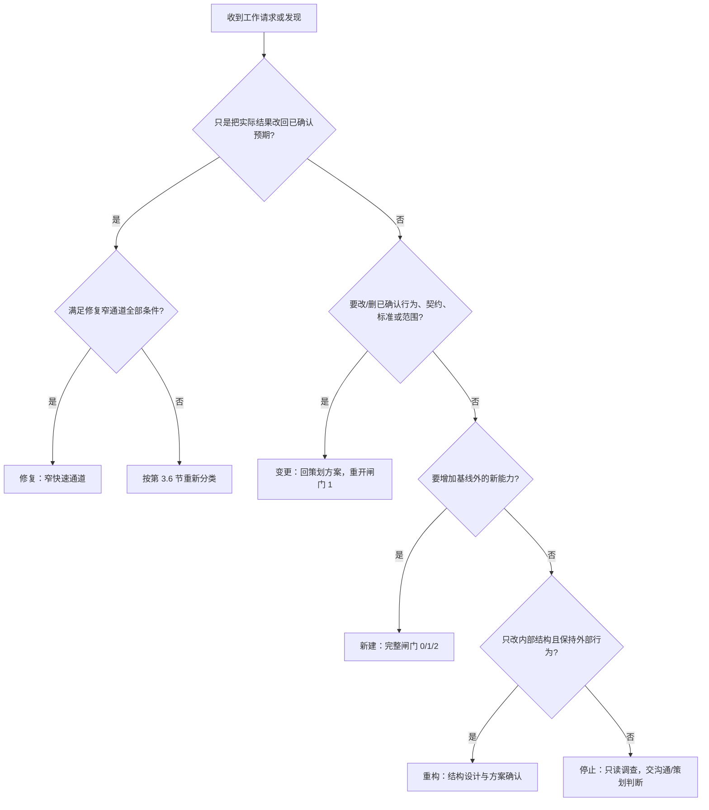
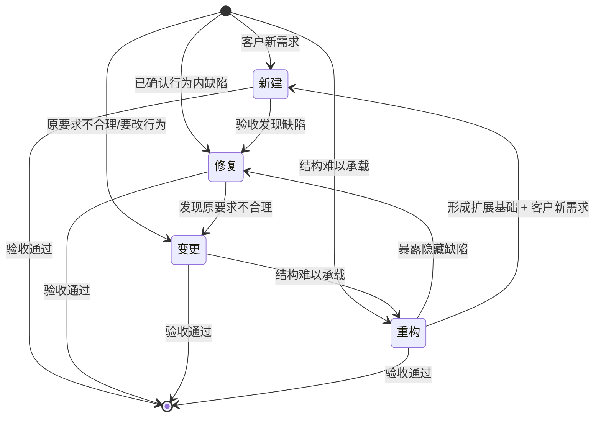

# 四类工作与五条转换：新建、修复、变更、重构的产品与流程方案

方案版本：**P1**（策划草案，尚未经同一策划角色独立只读复核，尚未经闸门 1 客户确认，不是实施方案，不是实施授权）。

## 0. 这份方案回答什么

客户在闸门 0（2026-11-03）已确认四类工作与转换的意图理解，确认记录见[闸门 0 意图记录](../../../../docs/communication/2026-11-03_communication_four-work-types.md)。客户原话：

> 新建：验收发现问题，进入修复。
> 修复：发现原要求不合理，提出变更。
> 变更：现有结构难以承载，需要重构。
> 重构：暴露隐藏缺陷，进入修复；形成扩展基础，支持新建。
>
> 我需要支持这四种情况。

客户另已明确：缺陷修复应走沟通→统筹→固定角色的快速通道，不走两个闸门；技能改动必须由固定角色完成，主上下文不得直接修改。这两条是客户对执行方式的明确要求，本方案按此设计，但不把任务书或统筹候选计划当成客户已确认的细节。

本方案回答闸门 0 记录列出的七个问题：四类工作的判定标准与判断权；各自流程与闸门；五条转换；文档与证据；精确写集与边界缺口；与现有不变量的关系；路线与推荐默认。方案包含产品方案、流程架构、共有业务契约和可核对完成标准。

**状态说明：**闸门 0 确认的是客户对意图的理解，不是本方案。本方案当前只是策划 P1 草案；提交沟通后，还需同一策划角色的独立只读复核、作者逐项处置和客户闸门 1 确认。未确认前不进入团队规划、不写正式团队计划、不由人事写卡、不实施。本文件之外，本轮没有修改任何文件，没有提交或推送。

## 1. 问题与目标

### 1.1 用户遇到的问题

当前技能主要按“新需求”组织流程：沟通接单、闸门 0、策划方案与架构、闸门 1、团队计划、闸门 2、实施授权、派发、验收。这个流程适合新增能力，但把四类性质不同的工作压成了同一条路：

- 已确认行为内的一个小缺陷，也要先写方案、过闸门 1、再确认角色指派，客户明确反馈“太慢了”。
- 修复中发现原要求本身不合理，没有规则说明必须停下来转变更，容易被当作“继续修”，最后静默改掉了已确认行为。
- 变更中发现现有结构撑不住，没有规则说明何时停止变更、转为结构设计，容易边改边重构、范围失控。
- 重构中暴露隐藏缺陷，或重构形成可扩展基础，没有规则说明如何转修复、如何衔接新建，容易把“重构完成”误当成“新功能已获授权”。
- 四份文档类型指南（设计、功能、修改、修复）当前没有 Section 1 所有者，修复记录和变更记录该写到哪里、谁有权写，存在边界缺口。

### 1.2 目标

1. 显式定义**新建、修复、变更、重构**四类工作的成立条件、判断权、触发条件、流程和闸门，使流程强度与工作风险相称。
2. 为“已确认行为内的缺陷”提供一条窄快速通道：沟通记录缺陷与客户明确修复指令，统筹核实后派原所有者，跳过闸门 1 和闸门 2；其他条件不满足时回普通流程。
3. 定义客户要求的五条转换，并要求每次转换显式停止、记录触发事实、重新分类、取得对应客户授权；旧授权不沿用，旧证据按影响范围失效或复用。
4. 保持授权和证据不丢失：修复仍要客户明确指令、所有者边界内写入、修复记录、证据、风险档位和独立验收；新建、变更、重构仍要有方案、复核和客户确认。
5. 与现有不变量一致：五个内置管理角色、三道客户闸门、统筹唯一调度口、一个上下文一个角色、独立验收、权力矩阵都不改变；不新增角色或权限。
6. 给出可核对的完成标准、精确写集和边界缺口，供闸门 1、闸门 2 和实施验收使用。

### 1.3 成功后的行为（用白话讲）

- 客户说“修个 bug”：沟通把症状、预期行为、实际结果和客户“请修复”的指令写清楚；统筹核实这是现有角色范围内的缺陷，直接派原所有者修，不再等两份方案确认。验收仍先在原有已确认行为和缺陷记录上写清怎样算修好，修完独立判断。
- 修着发现“原要求本身就不对”：停下来，记录发现，交策划写变更方案，客户在闸门 1 确认后才改；不能边修边把要求改掉。
- 变更发现“现有结构撑不住”：停下来，做结构设计，客户确认结构；默认保持已确认的对外行为不变；涉及角色或边界时再走闸门 2 和人事。
- 重构中暴露隐藏缺陷：按修复处理，仍只在已确认行为内走窄通道；修不了或需要改行为，就转变更或新建。
- 重构形成扩展基础：只说明“以后可以支持新能力”，不等于客户已经同意新功能；新功能仍走新建的完整闸门 0/1/2。
- 每次换类型都有记录：沟通记录客户授权，统筹记录停止、触发事实、新旧类型、依赖和证据状态；不能沿用旧授权继续做另一类工作。
- 五个内置管理角色、三道闸门、统筹唯一调度口、一个上下文一个角色、独立验收和权力矩阵都没有变；没有新增角色，没有扩大任何权限。

### 1.4 范围与非目标

**范围（本方案要定义）：**

- 四类工作的定义、成立条件、判断权、触发条件和不满足条件时的重新分类。
- 四类工作各自的最小流程、闸门适用性、交付物、验收基线和返工/复验规则。
- 五条转换的触发事实、停止点、提出者与判断者、客户授权、记录位置、旧授权/旧证据处理和禁止事项。
- 四类工作与文档类型、修复记录路径、风险档位、证据失效的关系。
- 实施时各固定角色的精确写集、当前 Section 1 核对结果和边界缺口。
- 可选项与推荐默认、可核对完成标准和实施阶段划分。

**非目标（本方案不做）：**

- 不新增、拆分、合并或改名任何内置管理角色；四类工作不是新角色，也不是新的 CLI 命令。
- 不删除、合并或改变三道客户闸门的顺序；修复快速通道只是“不产生新的闸门 1/2 对象”，不是取消闸门。
- 不改变统筹唯一调度口、一个上下文一个角色、独立验收和权力矩阵。
- 不修改任何程序权限、任务状态、验收凭证或已安装技能副本；不改代码和测试。
- 不在本方案中实施；不写正式团队计划；不伪造闸门 1/2、复核记录、团队共识或客户确认。
- 不直接修改 `references/documentation-design.md`、`documentation-feature.md`、`documentation-change.md`、`documentation-fix.md`；它们当前没有 Section 1，是边界缺口，补齐前只读。
- 不把任务书里的设计要点当成客户已确认的细节；客户已确认的是闸门 0 的意图。

## 2. 依据、已核实事实与待核实

### 2.1 已核实事实

以下事实来自本轮实际读取的仓库文件（2026-11-03，HEAD `98c3e8b910574ad66c42443ac0f66da50b7d921b`）：

| 编号 | 事实 | 依据 |
| --- | --- | --- |
| V1 | 闸门 0 已由客户确认；确认对象是沟通记录的意图理解，不是本方案 | [闸门 0 记录](../../../../docs/communication/2026-11-03_communication_four-work-types.md) |
| V2 | 统筹已有候选计划，但它是候选，不是闸门 1/2 确认或实施授权 | [统筹候选计划](../../../../docs/scheduling/2026-11-03_defect-fast-path.md) |
| V3 | 本方案写盘前，工作区只有上述两份未跟踪文档；本方案写盘后新增本文件。仓库没有 `.ans/project.json`，本轮不创建任务 ID、不写全局任务状态 | `git status --porcelain -uall`、目录检查 |
| V4 | 策划在本仓库的已接受路径是 `角色卡/策划/docs/design/` 条件目录，覆盖内置默认 `docs/planning/` | `角色卡/策划/boundary.md` Section 1、`boundary.yaml` |
| V5 | 技能规范拥有 `SKILL.md`、`SKILL.zh.md`、`README.md`、`references/workflow.md`、`action-policy.md`、`proposal-review.md`、`documentation.md`、`testing.md` 等共享入口和流程参考 | `角色卡/技能规范/boundary.md` Section 1 |
| V6 | `references/documentation-design.md`、`documentation-feature.md`、`documentation-change.md`、`documentation-fix.md` 不在任何 Section 1，当前只读 | 各边界检索结果 |
| V7 | 技能规范的 `docs/change/`、`docs/fix/` 只有历史精确文件，不是目录授权；没有本轮变更记录的精确路径 | `角色卡/技能规范/boundary.md` Section 1 |
| V8 | 验收边界只有历史 B1/B2 精确文件，没有 `docs/acceptance/` 目录授权，也没有本轮四类工作 B1/B2 路径 | `角色卡/验收/boundary.md` Section 1 |
| V9 | 统筹拥有 `docs/scheduling/` 条件目录，可写团队计划和调度记录；没有 `docs/coordination/` 目录授权 | `角色卡/统筹调度/boundary.md` Section 1 |
| V10 | 人事的本地治理边界覆盖 `角色卡/governance-boundary.md`，列出角色卡、边界、changelog、角色定义类参考、内置边界和治理变更记录；没有 `references/work-types.md` 路径 | `角色卡/governance-boundary.md` Section 1 |
| V11 | 项目管理边界只有历史精确设计文件，没有新的重构结构设计路径 | `角色卡/项目管理/boundary.md` Section 1 |
| V12 | 现行 SKILL 和角色定义写明：五个内置管理角色、闸门 0→1→2、闸门 2 角色不变也要确认参与角色/范围/写集、统筹唯一调度口、一个上下文一个角色、独立验收、权力矩阵只作汇总不新增权限 | `SKILL.md`、`SKILL.zh.md`、`references/communication-role.md`、`scheduler.md`、`acceptance-role.md`、`authority-matrix.md` |
| V13 | 现行 `references/testing.md` 的 T0–T3 是唯一风险档位定义；T3 包括治理/权限变更，即使改的是文档 | `references/testing.md` |
| V14 | 现行 `references/planning-proposal-review.md` 已定义闸门 1 前的独立只读复核、轻量/完整两档、三种建议和作者处置 | `references/planning-proposal-review.md` |
| V15 | 客户已明确“技能改动必须由固定角色完成，主上下文不得直接修改” | 闸门 0 记录中的客户原话 |

### 2.2 推断与解释

以下不是客户原话，而是本方案对客户要求的解释；需要客户在闸门 1 确认：

| 编号 | 解释 | 依据与限制 |
| --- | --- | --- |
| I1 | 客户说的“不走两个闸门”，按闸门 1（方案确认）和闸门 2（角色指派确认）理解，保留闸门 0 的轻量意图记录 | 客户没有点名是哪两个闸门；任务书明确写“跳过闸门 1 和闸门 2”。备选解释见第 10 节 O2 和第 13 节 |
| I2 | 修复快速通道可以解释为“没有产生新的闸门 1/2 对象”，而不是“删除或绕过闸门” | 修复不新增行为/契约/方案，也不新增所有者/范围/写集；这是本方案的理论依据，须客户确认 |
| I3 | 四类工作模型属于流程/产品方案级变更，需要策划方案、独立只读复核、闸门 1、正式团队计划、闸门 2 和实施授权 | 现行技能规则和统筹候选计划的判断一致 |
| I4 | 技术性质由所有者判断，原要求合理性由策划判断，结构承载性由策划/项目管理判断，归属/路由/闸门适用性由统筹判断 | 与现行角色职责最接近的分工；详见第 3.3 节 |
| I5 | 修复记录需要一个有界、可重复使用的路径，而不是每次由人事补精确文件 | 由“修复要快”的目标推导；具体路径策略见第 7.2 节，须客户选择 |
| I6 | 本轮作为治理/流程变更应按 T3 处理，建议独立验收 | 按 `references/testing.md`，治理/权限变更属于 T3；是否独立验收由客户决定 |

### 2.3 待核实

| 编号 | 待核实事项 | 影响 | 建议处理 |
| --- | --- | --- | --- |
| U1 | 客户对“两个闸门”的准确选择 | 决定修复快速通道跳过 0+1、1+2 还是 0+2 | 闸门 1 前由沟通确认；本方案推荐 1+2 |
| U2 | 客户是否接受第 4.2 节的修复条件集和“两次失败停止”规则 | 决定快速通道的宽窄 | 闸门 1 选项 O2/O3 |
| U3 | 是否允许新增 `references/work-types.md` 单一来源指南 | 决定规则放在一处还是分散在 `workflow.md` | 选项 O5；需要人事边界 |
| U4 | 是否允许为四份 `documentation-*` 指南补精确 Section 1 路径并修改 | 决定文档规则是否完整 | 选项 O6/O7；需要人事边界 |
| U5 | 是否要求本轮独立验收并补 B1/B2 精确路径 | 决定完成结论是否有独立判断 | 选项 O8；需要人事边界 |
| U6 | 工具是否启用 `task_ops`、是否创建任务 ID | 本仓库没有 `.ans/project.json`，当前不启用 | 由统筹按实际项目配置决定；本方案不依赖任务工具 |
| U7 | 本项目是否需要项目管理角色承接重构的实现层结构设计 | 决定是否新增 PM1 精确路径 | 仅当重构需要实现设计时，由统筹团队计划判断 |
| U8 | 客户是否接受“治理/角色定义文档只做非语义错字修复可走 T0 修复；任何语义变化都是变更” | 防止用“修错字”改治理规则 | 选项 O11 |

## 3. 四类工作的判定标准、判断权与触发条件

### 3.1 共同概念

| 概念 | 本方案的定义 |
| --- | --- |
| **已确认基线** | 客户在闸门 1 确认的策划方案版本（产品方案、架构设计、共有业务契约、可核对完成标准），以及该版本明确要求保持的现有行为和契约。修复还可以用已接受的当前行为文档、既有契约或既有测试作为预期行为的来源；草稿、未确认方案、团队计划、默认勾选、团队共识和沉默都不是基线。 |
| **缺陷** | 实际结果偏离已确认基线，且预期行为已经存在并被确认；把实际结果改回预期不需要新增行为、改变公开契约或改变验收标准。 |
| **行为变化** | 对用户可见的行为、公开契约、验收标准或范围发生改变；包括修改、删除已有确认行为，或客户要求改变原要求。 |
| **结构变化** | 内部分层、模块边界、共享抽象、数据流或实现组织发生变化，但已确认的外部行为和契约保持不变。 |
| **新能力** | 已确认基线不包含的目标、行为或契约；需要新的方案、架构、契约、文件或角色能力。 |
| **扩展基础** | 重构完成后形成的、可支持后续新能力的内部结构。它只说明“以后可以更容易地做”，不构成新能力的客户授权。 |
| **工作项** | 一次有明确类型、基线、授权、所有者、范围/写集、风险档位、证据和验收结论的工作。工作项在同一时刻只能有一个当前类型。 |
| **类型转换** | 工作项从一种类型变为另一种类型。转换必须显式停止、记录、重新分类并取得对应客户授权；不能沿用旧授权继续做另一类工作。 |

### 3.2 四类工作的定义与成立条件

| 类型 | 成立条件 | 典型触发 | 不成立时 |
| --- | --- | --- | --- |
| **新建** | 客户提出已确认基线不包含的新目标、新行为或新契约；需要新方案、架构、契约、能力或文件；不是只纠正偏离，也不是只改内部结构。 | 客户新需求；重构完成后提出的新能力；验收发现“原方案根本没有覆盖这个目标”（属于需求缺口，不是实现缺陷）。 | 只是现有行为偏离 → 修复；修改已有确认行为/契约 → 变更；只改内部结构 → 重构。 |
| **修复** | 预期行为已在已确认基线中存在；实际结果偏离；不新增行为、不改公开契约/架构/角色/边界/治理/权限；单一现有所有者；全部受影响文件和测试在该所有者已接受的 Section 1 内；风险档位 T0/T1；客户给出明确修复指令；缺陷报告清楚。 | 客户报告缺陷；验收发现交付不满足已确认标准；测试发现回归；所有者发现已确认行为内的缺陷；安全/数据问题在已确认行为内。 | 任一条件不满足 → 停止，按性质转变更、重构或新建；不能“修到通过”或边修边扩范围。 |
| **变更** | 原要求被判定不合理、不足、过时，或客户要求改变/删除已确认行为、契约、验收标准或范围；修复无法在不改变已确认基线的前提下解决。 | 修复中发现原要求不合理；客户要求改变已确认行为；验收失败暴露出验收标准或需求本身有问题；外部契约需要调整。 | 只是实现缺陷 → 修复；只是结构承载问题 → 重构；全新能力 → 新建。 |
| **重构** | 现有结构（产品/流程/实现架构）难以承载已确认或拟变更的需求；需要结构设计；默认保持已确认的外部行为和契约不变；不得静默改变已确认行为。 | 同一区域反复修复仍不稳定；变更方案发现结构撑不住；跨角色重复/耦合阻碍已确认需求；需要形成扩展基础。 | 局部缺陷 → 修复；外部行为变化 → 变更；新能力 → 新建；既改行为又改结构 → 先按变更/新建确认行为，再按重构做结构。 |

**判定顺序（按问题顺序问，先答“是”的类型优先）：**

1. **Q1：这次工作是否只是把实际结果改回已确认的预期行为，不改变预期行为、契约、验收标准或范围？** 是 → 修复候选，进入第 4.2 节条件检查；条件全部满足 → 修复；条件不满足 → 按第 3.6 节重新分类，不继续按 Q2–Q4 猜测。否 → Q2。
2. **Q2：这次工作是否要改变、删除已有确认行为/契约/验收标准/范围，或原要求被判定不合理？** 是 → 变更；否 → Q3。
3. **Q3：这次工作是否要增加已确认基线不包含的新能力，且不改变已有确认行为？** 是 → 新建；否 → Q4。
4. **Q4：这次工作是否只改内部结构，以承载已确认或拟变更需求，同时保持已确认外部行为不变？** 是 → 重构；否 → 停止，做只读调查，交沟通/策划判断，不按猜测的类型实施。

### 3.3 判断权分配

| 判断事项 | 判断者 | 说明与限制 |
| --- | --- | --- |
| **技术性质**：是不是缺陷、根因在哪里、是否在已确认行为内 | **受影响文件的所有者** | 所有者做只读复现和根因判断；验收、测试、客户只报告事实；统筹不替所有者判断技术性质。所有者判断有分歧时，交策划/统筹协调，必要时由沟通请客户决定。 |
| **原要求是否合理**：是否不合理、不足、过时，是否需要变更 | **策划** | 所有者或验收提出发现和证据；策划判断并写变更方案，说明理由、影响和选项；客户在闸门 1 决定是否变更。策划不能替客户宣布原要求无效。 |
| **现有结构是否难以承载**：产品/流程结构、实现结构 | **策划**（产品/流程结构）；**项目管理**（实现层结构，如已按团队计划建立） | 策划判断产品/流程结构并写结构方案；项目管理在已确认架构下判断实现结构和技术契约；客户确认结构方案。未建立项目管理时不虚构该角色。 |
| **归属、路由、闸门适用性** | **统筹** | 统筹按各角色 Section 1 和本方案判断所有者、是否跨角色、是否满足修复条件、适用哪些闸门；不确定时默认走更严格/普通流程，并记录理由。统筹不判断技术性质，也不判断产品要求是否合理。 |
| **问题报告** | **验收**报告失败标准和证据；**所有者/测试**报告缺陷事实；**客户**通过沟通报告问题 | 验收只报告“哪条标准没有满足、证据是什么”，不自行分类、不扩大需求、不修改标准；分类由所有者/策划/统筹按本方案执行。 |
| **客户授权** | **客户**，经**沟通**记录 | 闸门 0/1/2 或明确的修复指令；任何角色不能代替客户同意。默认勾选、团队共识、方案已写完、工具成功和沉默都不是同意。 |
| **记录** | **沟通**记客户授权；**统筹**记停止/分类/依赖/证据状态；**所有者/策划/验收**写自己的工作记录 | 各角色只写自己 Section 1 内的路径；不写他人记录，不伪造授权或结论。 |

**判断权边界：**

- 沟通只记录和转达客户意图，不判断技术性质，不判定“是不是缺陷”，不直接派发工作角色。
- 验收只判断当前成果是否满足确认标准；发现问题时报告触发事实，不重新分类、不扩大需求、不改标准。
- 统筹判断归属、路由、闸门适用性和团队计划；不判断产品/技术方案优劣，不替所有者做技术判断。
- 策划判断原要求是否合理、结构是否难以承载，并写对应方案；不写实现设计、代码、角色定义或调度记录。
- 客户确认闸门和转换授权；任何角色都不能代替客户同意。
- 不允许任何角色在同一任务里默默改变分类；转换必须按第 5 节显式执行。

### 3.4 触发条件

| 类型 | 触发条件（满足任一即可启动判断，不是自动成立） |
| --- | --- |
| **新建** | 客户提出新目标/新行为/新契约；重构完成后提出新能力；变更方案实际替换了原产品范围；验收发现原方案没有覆盖客户目标（需求缺口，而不是实现偏离）。 |
| **修复** | 客户报告缺陷；验收按已确认标准判 fail；测试发现回归；所有者发现已确认行为内的缺陷；已确认行为在真实使用中偏离预期。 |
| **变更** | 修复中发现原要求不合理/不足/过时；客户要求改变已确认行为；验收失败表明验收标准或需求本身有问题；外部契约/法规/依赖变化要求改变已确认行为。 |
| **重构** | 同一区域反复修复仍不稳定（例如同一缺陷修复两次失败）；变更方案发现现有结构无法承载；跨角色耦合/重复阻碍已确认需求；需要形成扩展基础；维护成本已经影响已确认行为的可靠性。 |

**注意：**触发条件只说明“可以开始判断”，不等于“类型已经成立”。类型成立要满足第 3.2 节的成立条件，并由第 3.3 节的判断者确认。

### 3.5 反例：避免硬套类型

| 编号 | 错误分类 | 场景 | 为什么错 | 正确处理 |
| --- | --- | --- | --- | --- |
| X1 | 把修复硬当新建 | 已确认行为内的小缺陷，却重新走闸门 0/1/2 写新方案 | 没有新行为/新契约，重复方案确认拖慢修复，且可能改掉原基线 | 所有者判断在已确认行为内且满足第 4.2 节条件 → 修复；否则按实际性质重新分类 |
| X2 | 把新建硬当修复 | “修登录问题时顺便加 SSO”“修保存时顺便加导出” | 新增能力不在已确认基线，修复窄通道不允许新增行为/契约/文件 | 拆成独立新建，走闸门 0/1/2；原缺陷按修复处理 |
| X3 | 把变更硬当修复 | 验收标准太严，直接把标准改成实际结果；原要求不对，直接改代码 | 改变了已确认行为/验收标准，属于变更；修复不能改基线 | 停止修复，交策划写变更方案，重开闸门 1 |
| X4 | 把修复硬当变更 | 明确的已确认行为回归，却因为“看起来复杂”直接开变更 | 没有行为变化，变更方案会掩盖缺陷，增加不必要流程 | 先只读调查；确认是缺陷且满足条件 → 修复；确认需要改行为/结构 → 变更/重构 |
| X5 | 把重构硬当变更 | 只改内部结构，却以“行为变更”为名绕过结构设计和回归证明 | 外部行为没变，属于重构；变更流程不能代替结构设计和保持行为的回归证据 | 按重构做结构设计、确认和回归；如确实改行为，明确写进变更方案 |
| X6 | 把变更硬当重构 | 在“重构”中悄悄改了已确认的外部行为 | 重构默认必须保持已确认外部行为；改行为是变更，需闸门 1 | 停止重构，按变更重新确认；重构部分单独做 |
| X7 | 把重构硬当修复 | 跨所有者、改共享契约的结构调整，以“修 bug”名义走快速通道 | 违反单一所有者、无共享契约/架构变化、T0/T1 等条件 | 停止修复；按重构或变更走普通流程 |
| X8 | 把新建硬当重构 | “重构时顺便把新功能做了” | 重构只形成扩展基础，不构成新能力授权 | 重构完成并验收后，按新建走闸门 0/1/2 |
| X9 | 验收失败自动当修复 | 验收判 fail，就直接派修复 | 失败可能是需求/标准本身有问题，或缺少能力；验收只报告事实 | 所有者判断技术性质，策划判断要求是否合理，统筹路由；按实际类型处理 |
| X10 | 把“客户说修一下”当无限授权 | 客户说“修一下”，执行者顺手清理相邻代码、改接口、加兼容 | 修复指令只覆盖报告的缺陷和已确认行为，不覆盖新行为/契约/范围 | 只修报告缺陷；相邻改动作为独立工作，按类型重新授权 |

### 3.6 不满足条件时如何重新分类

修复条件检查不通过时，不得继续修复，按以下顺序重新分类：

| 不满足的情况 | 重新分类 |
| --- | --- |
| 需要改变已确认行为、契约、验收标准或范围 | 变更（回策划方案，重开闸门 1） |
| 需要跨所有者、改共享契约/架构、增加边界外文件、角色/边界/治理/权限变化，或风险 T2/T3 | 重构或变更：如果外部行为不变、只是结构承载问题 → 重构；如果外部行为要变 → 变更；如果两者都有 → 先按变更确认行为，再按重构做结构 |
| 需要新增基线外能力 | 新建（完整闸门 0/1/2） |
| 只是报告不清楚、预期行为来源不明 | 先做只读调查；仍不清楚则交沟通补充客户意图；不得实施 |
| 类型之间确实存在争议 | 停止，记录争议；由所有者/策划/统筹分别给出判断，交沟通请客户决定；不按猜测实施 |

**重新分类的通用要求：**保留当前候选，记录触发事实和证据，说明为什么原分类不成立；由对应判断者确认新类型；取得新类型需要的客户授权；旧授权只保留在其原对象/版本/范围内；旧证据按第 5.7 节处理。

## 4. 每类工作的流程与闸门

本方案属于**管理流程层**，不涉及 Interface/Pipeline/Service/Provider/Model 五层业务代码架构；四类工作是工作类型，不是代码模块、不是新角色，也不改变五层调用规则。

### 4.1 新建

**流程：**

1. 沟通接待客户，写盘需求，取得闸门 0 意图确认（目标、范围、优先级、非目标、已授权边界、已知约束）。
2. 策划写产品方案、实施方案（即同一份确认版本）、调研方案（如需要）、架构设计、共有业务契约和可核对完成标准；需要先查清现状/根因/影响/可行性时，先写调研方案。
3. 沟通启动同一策划角色的独立只读复核；作者逐项处置，更新版本。
4. 沟通提交闸门 1，客户确认方案版本；确认版本是验收基线。
5. 统筹按五维判断与决策表判断团队（不变、改边界、拆分、新增或合并），写团队计划（哪些角色、谁做、各自范围、写集）。
6. 沟通提交闸门 2，客户确认角色指派；角色不变也要确认参与角色、范围和写集。
7. 需要新招/拆分/合并/改边界时，交人事按已确认计划写/改角色卡和边界；不需要时直接进入实施授权。
8. 客户给出明确实施指令；统筹逐角色授权、预留、派发。
9. 所有者实施、测试、更新功能文档和历史记录；固定测试执行跨角色/完整流程测试（如建立）。
10. 验收在实施前按同一确认版本写 B1 完成标准，实施后按同一版本和证据写 B2，判通过、返工或证据不足；统筹按匹配当前候选的通过结论放行。
11. 验收发现问题时，进入“新建→修复”转换（第 5.2 节）：先判断是已确认行为内的缺陷，还是需求/结构问题；不是所有失败都自动走修复。

**闸门：**闸门 0 → 闸门 1 → 闸门 2，完整；角色/边界变化另交人事。

**交付与证据：**方案版本、复核记录、处置摘要、团队计划、闸门 1/2 记录、实施授权、实现和测试证据、功能文档、B1/B2。

**失败路径：**闸门 0/1/2 未通过 → 停在当前阶段，按客户意见修改或终止；实施中发现问题 → 按第 5 节转换；验收失败 → 返工或转换，不把失败写成通过。

### 4.2 修复：已确认行为内的窄快速通道

#### 4.2.1 成立条件（全部满足才可走快速通道）

| 编号 | 条件 | 判断/核对者 |
| --- | --- | --- |
| F1 | 预期行为已在已确认基线中存在且可追溯：闸门 1 确认的方案/契约、已接受的当前行为文档、既有测试或客户明确的缺陷说明。不是新行为，不是“顺便加”。 | 所有者判断；验收核对 B1 来源 |
| F2 | 实际结果偏离预期，有可观察的症状或复现/证据；报告清楚（见 4.2.2）。 | 所有者/报告者；验收核对 |
| F3 | 单一现有所有者：全部受影响文件和测试恰好在一个角色的已接受 Section 1 内；没有第二个所有者。 | 统筹按 Section 1 核对 |
| F4 | 不新增或改变公开契约、共享抽象、数据模型、跨角色接口、架构分层或模块边界。 | 所有者判断；统筹核对 |
| F5 | 不新增 Section 1 之外的文件；不改变角色、边界、治理规则或程序权限；不改变验收标准。 | 统筹核对；人事不参与，除非需要补记录路径 |
| F6 | 风险档位为 T0 或 T1（按 `references/testing.md` 唯一定义）；不涉及 T2/T3 的跨角色/契约/shared/治理/权限变化。 | 统筹标注；验收核对 |
| F7 | 沟通记录缺陷与客户明确修复指令；修复记录/方案在动代码前写清，客户指令覆盖该记录/方案（方案尚不明确时先只读调查，写草稿确认后再改代码）；报告清楚时，同一轮满足闸门 0（见 4.2.2）。 | 沟通记录；客户确认；所有者写修复记录 |
| F8 | 所有者、范围和写集已有客户确认的团队计划/角色指派（同对象、同版本、同范围），或客户在修复指令中明确确认由该现有所有者在该范围内修复。 | 统筹核对；沟通记录 |
| F9 | 独立验收可用，并在实施前按“既有已确认行为/契约 + 缺陷记录”写 B1；实施后按同一 B1 写 B2；证据、修复记录、T0–T3 和选装规则保留。如果项目没有验收授权/路径，快速通道不成立，除非客户明确豁免并记录缺口（此时只能标“已实施、未独立验收”）。 | 验收写 B1/B2；统筹交变更包；沟通记录豁免（如有） |

**任何一条不满足：停止修复，按第 3.6 节重新分类，走普通流程。**不能因为“已经开始了”就继续修。

**F8 的操作方式：**沟通在修复意图记录中写明拟派的所有者、范围和写集；客户在同一轮确认该记录并授意修复，即视为客户确认该现有所有者/范围。客户只笼统说“修一下”、记录未写所有者/范围，或范围超出已确认指派时，F8 不成立，按普通流程或请客户明确。

**修复记录路径前提：**F7 要求所有者能写修复记录/方案；如果所有者当前没有可写的修复记录路径（本仓库技能规范即 GAP-2），快速通道不成立。此时先由人事按团队计划补精确路径或有界目录，或把记录写入所有者已有的授权文档并披露；不得先改代码再补记录，也不得写未授权路径。

#### 4.2.2 “报告清楚”与闸门 0 同轮满足

报告至少写清：

1. **症状**：用户/系统实际看到什么，发生在什么入口或路径。
2. **预期行为及来源**：应该怎样，依据哪份已确认方案/契约/当前行为文档/既有测试/客户哪句明确说明。
3. **实际结果**：与预期的差异，最好有复现步骤、输入、日志或证据。
4. **影响范围（已知部分）**：涉及哪些文件/模块/角色；不知道就写“待所有者只读调查”。
5. **范围与非目标**：这次只修什么，不做什么；不包含新行为、接口变更、相邻清理。
6. **客户明确修复指令**：客户说“请修复”“按这个修”，不是“看看”“调查一下”。

沟通把这些写成修复意图记录。**报告清楚 + 客户明确修复指令 → 同一轮满足闸门 0**，不需要再单独等一轮意图确认。报告不清楚、客户只说“调查”或预期行为来源不明 → 闸门 0 未满足；可以先做只读调查，但不得实施修复。

#### 4.2.3 流程

1. **报告与记录。**客户向沟通报告；验收/测试/所有者向统筹报告事实，统筹把需要客户决定的事项交沟通。沟通写修复意图记录（4.2.2 六项），确认客户明确修复指令。
2. **交统筹核实。**沟通已核对 F7（客户明确修复指令、报告清楚）；所有者核对 F1/F2（预期行为在基线内、实际偏离）；验收核对 F9（独立验收可用）；统筹按 Section 1 核对 F3–F6、F8：单一所有者、全部文件/测试在边界内、无共享契约/架构/角色/边界/治理/权限变化、风险 T0/T1、既有指派或客户指令覆盖该所有者/范围。
3. **分流。**F1–F9 全部满足 → 统筹在 `docs/scheduling/` 记录任务（缺陷、所有者、范围、风险档位、客户指令、验收要求），直接派原所有者；任何一条不满足 → 停止，记录，按第 3.6 节重新分类，走普通流程。
4. **修复与记录。**所有者只读复现、确认根因，在动代码前写清修复记录/方案（症状、预期及来源、根因、拟修复行为、范围、回归场景）；客户修复指令已明确覆盖该记录/方案的，视为同一轮完成文档级确认；方案尚不明确时先只读调查并写草稿，交沟通请客户确认后再改代码。然后在 Section 1 内修复，运行受影响测试，交原始证据（候选、命令、环境、退出码、结果、未测事项）。
5. **独立验收。**验收在实施前（或修复开始时）按既有已确认行为/契约 + 缺陷记录写 B1；修复后按同一 B1 逐行判 pass/fail/insufficient evidence/not applicable（not applicable 写依据），给出 B2 总体结论（通过/返工/证据不足）。验收不把缺陷记录当新需求，不扩大标准。
6. **放行或返工。**统筹只按匹配当前候选的通过结论放行；返工交原所有者；同一缺陷修复两次失败，或修复中发现原要求不合理/结构问题/跨边界需求 → 停止，记录，按第 5 节转换，不再盲试第三次。
7. **文档更新。**所有者按实际结果更新功能文档/历史记录；修复记录链接缺陷、根因、修复和回归证据。

**快速通道不做：**不写策划方案，不做团队计划，不走闸门 1/2，不交人事（除非需要补修复记录路径）；但仍要客户指令、所有者边界、修复记录、证据、风险档位、选装规则和独立验收。

#### 4.2.4 为什么可以跳过闸门 1 和闸门 2

- **闸门 1 的对象是新的产品方案/架构/验收标准。**修复不产生新方案：预期行为已经在已确认基线里，修复只是把实际结果改回基线。没有新的闸门 1 对象，所以不需要重开闸门 1。如果修复需要新行为/契约/标准，它就不是修复，按第 3.6 节转变更/新建。
- **闸门 2 的对象是新的角色指派、范围或写集。**修复使用单一现有所有者，全部文件/测试在该所有者已接受的 Section 1 内；所有者、范围和写集没有新增或变化。统筹核实并记录同一所有者/范围，客户修复指令确认这次修复；没有新的闸门 2 对象，所以不需要重开闸门 2。如果修复需要新所有者、新范围、新文件或角色/边界变化，它就不是窄修复，按第 3.6 节走普通流程。
- **这不是删除闸门。**新建、变更、重构仍走各自的闸门；修复只是在“没有新对象”时复用既有确认。闸门 0 仍保留，用同一轮的缺陷记录 + 客户明确修复指令满足。

**这一解释需要客户在闸门 1 明确确认；如果客户认为闸门 2 必须每次都确认，见第 10 节 O2 的备选。**

#### 4.2.5 修复的验收与返工

- **B1 来源**：既有已确认行为/契约 + 缺陷记录；不来自新的闸门 1 方案。B1 要写清：缺陷、预期、实际、复现、修复范围、回归场景、证据要求。
- **文档级确认**：修复记录/方案在动代码前写清，客户修复指令覆盖该记录/方案的，视为同一轮完成文档级确认；方案尚不明确时先只读调查、写草稿、请客户确认，再改代码。文档级确认不是闸门 1，也不替代闸门 2；修复窄通道没有新的闸门 2 对象。
- **B1 行判断**：pass / fail / insufficient evidence / not applicable（not applicable 写依据）。
- **B2 总体结论**：通过、返工或证据不足；三种结论口径不变。
- **证据**：候选哈希/版本、改动路径、命令、环境、退出码、测试结果、未测事项；同候选、同输入/依赖、同命令可复用；候选/依赖/契约变化时受影响证据失效。
- **返工**：交原所有者；修复两次失败 → 停止并重新分类；不得删除测试、放宽断言、隐藏错误或扩大范围来“修到通过”。“两次失败”指同一缺陷的两个不同修复候选均被 B2 判返工，或同一 B1 下连续两次证据不足且无法补齐；由统筹记录并交策划/所有者判断是否转变更或重构。
- **选装**：修复中的额外兼容/兜底/扩展必须与必要修复分开，给编号、好处、代价和待确认状态；默认勾选不是批准；未选中的不实施。
- **验收缺口**：如果项目没有独立验收授权/路径，只有在客户明确豁免并记录后才可继续；此时记录“未独立验收”的缺口，修复只能标为“已实施、未独立验收”，不能宣称验收通过。

### 4.3 变更

**成立后流程：**

1. **显式停止当前通道。**如果变更来自修复、新建验收失败或重构，先停止当前工作，保留候选，记录触发事实（发现什么、依据哪条标准/证据、当前候选、为什么原分类不成立）。
2. **沟通重开闸门 0（如需要）。**意图/范围实质变化时，沟通重写意图理解并取得客户确认；如果客户已经明确要求这次变更，可以在同一轮记录，但仍要写清目标、范围、非目标、边界和约束。
3. **策划写变更方案。**说明：原要求哪里不合理/不足/过时；要改变哪些已确认行为、契约、验收标准或范围；受影响角色/文件/证据；迁移/回退；选项和风险；新的可核对完成标准。需要调查时先写调研方案。
4. **同一策划角色独立只读复核；作者逐项处置。**
5. **闸门 1。**沟通提交变更方案版本，客户确认；确认版本成为新验收基线。
6. **统筹团队计划与闸门 2。**按现行规则，统筹写新的团队计划（角色、范围、写集），沟通提交闸门 2；角色不变也要确认参与角色、范围和写集。角色/边界变化另交人事。完全同对象、同版本、同范围的既有确认可复用；但变更方案通常改变范围/写集，不能假设旧闸门 2 继续覆盖。
7. **实施授权与派发。**客户明确实施指令；统筹逐角色授权、预留、派发。
8. **实施、测试、文档更新；验收在实施前按新版本写 B1，实施后按同一版本写 B2。**
9. **旧证据失效。**与变更行为/契约/候选相关的旧证据失效；未受影响且能证明仍对应当前候选的证据可按 `references/testing.md` 复用。
10. **变更中发现结构问题** → 进入“变更→重构”转换（第 5.4 节）；不得边变更边重构。

**闸门：**闸门 0（意图/范围变化时重开）→ 闸门 1（必须重开）→ 闸门 2（新的团队计划/角色指派；角色/边界变化另交人事）。

**关键约束：**变更必须回到策划方案并重开闸门 1；不能把变更写成修复记录，也不能用“修复”名义改验收标准。

### 4.4 重构

**成立后流程：**

1. **显式停止当前通道。**记录触发事实：现有结构哪里撑不住、影响哪些已确认/拟变更需求、当前候选、为什么修复/变更不足以解决。
2. **结构设计。**
   - **策划**写产品/流程结构方案：当前结构问题、目标结构、分层/模块/调用/数据流、保留的已确认外部行为和契约、迁移/回退、验证要点、受影响角色。
   - **项目管理**（如已按团队计划建立）在已确认架构下写实现层结构设计、技术契约和 shared 影响；未建立时不虚构该角色。
   - 结构方案必须明确：**默认不改变已确认外部行为和契约**；任何要改变的行为必须单独列出，并按变更/新建处理，不能藏在重构里。
3. **独立复核/审核。**策划结构方案按 `references/planning-proposal-review.md` 复核；实现层提案按 `references/proposal-review.md` 审核（项目管理如已建立；未建立时统筹按已确认方案核对）。
4. **客户确认（分层）：**
   - **R1：结构方案改变策划架构、共有契约或验收标准（但仍保持已确认外部行为）** → 重开闸门 1（如意图/范围变化先重开闸门 0）。
   - **R2：只在已确认架构/契约内改实现结构，不改变已确认外部行为、契约、验收标准、角色/边界** → 按文档级确认：所有者/项目管理把结构设计文档交客户确认并授意实施；这不是闸门 1，不能替代闸门 2。
   - **R3：涉及角色、边界、写集变化** → 闸门 2 + 人事。
   - **R4：结构方案要改变已确认外部行为** → 不是纯重构，按变更或新建重新分类；重构部分单独做。
5. **团队计划与闸门 2。**按现行规则，统筹写团队计划（角色、范围、写集），沟通提交闸门 2；角色不变也要确认参与角色、范围和写集；角色/边界变化另交人事。
6. **实施授权与派发。**客户明确实施指令；统筹逐角色授权、预留、派发。
7. **实施与回归。**按结构方案实施；运行受影响测试和回归，证明已确认外部行为/契约保持不变；受影响的调用方要复测；共享结构/跨角色变化按 T3 做适用全量回归。
8. **验收。**验收在实施前按确认的结构方案 + 默认保持的已确认外部行为/契约写 B1，实施后按同一版本写 B2；证据要覆盖结构约束、回归和未受影响证据复用。
9. **重构中暴露隐藏缺陷** → 进入“重构→修复”转换（第 5.5 节）；**重构形成扩展基础** → 只记录为基础，不授权新能力（第 5.6 节）。
10. **结构方案无法保持外部行为** → 停止，重新分类为变更/新建；不得静默改变行为。

**闸门：**结构方案确认（R1 闸门 1；R2 文档级确认）+ 闸门 2（团队计划/角色指派，角色/边界变化另交人事）；已确认外部行为不变是默认约束。

### 4.5 四类工作与闸门对照

| 类型 | 闸门 0 | 闸门 1 | 闸门 2 | 人事 | 独立验收 |
| --- | --- | --- | --- | --- | --- |
| **新建** | 必须 | 必须 | 必须（角色不变也确认参与角色/范围/写集） | 角色/边界变化时 | 必须（B1/B2） |
| **修复** | 同一轮缺陷记录 + 客户明确修复指令 | 跳过（没有新方案对象） | 跳过（没有新指派对象；既有所有者/范围或客户指令覆盖） | 不参与（除非补修复记录路径） | 必须（B1 来自既有基线 + 缺陷记录） |
| **变更** | 意图/范围实质变化时重开 | 必须重开 | 必须（新的团队计划/角色指派；同对象/版本/范围可复用） | 角色/边界变化时 | 必须（按新版本） |
| **重构** | 意图/范围变化时重开 | 结构方案改变策划架构/契约/验收标准时必须；纯实现结构用文档级确认；要改已确认外部行为则按变更/新建重新分类 | 必须（团队计划/角色指派；角色/边界变化另交人事） | 角色/边界变化时 | 必须（结构方案 + 保持的外部行为） |

**说明：**“跳过”只适用于修复窄通道且全部条件满足；不是“所有小改动都跳过”。新建、变更、重构仍按现行规则确认；闸门 2 在角色不变时也要确认参与角色、范围和写集，修复是唯一的有界例外。

### 4.6 风险档位、证据、返工/复验

| 类型 | 风险档位 | 验收基线 | 返工/复验 |
| --- | --- | --- | --- |
| **新建** | 按 `references/testing.md` T0–T3；涉及治理/权限/共享抽象为 T3 | 闸门 1 确认的同一版方案（产品 + 架构 + 契约 + 标准） | 验收失败交原所有者；方案实质变化重开闸门 1；受影响证据失效 |
| **修复** | **只允许 T0/T1**；纯文档且不涉及治理/权限为 T0；局部实现为 T1；T2/T3 不走快速通道 | 既有已确认行为/契约 + 缺陷记录；不是新的闸门 1 方案 | 同一所有者修复；复验受影响路径；同候选/输入/依赖/命令证据可复用；两次失败或发现需求/结构问题 → 重新分类 |
| **变更** | 按 T0–T3；行为/契约变化通常 T2；治理/权限为 T3 | 新闸门 1 确认的变更方案版本 | 按新方案返工；旧行为证据失效；未受影响部分可复用 |
| **重构** | T2/T3；共享结构、跨角色或治理变化为 T3 | 客户确认的结构方案 + 默认保持的已确认外部行为/契约 | 回归证明外部行为保持；隐藏缺陷按修复处理；范围扩大重新分类；受影响调用方证据失效 |

**统一规则：**

- 风险档位不新增第二套定义，仍以 `references/testing.md` 的 T0–T3 为唯一口径；四类工作只做映射，不新增档位。
- 证据失效按“候选、输入、依赖、契约或确认版本是否改变”判断；受影响的必须重跑，不受影响的可按 `references/testing.md` 复用。
- 独立验收只按客户确认的同一版方案/缺陷基线判断，不自造标准、不增加需求、不把返工说成通过。
- 选装规则不因修复快速通道而放宽：必要修复与建议选装分开；默认勾选只是推荐；未选中的不实施。

## 5. 五条转换

### 5.1 通用规则

1. **显式停止。**每次转换先停止当前通道，保留当前候选；不能边做边换名，不能在同一任务里默默扩大范围。
2. **记录触发事实。**写清发现了什么、依据哪条标准/证据、当前候选、为什么原分类不成立。
3. **重新分类。**由第 3.3 节的判断者确认新类型；不由执行者单方面宣布。
4. **取得对应客户授权。**修复的缺陷指令、变更的闸门 1、重构的结构方案确认、角色/边界的闸门 2；新建的完整闸门 0/1/2。旧授权不能覆盖新类型。
5. **双记录。**沟通在 `docs/communication/` 记录客户授权；统筹在 `docs/scheduling/` 记录停止、触发事实、旧/新类型、依赖和证据状态。两者缺一不得继续。
6. **旧授权限原对象。**旧授权只在其原对象/版本/范围内有效；新类型需要新授权。同对象、同版本、同范围的确认可复用，但不能把一个类型的确认当成另一个类型的确认。
7. **旧证据按影响失效或复用。**见第 5.7 节。
8. **禁止静默扩大。**新类型不得顺便带入未授权的新行为、新契约、新文件、新角色、新边界或新权限。
9. **不接受“先做后补”。**转换记录和客户授权必须在继续实施前完成；不能先按新类型做完再补记录。
10. **五条是客户明确要求的转换链，不是穷举。**其他类型变化如发生，同样适用本节通用规则；未列出的转换不等于允许静默转换。

### 5.2 新建 → 修复

| 项目 | 内容 |
| --- | --- |
| **触发事实** | 验收按闸门 1 确认的标准判 fail，或测试/所有者发现交付结果不满足已确认行为；预期行为已在基线中，不需要新行为。 |
| **停止点** | 停止“新建完成”结论和受影响路径的后续功能工作；保留当前候选；新建工作项保持未完成。 |
| **提出者/判断者** | 验收报告失败标准和证据；所有者判断技术性质（是否在已确认行为内）；统筹核实归属和修复条件并记录转换；如果条件不满足，策划判断是变更/重构/新建。 |
| **客户授权** | 客户明确修复指令；报告清楚时同一轮满足闸门 0。窄条件全部满足 → 跳过闸门 1/2；任一不满足 → 按新类型走普通流程。 |
| **记录位置** | 沟通修复记录 + 转换记录；统筹停止/重新分类/任务记录；验收 B1/B2；所有者修复记录。 |
| **旧授权/旧证据** | 原闸门 1 方案仍是预期行为基线；原闸门 2/团队计划对同一所有者/范围仍有效；受影响路径的旧证据失效，未受影响证据可复用；修复通过前新建不算完成。 |
| **禁止静默扩大** | 不得把“验收失败”当成“可以加新功能”；不得把缺少需求覆盖当成修复；不得在修复中改验收标准或扩大范围。 |

### 5.3 修复 → 变更

| 项目 | 内容 |
| --- | --- |
| **触发事实** | 修复中发现原要求不合理、不足、过时；或修复唯一可行的办法是改变已确认行为/契约/验收标准；或客户要求改变行为。 |
| **停止点** | 立即停止修复，保留修复候选；不再按修复写入；记录触发事实和证据。 |
| **提出者/判断者** | 所有者提出发现和证据；策划判断是否属于需求/架构变更并写变更方案；统筹停止当前通道并记录；沟通取得客户授权。 |
| **客户授权** | 意图/范围变化先重开闸门 0；变更方案重开闸门 1；新的团队计划/角色指派走闸门 2；角色/边界变化交人事。 |
| **记录位置** | 沟通触发事实 + 闸门记录；策划变更方案 + 复核记录；统筹停止/转换/团队计划；原修复记录保留为触发证据；验收记录失效/重判。 |
| **旧授权/旧证据** | 修复指令和缺陷记录保留为历史证据，但不再授权实施；旧修复候选和受影响证据失效；未受影响的既有基线证据可复用；变更方案确认后以新版本为准。 |
| **禁止静默扩大** | 不得用“原要求不合理”当借口跳过闸门 1；不得边修边改要求；不得把变更写成修复记录的附注；不得沿用修复授权实施变更。 |

### 5.4 变更 → 重构

| 项目 | 内容 |
| --- | --- |
| **触发事实** | 变更方案/实施中发现现有结构无法承载变更后的需求；需要结构设计；变更的行为目标仍成立。 |
| **停止点** | 停止受影响路径的变更实施；保留变更候选；变更方案保留为重构的输入，但不作为重构的实施授权。 |
| **提出者/判断者** | 策划判断产品/流程结构；项目管理（如已建立）判断实现结构和技术契约；统筹判断团队、依赖和阶段；客户确认结构方案。 |
| **客户授权** | 结构方案改变策划架构/契约/验收标准（保持已确认外部行为）→ 闸门 1；纯实现结构 → 文档级确认；团队计划/角色指派 → 闸门 2；角色/边界变化 → 人事；意图/范围变化 → 闸门 0；要改已确认外部行为 → 不是纯重构，按变更/新建重新分类。 |
| **记录位置** | 沟通结构确认/闸门记录；策划/项目管理结构方案 + 复核/审核；统筹停止/转换/团队计划/回归安排；验收结构基线。 |
| **旧授权/旧证据** | 变更方案中仍有效的已确认行为要求保留为输入；变更实施的旧证据对重构路径失效；重构确认不自动确认变更中未确认的行为；未受影响证据可复用。 |
| **禁止静默扩大** | 不得用重构悄悄改变变更后的行为；不得把“结构重写”当成变更实施；不得跳过回归证明；不得在重构中顺带实现未授权的新能力。 |

### 5.5 重构 → 修复

| 项目 | 内容 |
| --- | --- |
| **触发事实** | 重构过程中暴露隐藏缺陷：实际行为偏离已确认行为或重构承诺保持的行为；缺陷在已确认行为内，且修复条件满足。 |
| **停止点** | 停止受影响路径的重构工作；保留候选；重构工作项保持未完成；记录缺陷、证据和影响范围。 |
| **提出者/判断者** | 所有者/验收/测试报告事实；所有者判断技术性质；统筹核实单一所有者、Section 1、无共享契约/架构变化、风险 T0/T1；如果修复需要结构变化或跨边界，继续重构或转变更/新建，不走窄修复。 |
| **客户授权** | 客户明确修复指令；报告清楚时同一轮满足闸门 0；窄条件满足 → 跳过闸门 1/2；否则按新类型走普通流程。 |
| **记录位置** | 沟通修复记录 + 转换记录；统筹停止/分类/重构状态；所有者修复记录；验收 B1/B2；重构回归证据更新。 |
| **旧授权/旧证据** | 重构结构确认继续有效；修复基线是已确认外部行为/契约；受影响路径的旧证据失效；未受影响的重构证据可复用；修复通过前重构不算完成。 |
| **禁止静默扩大** | 不得借“隐藏缺陷”扩大重构范围；不得把修复变成行为变更；不得因为“已经在重构”就跳过修复条件或验收。 |

### 5.6 重构 → 新建

| 项目 | 内容 |
| --- | --- |
| **触发事实** | 重构完成并形成扩展基础，能够支持新的能力；客户提出或确认新能力需求。 |
| **停止点** | 停在扩展基础；不把重构完成当成新能力授权；记录基础、可支持的能力范围和限制。 |
| **提出者/判断者** | 客户提出新需求；策划判断是新建还是变更；统筹判断团队；验收按新建标准判断。 |
| **客户授权** | 新建完整闸门 0/1/2：客户确认意图、方案和角色指派；实施授权单独取得。重构的结构确认不能代替新建的方案确认。 |
| **记录位置** | 沟通新建闸门 0/1/2 记录；策划新建方案 + 复核；统筹新团队计划；验收新 B1/B2；重构记录链接为基线和历史。 |
| **旧授权/旧证据** | 重构确认只授权重构，不授权新行为；已验证的重构基线/证据可作为当前行为和回归基线复用；新能力需要自己的方案、验收标准和证据。 |
| **禁止静默扩大** | 不得把“扩展基础”说成“客户已经同意新功能”；不得在重构中顺手实现新行为；不得用重构的闸门 1 确认代替新建的闸门 1。 |

### 5.7 转换与证据失效对照

| 转换 | 失效的旧证据 | 可复用的旧证据 | 旧授权处理 |
| --- | --- | --- | --- |
| 新建→修复 | 与失败标准/缺陷路径相关的实现、测试、验收证据 | 未受影响的路径、同一候选/输入/依赖/命令的证据 | 原闸门 1/2 对同一基线/所有者/范围仍有效；修复按新指令 |
| 修复→变更 | 修复候选、与改变行为/契约相关的证据 | 未受影响的既有基线证据、仍匹配当前候选的检查 | 修复授权不覆盖变更；变更需闸门 0/1/2 |
| 变更→重构 | 变更实施中与重构路径相关的证据 | 变更方案中仍确认的行为要求、未受影响的基线证据 | 变更授权不覆盖重构；重构需结构确认/闸门 2 |
| 重构→修复 | 重构受影响路径的回归证据 | 未受影响的重构证据、保持的已确认行为基线 | 重构确认继续有效；修复按客户指令 |
| 重构→新建 | 重构阶段不覆盖新能力的证据 | 重构基线、已验证的当前行为和回归证据 | 重构确认不覆盖新建；新建需完整闸门 0/1/2 |

**通用失效规则：**候选、输入、依赖、契约或客户确认版本变化 → 受影响证据失效；未受影响且能证明仍对应当前候选的证据可复用；无法界定影响范围时按全部失效处理并重新取证。

## 6. 共有业务契约

四类工作跨越沟通、策划、统筹、人事、验收和所有者，以下契约写明“角色之间必须保证什么”，不规定技术实现。

| 编号 | 契约 | 提供方 | 消费方 | 内容 | 失败语义 |
| --- | --- | --- | --- | --- | --- |
| C-1 | **工作项记录契约** | 沟通（客户授权）+ 统筹（调度记录） | 所有角色 | 每个工作项记录：类型、基线版本、客户授权引用、所有者、范围/写集、风险档位、状态、证据、验收结论；同一时刻只有一个当前类型 | 缺类型/授权/所有者 → 停止，不派发；类型变化未记录 → 视为未转换 |
| C-2 | **缺陷记录契约** | 沟通 | 统筹、所有者、验收 | 症状、预期行为及来源、实际结果、复现/证据、影响范围、范围/非目标、客户明确修复指令、报告是否清楚 | 缺预期来源 → 不是修复；缺客户指令 → 闸门 0 未满足；缺复现 → 先只读调查 |
| C-3 | **修复验收基线契约** | 验收 | 统筹、所有者、沟通 | B1 从既有已确认行为/契约 + 缺陷记录导出，不新增标准；B1 行判 pass/fail/insufficient evidence/not applicable；B2 总体判通过/返工/证据不足 | 缺陷记录不足以导出标准 → 退回沟通/策划；验收不自行发明标准 |
| C-4 | **变更/重构方案契约** | 策划（+ 项目管理如已建立） | 统筹、验收、所有者 | 问题、原要求为何不合理/结构为何不足、改变什么、保留什么、受影响角色/文件/证据、迁移/回退、风险、验证、选项 | 缺“保留的外部行为”或影响分析 → 不提交闸门 1/结构确认 |
| C-5 | **转换记录契约** | 统筹（调度记录）+ 沟通（客户授权） | 所有角色 | 停止点、触发事实、旧类型、新类型、为什么不成立、依赖、证据状态、客户授权 | 缺任一记录 → 不得继续新类型工作 |
| C-6 | **证据有效性契约** | 统筹（变更包）+ 验收（判断） | 所有角色 | 候选/输入/依赖/契约/确认版本变化 → 受影响证据失效；未受影响可复用；无法界定 → 全部失效 | 不能证明对应当前候选的证据不得使用 |
| C-7 | **派发契约** | 统筹 | 所有者、沟通、验收 | 只在授权、范围、依赖、写入冲突核对通过后派发；修复派原所有者；沟通不直接派发；所有者向统筹交证据 | 缺授权/冲突 → 不派发；沟通直接派发 → 治理违规 |
| C-8 | **选装契约** | 策划/所有者 | 客户（经沟通） | 必需改动与建议选装分开；选装编号、好处、代价、默认推荐、待确认；只实施客户选中的 | 默认勾选/沉默不算批准；未选中不实施 |

**工作项状态机（简版）：**

状态机只表达客户要求的五条转换；其他转换按 5.1 通用规则处理。

## 7. 文档类型与记录

### 7.1 四类工作的文档对应

| 类型 | 策划/设计文档 | 所有者历史文档 | 当前行为文档 | 验收文档 | 沟通/统筹记录 |
| --- | --- | --- | --- | --- | --- |
| **新建** | 产品方案、架构、契约、完成标准（本仓库 `角色卡/策划/docs/design/`；默认 `docs/planning/`） | 按需写 change/feature 历史 | 实施后更新 `docs/feature/<feature-id>.md` | B1/B2 | 闸门 0/1/2、实施授权；团队计划、派发 |
| **修复** | 通常不写策划方案；复杂修复可在所有者 docs 内写设计/修复记录，不新建闸门 1 方案（除非重新分类为变更/重构） | 修复记录（`docs/fix/`；路径策略见 7.2） | 如缺陷涉及当前功能说明，更新功能文档 | B1/B2（缺陷基线） | 缺陷记录 + 修复指令；任务/转换记录 |
| **变更** | 变更方案 + 复核记录 | 修改记录（`docs/change/`） | 实施后更新功能文档 | B1/B2（新版本） | 闸门 0/1/2、实施授权；团队计划 |
| **重构** | 结构方案（策划；项目管理写实现层结构，如已建立） | 设计/修改记录 | 如结构变化影响使用说明，更新功能文档 | B1/B2（结构 + 保持行为） | 结构确认/闸门；团队计划、回归安排 |

**文档选择规则（沿用 `references/documentation.md`）：**

- 还在决定怎么实现 → 设计文档。
- 新增或了解当前功能 → 功能文档。
- 改变原有行为 → 修改文档。
- 修复不符合预期的行为 → 修复文档。
- 简单修复不必为了凑流程另写设计文档；一个改动不必在四个目录各写一遍；跨类型确有不同读者时分别写重点并互相链接，不复制相同段落。

### 7.2 修复记录路径策略

修复记录必须写在所有者已获授权的路径内；没有授权路径时，不能直接写。可选策略：

| 策略 | 做法 | 优点 | 代价 | 推荐 |
| --- | --- | --- | --- | --- |
| **S1 有界目录** | 给需要经常修复的角色增加一个有界 `docs/fix/` 条件目录授权（本仓库技能规范为 `角色卡/技能规范/docs/fix/`；如也需要变更记录，可同时考虑 `docs/change/`） | 修复记录可重复写入，不用每次补精确路径；快速通道不被边界流程拖慢 | 需要客户确认、团队计划、闸门 2 和人事边界更新；目录授权范围要写清 | **推荐默认**（O4） |
| **S2 逐次精确路径** | 每次修复由人事在 Section 1 增加精确单文件路径，再由所有者写 | 权限最窄，审计清楚 | 每次修复都要人事/闸门 2，快速通道基本失效 | 仅用于一次性/高风险修复 |
| **S3 写入已有授权文档** | 把修复记录写进所有者已有的功能文档历史、变更记录或其他已授权文档 | 不需要新边界 | 修复历史混在功能/变更文档里，不如 `docs/fix/` 清楚；可能与 `documentation-fix.md` 的结构不一致 | 客户拒绝 S1 时的回退，需在交付中披露 |

**本仓库现状：**技能规范的 `docs/fix/` 只有历史精确文件 `2026-10-20_fix_workflow-gaps.md`，不是目录授权；选择 S1 需要人事把 `角色卡/技能规范/docs/fix/` 加入 `boundary.md`/`.yaml`。其他角色如果边界已有 `docs/fix/`，直接使用；没有的，由团队计划决定 S1/S2/S3。

**修复记录最少内容（与 `documentation-fix.md` 的方向一致，具体格式由该指南定义）：**症状和触发条件、预期及来源、根因、修复后的行为、回归验证和证据链接；不写调查流水账。

### 7.3 四份 `documentation-*` 指南的边界缺口

以下四个文件当前不在任何角色 Section 1，**不能直接修改**：

| 文件 | 当前状态 | 缺口 | 建议 |
| --- | --- | --- | --- |
| `references/documentation-design.md` | 无 Section 1 | 技能规范不能写；无其他所有者 | 由人事按团队计划把精确单文件路径加入 `角色卡/技能规范/boundary.md`/`.yaml`，再由技能规范按确认方案修改 |
| `references/documentation-feature.md` | 无 Section 1 | 同上 | 同上；如本轮不需要改功能文档规则，可保持只读 |
| `references/documentation-change.md` | 无 Section 1 | 同上 | 同上；变更/重构文档规则需要它 |
| `references/documentation-fix.md` | 无 Section 1 | 同上；修复快速通道最需要它 | 同上；建议优先补齐并修改（O6/O7） |

**边界补齐前：**四类工作的文档规则只能写在已授权的 `references/documentation.md` 和角色定义中，并明确披露“类型指南未修改”的缺口；不能假设四份指南已经包含新规则，也不能直接改。

### 7.4 本仓库的记录位置

| 角色 | 记录 | 位置 | 当前授权 |
| --- | --- | --- | --- |
| 沟通 | 闸门 0/1/2、修复指令、转换授权、客户原话 | `docs/communication/` | 默认写权 |
| 策划 | 四类工作方案、变更/重构方案、复核记录 | `角色卡/策划/docs/design/` | 条件目录授权 |
| 统筹 | 团队计划、停止/转换记录、派发、证据状态 | `docs/scheduling/` | 条件目录授权 |
| 人事 | 角色卡、边界、changelog、角色定义类参考、治理变更记录 | `角色卡/` 治理文件、`references/` 角色定义类参考 | `角色卡/governance-boundary.md` Section 1 |
| 技能规范 | 入口、共享流程/格式参考、类型指南（补权后）、宣传页 | `SKILL.md`、`SKILL.zh.md`、`README.md`、`references/` 中已列出的单文件、`site/` | `角色卡/技能规范/boundary.md` Section 1 |
| 验收 | B1/B2 | `角色卡/验收/docs/acceptance/` 精确文件 | 当前只有历史精确文件；本轮需补权 |
| 所有者 | 修复/变更/设计记录、证据 | 各自 Section 1 | 各自边界 |
| 项目管理（条件） | 实现层结构设计 | `角色卡/项目管理/docs/design/` 精确文件 | 当前只有历史精确文件；需要时补权 |

## 8. 与现有不变量的一致性

### 8.1 逐项核对

| 不变量 | 现行来源 | 本方案如何保持 | 核对点 |
| --- | --- | --- | --- |
| **五个内置管理角色** | `SKILL.md`、`SKILL.zh.md`、`references/authority-matrix.md` | 不新增、不拆分、不合并、不改名；四类工作是工作类型，不是角色；项目管理仍是按需建立的技术架构角色 | 全库检索无新角色；角色卡无新增 |
| **三道客户闸门** | `SKILL.md`、`communication-role.md`、`authority-matrix.md` | 闸门 0→1→2 顺序不变；新建/变更/重构按各自对象过闸门；修复只在“没有新闸门 1/2 对象”时复用既有确认，不删除闸门 | 闸门规则文本；修复条件；全库检索无“修复绕过所有闸门”的表述 |
| **闸门 2 角色不变也要确认** | `SKILL.md`、`scheduler.md`、`communication-role.md` | 普通流程（新建/变更/重构）仍确认参与角色、范围和写集；修复是唯一有界例外，且要求既有所有者/范围已确认或客户指令明确覆盖 | 修复 F8；闸门 2 对照表 |
| **统筹唯一调度口** | `SKILL.md`、`scheduler.md`、`authority-matrix.md` | 修复仍由统筹核实、记录、派发；沟通不直接派发工作角色；客户原话“沟通调度运营”按沟通→统筹→固定角色解释 | 派发契约 C-7；全库检索无沟通直接派发 |
| **一个上下文一个角色** | `SKILL.md`、`references/workflow.md` | 四类工作的判断/执行/验收仍由各固定角色在独立上下文完成；不新增角色切换 | 角色定义与流程文本 |
| **独立验收** | `acceptance-role.md`、`testing.md` | 修复仍由验收先写 B1、后写 B2；不由所有者自验收；验收不分类、不扩大标准 | 修复 F9；B1/B2 路径 |
| **权力矩阵** | `authority-matrix.md` | 不新增权限；矩阵只做摘要，具体仍以 SKILL、角色参考和 Section 1 为准；更新摘要文字不改变权限 | 矩阵变更前后对比；无权限扩大 |
| **技能改动由固定角色完成** | 客户明确要求、`SKILL.md` | 实施写集只给技能规范/人事/验收/统筹/策划；主上下文不得直接改技能文件 | 写集表；实施阶段检查 |
| **风险档位 T0–T3** | `testing.md` | 沿用唯一定义；修复只允许 T0/T1；不新增第二套档位 | 修复条件 F6；全库检索 |
| **选装规则** | `documentation.md`、`SKILL.md` | 四类工作都保留“必需 vs 选装”、编号、好处、代价、待确认；默认勾选不是批准 | 修复记录、方案文档、验收材料 |
| **不修改程序权限** | 客户要求、`governance-boundary.md` | 本方案只改文档/角色定义/边界，不改代码、测试、程序权限、任务状态或已安装副本 | 写集表；`git diff` 核对 |

### 8.2 对闸门 2 的边界说明

现行规则要求“角色不变也要在闸门 2 确认参与角色、各自范围和写集”。修复快速通道跳过闸门 2，必须有明确边界，否则会被理解为绕过客户确认：

- **只在修复窄通道、且 F1–F9 全部满足时适用。**
- 所有者、范围和写集必须是**既有的**：已确认的团队计划/角色指派（同对象、同版本、同范围），或客户在修复指令中明确确认由该现有所有者在该范围内修复。
- 统筹必须核对 Section 1、依赖、写入冲突，并在 `docs/scheduling/` 记录“同一所有者/同一范围/无新增权限”。
- 任何新所有者、新范围、新文件、角色/边界/治理/权限变化 → 不是窄修复，必须走普通流程和闸门 2。
- 这不是“删除闸门 2”，而是“没有新的闸门 2 对象”；如果客户或复核认为这个解释不够严格，可选择 O2 的备选，保留闸门 2。

### 8.3 不新增角色或权限

- 四类工作由现有角色承接：沟通记录客户授权；策划判断要求/结构并写方案；统筹判断归属/路由/团队并派发；所有者判断技术性质并实施；验收独立判断；人事按确认计划维护角色定义和边界。
- 没有新的常设责任，不需要新角色；不需要新 CLI、新工具或新程序权限。
- 客户原话中的“沟通调度运营”按“沟通记录→统筹核实→固定角色”执行；沟通直接派发工作角色会改变统筹唯一调度口和权力矩阵，本方案不采用、不预留；如客户要求，须另行确认并更新角色定义/权力矩阵。
- 项目管理仍是按需建立的技术架构角色；本方案不默认建立，也不给它新的写权。

## 9. 精确写集

以下写集是“如果闸门 1 确认本方案、统筹形成正式团队计划、客户通过闸门 2 并给出实施授权”后，各固定角色要改的文件。**本方案当前不授权任何写入；所有路径逐项核对了当前 Section 1，无权的列为待补边界。**

### 9.1 策划（方案作者）

| 编号 | 路径 | 当前 Section 1 | 变更类型 | 说明 |
| --- | --- | --- | --- | --- |
| P1 | `角色卡/策划/docs/design/2026-11-03_design_four-work-types.md` | 有（`角色卡/策划/docs/design/` 条件目录） | 新建 | 本方案 |
| P2 | `角色卡/策划/docs/design/2026-11-03_review_four-work-types.md` | 有（同上） | 新建（由复核上下文写） | 同一策划角色独立只读复核记录；作者不改 |
| P3 | `角色卡/策划/memo.md` | 有（单文件） | 更新 | 续接线索；不是任务状态 |

**策划不写：**技能文件、角色定义、角色卡、边界、代码、测试、调度记录、验收标准/结论。

### 9.2 技能规范（共享入口、流程/格式参考、宣传页）

| 编号 | 路径 | 当前 Section 1 | 变更类型 | 说明 |
| --- | --- | --- | --- | --- |
| S1 | `SKILL.md` | 有 | 修改 | 四类工作摘要、修复窄通道、转换、固定角色执行、不变量；只摘要并链接单一来源，不复制完整定义 |
| S2 | `SKILL.zh.md` | 有 | 修改 | 中文入口同步 |
| S3 | `README.md` | 有 | 修改（推荐） | 项目说明与工作流摘要同步；可延后，但需披露 |
| S4 | `references/workflow.md` | 有 | 修改 | 四类工作的判定、流程、转换、停止/记录/重新分类、证据失效摘要；详细规则链接单一来源 |
| S5 | `references/action-policy.md` | 有 | 修改 | 修复窄通道与文档先行例外；不得把默认勾选/沉默当授权 |
| S6 | `references/proposal-review.md` | 有 | 修改 | 新建/变更/重构适用；修复窄通道的审核边界；不得绕过客户闸门 |
| S7 | `references/documentation.md` | 有 | 修改 | 四类工作与文档类型、修复记录、快速通道最少文档要求；链接类型指南；写明未补权指南的缺口 |
| S8 | `site/index.html` | 有 | 修改（推荐） | 宣传页与产品规则一致；可延后 |
| S9 | `site/en/index.html` | 有 | 修改（推荐） | 英文宣传页同步；可延后 |
| S10 | `角色卡/技能规范/memo.md` | 有 | 更新 | 续接线索 |
| S11 | `references/documentation-design.md` | **无（边界缺口）** | 条件修改 | 仅在人事把精确单文件路径加入技能规范 Section 1 后修改 |
| S12 | `references/documentation-feature.md` | **无（边界缺口）** | 条件修改 | 同上；可选 |
| S13 | `references/documentation-change.md` | **无（边界缺口）** | 条件修改 | 同上；变更/重构文档规则需要 |
| S14 | `references/documentation-fix.md` | **无（边界缺口）** | 条件修改 | 同上；修复记录规则最需要，建议优先补齐 |
| S15 | `角色卡/技能规范/docs/change/2026-11-03_change_four-work-types.md` | **无（只有历史精确文件）** | 条件新建 | 本轮技能规范变更记录；需人事补精确路径；如不补，由人事在 `角色卡/技能规范/changelog.md` 和 `references/governance-changelog.md` 记录，技能规范不写自己的 changelog |

**技能规范不写：**角色定义类参考、角色卡、边界（S11–S14 的边界由人事补）、治理变更记录、代码、测试、验收标准/结论、其他角色文档。

### 9.3 人事（角色定义类参考、角色卡、边界、治理记录）

| 编号 | 路径 | 当前 Section 1 | 变更类型 | 说明 |
| --- | --- | --- | --- | --- |
| A1 | `references/communication-role.md` | 有（`角色卡/governance-boundary.md`） | 修改 | 四类工作的客户记录、修复缺陷记录/修复指令、转换授权、不得直接派发 |
| A2 | `references/planning-role.md` | 有 | 修改 | 新建/变更/重构方案；修复不默认经过策划；原要求合理性/结构承载性判断 |
| A3 | `references/scheduler.md` | 有 | 修改 | 按 Section 1 判断归属/路由/闸门适用性；修复快速通道核实与派发；转换停止/记录/重新分类；证据失效 |
| A4 | `references/acceptance-role.md` | 有 | 修改 | 四类工作验收基线；修复的缺陷基线；转换时证据失效；发现问题只报告、不分类/不扩大 |
| A5 | `references/authority-matrix.md` | 有 | 修改（摘要文字） | 四类工作与闸门摘要；不新增权限；明确统筹仍是唯一调度口、修复是窄例外 |
| A6 | `references/governance-changelog.md` | 有 | 追加 | 记录本轮四类工作模型、边界缺口、未新增角色/权限 |
| A7 | `references/work-types.md` | **无（新参考）** | 条件新建 | 四类工作与五条转换的单一来源（判定、判断权、流程、闸门、转换、证据、记录）；需先把精确路径加入 `角色卡/governance-boundary.md`/`.yaml` |
| A8 | `references/built-in-boundary.md` | 有 | 条件修改（推荐） | 把 `references/work-types.md` 加入内置人事边界，供其他项目维护；如不加入，需披露其他项目需另行治理 |
| A9 | `references/built-in-boundary.yaml` | 有 | 条件同步 | 与 A8 一致 |
| A10 | `角色卡/governance-boundary.md` | 有 | 修改 | 为 A7 增加精确路径；用途写明“四类工作与转换规则（角色定义类参考，人事唯一维护）” |
| A11 | `角色卡/governance-boundary.yaml` | 有 | 同步 | 与 A10 一致 |
| A12 | `角色卡/技能规范/boundary.md` | 有（治理边界） | 条件修改 | 把 S11–S14 四个精确单文件路径加入技能规范 Section 1；如选 S1，加入 `角色卡/技能规范/docs/fix/` 条件目录；如需要，加入 S15 精确路径 |
| A13 | `角色卡/技能规范/boundary.yaml` | 有 | 条件同步 | 与 A12 一致 |
| A14 | `角色卡/统筹调度/role-card.md` | 有 | 修改 | 四类工作判断/修复快速通道/转换记录/闸门职责 |
| A15 | `角色卡/统筹调度/changelog.md` | 有 | 追加 | 本角色治理变更记录 |
| A16 | `角色卡/验收/role-card.md` | 有 | 修改 | 四类工作验收基线与转换失效；不发明标准 |
| A17 | `角色卡/验收/changelog.md` | 有 | 追加 | 本角色治理变更记录 |
| A18 | `角色卡/策划/role-card.md` | 有 | 修改 | 变更/重构方案与原要求/结构判断；修复不默认经过策划 |
| A19 | `角色卡/策划/changelog.md` | 有 | 追加 | 本角色治理变更记录 |
| A20 | `角色卡/技能规范/role-card.md` | 有 | 修改（推荐） | 必读资料加入 `references/work-types.md`（如新增） |
| A21 | `角色卡/技能规范/changelog.md` | 有 | 追加 | 记录技能规范本轮修改与边界补齐 |
| A22 | `角色卡/验收/boundary.md` | 有 | 条件修改 | 如要求本轮独立验收，加入 B1/B2 精确路径（见 9.4） |
| A23 | `角色卡/验收/boundary.yaml` | 有 | 条件同步 | 与 A22 一致 |
| A24 | `角色卡/项目管理/boundary.md` | 有 | 条件修改 | 如重构需要实现层结构设计，加入 PM1 精确路径（见 9.7） |
| A25 | `角色卡/项目管理/boundary.yaml` | 有 | 条件同步 | 与 A24 一致 |
| A26 | `角色卡/招募/memo.md` | 有 | 更新 | 人事治理续接线索 |

**人事不写：**技能共享规则正文、方案正文、代码、测试、验收标准/结论、调度记录；不自行决定招聘，不扩大计划外权限。

### 9.4 验收（独立验收）

| 编号 | 路径 | 当前 Section 1 | 变更类型 | 说明 |
| --- | --- | --- | --- | --- |
| B1 | `角色卡/验收/docs/acceptance/2026-11-03_four-work-types-criteria.md` | **无（只有历史精确文件）** | 条件新建 | 本轮独立验收标准；需人事先把精确路径加入验收边界 |
| B2 | `角色卡/验收/docs/acceptance/2026-11-03_four-work-types-result.md` | **无（同上）** | 条件新建 | 唯一验收结果；需人事补精确路径 |
| B3 | `角色卡/验收/memo.md` | 有 | 更新 | 续接线索 |

**验收不写：**其他角色文档、角色定义、技能文件、代码、测试、调度记录；不自造标准、不扩大需求、不改结论。

### 9.5 统筹（本角色）

| 编号 | 路径 | 当前 Section 1 | 变更类型 | 说明 |
| --- | --- | --- | --- | --- |
| L1 | `docs/scheduling/2026-11-03_defect-fast-path.md`（或后续正式团队计划） | 有（`docs/scheduling/` 条件目录） | 更新 | 闸门 1 后冻结正式团队计划；记录精确写集、边界批次、依赖、验证 |
| L2 | `docs/scheduling/` 下的转换/任务记录 | 有（同上） | 后续按任务新建 | 停止、触发事实、重新分类、依赖、证据状态、派发、放行 |

**统筹不写：**策划方案、技能规则、角色定义、代码、测试、验收结论。

### 9.6 沟通（客户记录）

| 编号 | 路径 | 当前写权 | 变更类型 | 说明 |
| --- | --- | --- | --- | --- |
| C1 | `docs/communication/2026-11-03_communication_four-work-types.md` | 默认 `docs/communication/` | 更新 | 追加闸门 1 方案确认、闸门 2 角色指派、实施授权、转换授权；记录客户原话、版本、范围、时间 |

**沟通不写：**其他角色文档、角色定义、技能文件、代码、测试、调度记录、验收结论；不直接派发工作角色。

### 9.7 项目管理（条件参与）

| 编号 | 路径 | 当前 Section 1 | 变更类型 | 说明 |
| --- | --- | --- | --- | --- |
| PM1 | `角色卡/项目管理/docs/design/2026-11-03_design_four-work-types-structure.md` | **无（只有历史精确文件）** | 条件新建 | 仅当重构需要实现层结构设计/技术契约；需人事先加精确路径，且按团队计划建立/授权 |

**项目管理不写：**策划方案正文、技能规则、角色定义、业务代码、测试、验收结论；只在已确认架构下做实现设计和技术契约。

### 9.8 测试

| 编号 | 路径 | 当前 Section 1 | 变更类型 | 说明 |
| --- | --- | --- | --- | --- |
| T1 | 无 | — | 不改 | 本方案不修改程序代码或测试；如实施轮次需要运行现有测试/文档检查，只读运行并按 `testing.md` 记录证据，不新增测试文件 |

### 9.9 明确不修改

- `references/planning-proposal-review.md`：复核本方案时只读引用；四类工作不改变复核规则，本轮不改。
- `references/team-formation.md`：人事角色定义；本轮不改变招聘职责，不改。
- `references/testing.md`：T0–T3 唯一定义；不新增档位，不改。
- `references/evidence.md`、`references/coordination.md`、`references/task-operations.md`、`references/meeting.md`、`references/shared-directories.md`、`references/architecture.md`：只读引用，不改。
- `references/built-in-boundary.md`/`.yaml`：除 A8/A9 的条件修改外不改。
- 除 A10–A13、A22–A25 外的所有 `角色卡/*/boundary.md`、`boundary.yaml`：不改；不新增角色、不合并角色、不改角色名册或程序权限。
- `scripts/`、`test/`、`dashboard/`、`assets/`、`doc/`、`.ans/`、已安装技能副本：不改。
- 除本表明确列出的文件外，其他 `references/` 产品文件和 site 文件不改。
- 未列路径默认只读；没有两个角色争同一文件。

### 9.10 边界缺口清单

| 编号 | 缺口 | 影响 | 处理建议 |
| --- | --- | --- | --- |
| GAP-1 | `references/documentation-design.md`、`documentation-feature.md`、`documentation-change.md`、`documentation-fix.md` 不在任何 Section 1 | 四类工作的文档规则无法写入类型指南 | 由人事按团队计划把四个精确单文件路径加入技能规范 Section 1；补齐前只读并披露 |
| GAP-2 | 技能规范没有新的 `docs/change/` 或 `docs/fix/` 目录授权；只有历史精确文件 | 本轮变更记录和未来修复记录无法落盘 | 选 S1 有界目录；或为本轮补精确路径；或用 changelog/已有文档并披露 |
| GAP-3 | 验收边界没有本轮 B1/B2 精确路径 | 独立验收无法写标准和结论 | 如要求独立验收，由人事补 B1/B2 精确路径；否则披露“未独立验收” |
| GAP-4 | 项目管理边界没有新的重构结构设计路径 | 重构需要实现层结构设计时无法落盘 | 仅当需要时由人事补 PM1 精确路径；否则由策划在架构/方案中写结构，所有者写实现记录 |
| GAP-5 | `references/work-types.md` 不在 `角色卡/governance-boundary.md` 或 `references/built-in-boundary.md` | 新参考无法创建/维护 | 由人事在治理边界（和内置边界，如同意）加入精确路径 |
| GAP-6 | `references/code-atlas.md`、`interface.md`、`model.md`、`pipeline.md`、`provider.md`、`role-atlas.md`、`service.md`、`functional-description.md` 无 Section 1（2026-10-22 独立验收已记录） | 与本轮无直接关系 | 保持只读；不在本轮顺手修改 |

## 10. 可选项与推荐默认（供闸门 1 确认）

以下选项目前都是**待客户确认**；默认勾选只是推荐，不是客户确认，也不能据此实施。客户可以在闸门 1 明确选择编号或组合。

| 编号 | 选项 | 推荐默认 | 理由 | 收益 | 代价/不选时 |
| --- | --- | --- | --- | --- | --- |
| **O1** | 判断权按第 3.3 节：所有者判断技术性质；策划判断原要求/结构；统筹判断归属/路由/闸门；验收只报告事实 | ☑ 推荐 | 与现有角色职责最接近；技术判断给所有者，产品判断给策划，路由给统筹，避免一人同时判断所有维度 | 责任清楚，误分类少 | 交接多一步；如改由统筹集中判断，速度快但技术/需求判断弱，可能误分类 |
| **O2** | 修复快速通道跳过闸门 1 和闸门 2；闸门 0 用同一轮缺陷记录 + 客户明确修复指令满足 | ☑ 推荐 | 直接落实客户“不走两个闸门”；不产生新方案/新指派对象 | 修复明显加快；授权和证据仍保留 | 需要严格条件与验收基线；若客户选“跳过 0+1”或“保留闸门 2”，快速程度和记录方式不同（见 13.1） |
| **O3** | 修复条件集按 F1–F9；同一缺陷修复两次失败即停止并重新分类 | ☑ 推荐 | 窄条件防止快速通道变成绕过闸门的口子；两次失败防止“修到通过” | 范围可控，返工有止损点 | 某些 T2/跨所有者修复会走普通流程，稍慢；如不设两次失败，可能反复试错 |
| **O4** | 修复记录路径用 S1 有界 `docs/fix/` 目录（本仓库先给技能规范）；其他角色用已有授权路径 | ☑ 推荐 | 快速通道需要可重复写入的路径，否则每次补精确路径会拖慢修复 | 长期快；记录统一 | 需要客户确认、团队计划、闸门 2 和人事边界更新；如不选，回退 S3 已有文档或 S2 逐次路径 |
| **O5** | 新增 `references/work-types.md` 作为四类工作与五条转换的单一来源（人事维护，角色定义类参考）；SKILL/workflow 只摘要链接 | ☑ 推荐 | 内容多、跨角色，集中维护避免第二套定义漂移；与 `planning-proposal-review.md`、`acceptance-parallel-evidence.md` 的先例一致 | 单一来源，易核对 | 新增文件、边界和维护成本；如不选，规则放入 `workflow.md`，但角色定义内容放在技能规范文件里，存在归属和漂移风险 |
| **O6** | 为四份 `documentation-*` 指南补精确 Section 1 路径，并修改 design/change/fix 三份（feature 可选） | ☑ 推荐 | 四类工作的文档规则需要类型指南承载；当前无所有者是明确缺口 | 文档规则完整，修复/变更/重构记录有统一格式 | 需要人事边界和更多编辑；如不选，规则只写在 `documentation.md` 并披露缺口 |
| **O7** | 修改 `references/documentation-fix.md`，加入修复快速通道的记录字段和证据要求 | ☑ 推荐 | 修复是客户最关心的快路径，修复文档指南必须能承载 | 修复记录一致，验收可核对 | 依赖 O6 的边界；如不选，修复记录格式由 `documentation.md` 和所有者约定，容易不一致 |
| **O8** | 本轮要求独立验收，并补 B1/B2 精确路径 | ☑ 推荐 | 四类工作是治理/流程 T3 变更，独立验收能核对规则、写集、边界和证据 | 完成结论独立、可追溯 | 需要人事边界和验收时间；如不选，只能自检 + 统筹一致性核对，披露“未独立验收” |
| **O9** | 重构确认分层：改策划架构/契约/验收标准 → 闸门 1；纯实现结构 → 文档级确认；团队计划/角色指派 → 闸门 2；角色/边界 → 人事；改已确认外部行为 → 按变更/新建重新分类 | ☑ 推荐 | 与重构的风险相称；避免每个内部重构都走产品闸门，也避免用“实现细节”绕过行为确认 | 流程与风险匹配 | 需要判断结构方案属于哪一层；如不选，可选“所有重构都走闸门 1”（更慢）或“纯实现重构不走任何确认”（风险高） |
| **O10** | 验收发现问题不自动转修复；验收只报告失败标准和证据，由所有者/策划/统筹按第 3 节分类 | ☑ 推荐 | 验收失败可能是要求/标准本身的问题；自动转修复会掩盖变更/新建需求 | 分类准确，验收不越权 | 多一步判断；如不选，验收失败直接派修复，快但可能修错方向 |
| **O11** | 修复快速通道中的治理/角色定义文档只允许非语义错字修复（T0）；任何语义变化都是变更，走闸门 1/2 | ☑ 推荐 | 防止用“修错字”改治理规则；非语义修复仍可快 | 治理安全，错字可快修 | 需要区分语义/非语义；不确定时按变更处理，稍慢 |
| **O12** | 本轮同步更新 `README.md` 和 `site/index.html`、`site/en/index.html` | ☑ 推荐 | 产品规则变了，公开说明应一致；三处都已在技能规范边界内 | 对外说明一致 | 增加编辑和核对；可延后，但需在交付中披露 |
| **O13** | 不修改 `references/testing.md`；T0–T3 唯一定义不变，四类工作的档位映射写在新参考/方案中 | ☑ 推荐 | 避免第二套风险档位；`testing.md` 已是唯一来源 | 无重复定义 | 如不选，需要在 testing.md 增加映射，增加维护点 |
| **O14** | 不修改 `references/planning-proposal-review.md`；四类工作方案按现行复核规则复核 | ☑ 推荐 | 复核规则与工作类型正交；新增类型不需要改复核清单 | 少改一份规则 | 如不选，可为变更/重构增加专门复核清单，增加复杂度 |
| **O15** | 把 `references/work-types.md` 同时加入内置人事边界，供其他项目维护（依赖 O5） | ☑ 推荐 | 四类工作是技能级规则，不只本仓库使用；内置边界应覆盖 | 其他项目可直接维护 | 需要改内置边界；如不选，仅本仓库本地治理覆盖，其他项目需另行治理并披露 |

## 11. 可核对完成标准（验收基线）

以下标准是实施后的核对项；当前只有本草案，尚未实施，不能把草案当成已完成证据。

| ID | 完成标准 | 需要的证据 |
| --- | --- | --- |
| C1 | 存在一份四类工作与五条转换的单一来源，写明定义、成立条件、判断权、触发条件、流程、闸门、转换、证据和记录；其他文件只摘要并链接，不复制完整定义 | 新参考（如按 O5）或指定单一来源的章节结构；其他文档的链接段落；全库检索无第二套完整定义 |
| C2 | 新建流程完整：闸门 0、策划方案/架构/契约/标准、同一策划角色复核、闸门 1、团队计划、闸门 2、实施授权、派发、验收；没有用快速通道替代新建 | 流程规则文本；角色定义；验收材料中的流程走查 |
| C3 | 修复窄通道 F1–F9 全部写明：单一现有所有者、全部文件/测试在已接受 Section 1、无共享契约/架构/角色/边界/治理/权限变化、风险 T0/T1、客户明确修复指令、报告清楚、既有指派/指令覆盖、独立验收基线 | 规则文本；角色定义；走查记录 |
| C4 | 修复流程写明：沟通缺陷记录；统筹核实并派原所有者；跳过闸门 1/2；修复记录；证据；验收 B1/B2；不写策划方案/团队计划 | 流程文本；调度记录样例；修复记录样例；B1/B2 样例 |
| C5 | 修复回退写明：任一条件不满足 → 停止、记录、按第 3.6 节重新分类；同一缺陷两次失败 → 停止；不得“修到通过”或扩大范围 | 规则文本；走查中的回退样例或说明 |
| C6 | 变更流程写明：停止当前通道、记录触发、策划变更方案、复核、闸门 1、闸门 2（新团队计划/角色指派）、角色/边界变化交人事、旧证据失效 | 流程文本；角色定义；走查记录 |
| C7 | 重构流程写明：结构设计、保持已确认外部行为、复核/审核、分层确认（闸门 1/文档级/闸门 2/人事）、回归证据、不得静默改行为 | 流程文本；角色定义；结构方案模板；走查记录 |
| C8 | 五条转换各自写明触发事实、停止点、提出者/判断者、客户授权、记录位置、旧授权/旧证据、禁止静默扩大；沟通和统筹双记录 | 转换规则表；沟通记录样例；调度转换记录样例 |
| C9 | 转换证据规则写明：候选/输入/依赖/契约/确认版本变化 → 受影响证据失效；未受影响可复用；无法界定 → 全部失效 | 规则文本；验收证据对照表；走查样例 |
| C10 | 判断权写明：所有者判断技术性质；策划判断原要求/结构；统筹判断归属/路由/闸门；验收只报告事实；沟通只记录客户；没有角色越权 | 角色定义；流程文本；全库检索无相反表述 |
| C11 | 文档类型与四类工作对应；修复记录路径策略写明；四份 `documentation-*` 指南在补权前只读；没有未授权写入 | 文档规则；边界文件；`git status`/`git diff --name-only` 核对 |
| C12 | 不变量保持：五个内置管理角色、三道闸门顺序、闸门 2 普通流程确认、统筹唯一调度口、一个上下文一个角色、独立验收、权力矩阵无权限扩大 | 角色定义；SKILL；权力矩阵对比；全库检索 |
| C13 | 技能改动由固定角色完成；主上下文不得直接修改；所有写入在 Section 1；没有新增角色/权限 | 写集表；实施记录；`git diff --name-only`；治理记录 |
| C14 | 精确写集逐项核对当前 Section 1；无权路径列为 GAP 并披露；边界更新由人事按团队计划和闸门 2 执行；MD/YAML 一致 | 写集表；边界文件；MD/YAML 一致性检查 |
| C15 | 选装规则：每项有编号、推荐默认、理由、好处、代价、待确认；默认勾选不是批准；只实施客户选中的 | 方案选装表；闸门 1 记录；实施范围核对 |
| C16 | 修复快速通道安全：不新增文件/契约/架构/角色/边界/治理/权限；不跨所有者；不改验收标准；不涉及 T2/T3 | 修复条件文本；走查记录；风险档位核对 |
| C17 | 风险档位沿用 `references/testing.md` T0–T3：修复只 T0/T1；变更/重构按影响映射；不新增档位；T3 全量回归 | 规则文本；验收报告；测试记录 |
| C18 | 记录真实：沟通闸门记录含客户原话、版本、范围、时间；统筹记录含停止/触发/类型/依赖/证据；没有伪造闸门/共识/授权 | 沟通记录；调度记录；验收材料 |
| C19 | 验证通过：文档链接/锚点可解析；MD/YAML 一致；`git diff --check` 退出码 0；不改代码/测试；如要求独立验收，B1/B2 路径已授权并使用 | 链接检查、一致性检查、`git diff --check`、`git status`、B1/B2 文件 |
| C20 | 本轮状态真实：本方案只是 P1；没有声称闸门 1/2、复核、团队共识或实施授权；没有在本轮实施或修改其他文件 | 本文件状态段；沟通记录；`git status` |
| C21 | 如新增 `references/work-types.md`：唯一所有者是人事（角色定义类参考），精确路径在治理边界（和内置边界，如选 O15），其他文件只摘要链接 | 边界文件；新参考；链接段落；全库检索 |
| C22 | 闸门记录完整：闸门 1 记录方案版本、选中选项、范围；闸门 2 记录角色/范围/写集；实施授权单独记录；没有用默认/共识/沉默代替 | `docs/communication/` 记录；团队计划；实施授权记录 |
| C23 | 无回归：现有闸门/角色/验收/权力矩阵表述未被削弱；全库检索不再出现“所有改动都必须走闸门 1/2”的绝对表述（修复窄通道例外明确）；没有相反的第二套规则 | 全库检索结果；角色定义对比；验收走查 |

## 12. 实施阶段划分（供统筹做正式团队计划）

| 阶段 | 入口 | 负责角色 | 主要交付 | 出口条件 |
| --- | --- | --- | --- | --- |
| **P0 方案确认** | 本方案 P1 交沟通 | 沟通（启动复核）、策划（复核处置） | 复核记录、处置摘要、闸门 1 材料 | 客户闸门 1 确认方案版本和选中选项 |
| **P1 团队计划** | 闸门 1 通过 | 统筹 | 正式团队计划：角色、范围、写集、边界批次、依赖、验证、风险 | 沟通提交闸门 2，客户确认角色指派 |
| **P2 边界批次** | 闸门 2 通过 + 客户实施授权 | 人事 | 治理边界、技能规范边界、验收边界、内置边界（如选）、项目管理边界（如需要）的 MD/YAML 更新 | 边界路径可用、MD/YAML 一致 |
| **P3 角色定义批次** | P2 完成（新参考路径可用） | 人事 | `references/work-types.md`（如选 O5）、communication/planning/scheduler/acceptance 角色定义、authority-matrix 摘要、角色卡、changelog、治理变更记录 | 角色定义一致、无权限扩大、可核对 |
| **P4 技能规范批次** | P2 完成（类型指南路径可用） | 技能规范 | `SKILL.md`、`SKILL.zh.md`、`README.md`、`workflow.md`、`action-policy.md`、`proposal-review.md`、`documentation.md`、类型指南（补权后）、site、memo | 入口/流程/类型指南一致，单一来源，链接可解析 |
| **P5 验证与验收** | P3/P4 完成 | 技能规范/人事自检；统筹一致性核对；验收（如授权） | 自检记录、写集核对、链接/锚点/MD-YAML 检查、B1/B2（如授权） | 当前候选的通过结论或客户明确例外；缺口披露 |
| **P6 交付** | P5 完成 | 沟通 | 客户报告：改了什么、没改什么、验证结果、缺口 | 客户知晓完成状态和未决事项 |

**依赖与并行：**

- P2 必须先于 P3 的 `references/work-types.md` 和 P4 的类型指南；否则无写权。
- P3 与 P4 写集不相交时可按顺序或并行执行；同一文件不能有两个写入者。
- 闸门 2 之前人事不写卡/改边界；实施授权之前不派发。
- 独立验收 B1 应在实施前写好（如要求）；B2 在实施后按同一版本判断。
- 任何边界无法补齐 → 停止该路径，披露缺口，不写未授权路径；不把缺口说成已完成。
- 本方案不修改代码/测试；若仓库有文档链接/一致性检查，按 T3 运行适用检查。

## 13. 未决问题与需要客户在闸门 1 决定的事项

### 13.1 需要客户决定

1. **修复跳过的两个闸门是哪两个。**推荐闸门 1 + 闸门 2，保留闸门 0 同轮记录（O2）。备选：跳过 0 + 1、保留闸门 2；或跳过 0 + 2、保留闸门 1；或保留全部闸门（没有快速通道）。客户原话只说“两个闸门”，未点名，必须由客户在闸门 1 明确。
2. **是否接受修复条件集 F1–F9 和“两次失败停止”（O3）。**如果客户希望更宽（例如允许 T2 或跨所有者修复），需要说明哪些条件放宽、如何补验收和风险控制。
3. **是否接受第 3.3 节的判断权分配（O1）。**尤其是“技术性质由所有者判断、原要求合理性由策划判断、归属/路由由统筹判断”。
4. **修复记录路径策略（O4）。**推荐 S1 有界 `docs/fix/` 目录；备选 S3 写入已有文档或 S2 逐次精确路径。
5. **是否新增 `references/work-types.md`（O5）。**推荐是；如否则规则放入 `workflow.md`，但需接受角色定义内容由技能规范维护的归属风险。
6. **是否为四份 `documentation-*` 指南补精确边界，并修改 design/change/fix（O6/O7）。**推荐是；至少应补 `documentation-fix.md`。
7. **本轮是否要求独立验收并补 B1/B2（O8）。**推荐是；如否则披露“未独立验收”。
8. **重构确认是否采用分层路线（O9）。**推荐是；备选“所有重构走闸门 1”或“纯实现重构不走确认”。
9. **验收发现问题是否不自动转修复（O10）。**推荐是；由所有者/策划/统筹分类。
10. **治理/角色定义文档的错字修复是否只允许非语义 T0（O11）。**推荐是；语义变化走变更。
11. **是否同步更新 README 和宣传页（O12）。**推荐是；可延后但需披露。
12. **是否把 `references/work-types.md` 加入内置人事边界（O15）。**推荐是；否则只在本仓库本地治理，其他项目另行治理。

### 13.2 待核实/待团队计划确认

- 工具是否启用 `task_ops`、是否创建任务 ID；本仓库当前没有 `.ans/project.json`，本方案不依赖任务工具。
- 本项目是否需要项目管理角色承接重构的实现层结构设计；如需要，PM1 路径由人事补。
- 四份 `documentation-*` 指南的边界补齐是否能一次完成；如不能，先补 `documentation-fix.md`，其余披露缺口。
- 验收 B1/B2 精确路径是否获批；如不获批，本轮实施只能做自检 + 统筹一致性核对并披露“未独立验收”；修复快速通道在无验收路径时也不成立，除非客户明确豁免并记录。
- 技能规范 `docs/change/`/`docs/fix/` 是否采用有界目录；如不采用，变更/修复记录写哪里。
- 实施轮次是否有可运行的文档检查命令；如没有，按 `testing.md` 记录“未能运行”及原因。

### 13.3 不替客户决定的事项

- 不替客户决定四类工作的优先级、是否接受某个具体修复、是否变更某个具体需求。
- 不替客户决定是否新增角色、是否改角色名册、是否扩大任何权限。
- 不替客户决定是否接受某项选装；默认勾选只是推荐。
- 不替客户确认闸门 1/2、团队共识或实施授权。

## 14. 风险与应对

| 风险 | 影响 | 应对 |
| --- | --- | --- |
| 修复快速通道被滥用为“所有改动都能快” | 改变已确认行为、扩大范围、绕过验收 | F1–F9 严格条件；任一不满足回普通流程；两次失败停止；验收 B1 来自既有基线；全库检索禁止“所有缺陷都可跳过方案”的表述 |
| 把变更硬当修复 | 静默改掉已确认行为/验收标准 | 变更定义和反例 X3；所有者/策划判断；验收不把缺陷记录当新需求；闸门 1 重开 |
| 把重构硬当变更/修复 | 跳过结构设计、回归证据或跨角色影响 | 重构定义和反例 X5/X7；结构方案必须写保留的外部行为；回归证据；统筹核对所有者/契约 |
| 转换沿用旧授权 | 客户不知情，范围失控 | 每次转换显式停止、双记录、重新授权；旧授权只限原对象/版本/范围；C-5 契约 |
| 转换时旧证据被误用 | 错误通过 | 第 5.7 节失效规则；验收核对候选/输入/依赖/契约；无法界定则全部失效 |
| 闸门 2 例外被误解为删除闸门 | 角色指派未经客户确认 | 只在修复窄通道、既有所有者/范围/客户指令覆盖时适用；普通流程仍确认；O2 备选保留闸门 2 |
| 四份文档指南无边界 | 文档规则不完整，修复记录无处写 | GAP-1/2 披露；人事按团队计划补精确路径；补权前只读 |
| 验收路径缺失 | 无法独立验收 | O8；人事补 B1/B2；不获批则披露“未独立验收”，不宣称通过 |
| 规则分散/漂移 | 第二套定义，角色误读 | O5 单一来源；其他文件只摘要链接；单一来源唯一所有者；全库检索 |
| 主上下文直接改技能文件 | 违反客户明确要求，治理违规 | 写集只给固定角色；实施检查 `git diff --name-only`；主上下文不写 |
| 修复记录路径每次补权 | 快速通道被边界流程拖慢 | O4 S1 有界目录；或接受 S3 并披露 |
| 过度流程化内部重构 | 小重构走产品闸门，效率低 | O9 分层确认；纯实现结构用文档级确认 + 闸门 2 |
| 规则与现有角色定义冲突 | 角色误读权限/流程 | 不变量核对表；人事统一更新角色定义；权力矩阵只摘要；验收逐句核对 |
| 本轮没有独立复核/验收 | 方案质量/完成结论缺少独立判断 | 沟通启动同一策划角色复核；O8 独立验收；无法启动时记录缺口并披露 |
| 客户对“两个闸门”的理解与本方案不同 | 方案与客户意图不符 | 闸门 1 前明确选项；13.1 第 1 项；不把任务书当客户确认 |

## 15. 复核处置

本版本为 P1，尚未提交同一策划角色独立只读复核。沟通启动复核后，作者将在此逐项记录发现编号、采纳/部分采纳/不采纳、理由和改动位置；当前没有复核发现，也没有处置记录，不声称已复核。

复核记录计划路径：`角色卡/策划/docs/design/2026-11-03_review_four-work-types.md`（由复核上下文写，作者不改）。复核只作建议，不替代闸门 1，不授予实施权限，不是验收基线。

## 16. 当前决定状态

- 闸门 0：已由客户确认（2026-11-03），确认对象是沟通记录的意图理解。
- 本方案：P1 策划草案，尚未复核，尚未闸门 1 确认。
- 闸门 1：未确认。
- 闸门 2：未确认；正式团队计划未冻结。
- 实施授权：未取得。
- 独立验收：未安排；B1/B2 路径未授权。
- 本轮实际写入：仅本文件；没有修改其他文件，没有提交或推送。
- 没有声称团队共识、复核通过、验收通过或任何客户未明确给出的确认。

客户确认本方案后，才由统筹判断团队并进入后续闸门；本方案不替代闸门 1/2，也不构成实施授权。

## 17. 依据与链接

- [闸门 0 意图记录](../../../../docs/communication/2026-11-03_communication_four-work-types.md)
- [统筹候选计划（只作输入）](../../../../docs/scheduling/2026-11-03_defect-fast-path.md)
- [ANS 技能入口](../../../../SKILL.md)、[中文入口](../../../../SKILL.zh.md)、[README](../../../../README.md)
- [工作流](../../../../references/workflow.md)、[统筹调度](../../../../references/scheduler.md)、[沟通角色](../../../../references/communication-role.md)、[策划角色](../../../../references/planning-role.md)、[独立验收](../../../../references/acceptance-role.md)、[权力矩阵](../../../../references/authority-matrix.md)、[测试要求](../../../../references/testing.md)、[文档规则](../../../../references/documentation.md)
- [设计文档规则](../../../../references/documentation-design.md)、[功能文档规则](../../../../references/documentation-feature.md)、[修改文档规则](../../../../references/documentation-change.md)、[修复文档规则](../../../../references/documentation-fix.md)（当前无 Section 1，只读）
- [策划方案复核规则](../../../../references/planning-proposal-review.md)
- [策划角色卡](../../role-card.md)、[策划边界](../../boundary.md)、[策划边界 YAML](../../boundary.yaml)
- [技能规范边界](../../../技能规范/boundary.md)、[治理边界](../../../governance-boundary.md)、[统筹调度边界](../../../统筹调度/boundary.md)、[验收边界](../../../验收/boundary.md)、[项目管理边界](../../../项目管理/boundary.md)
