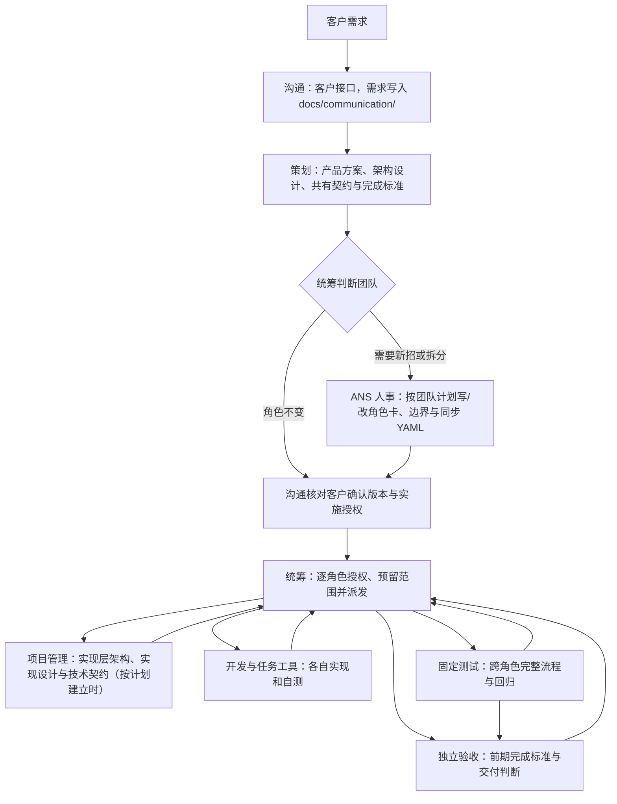

# ANS 项目架构与角色配合

更新：2026-10-22。ANS 产品由通用技能规则、任务执行工具、可选图谱和 Dashboard／同步能力组成，源码沿用现有目录。本页由按统筹团队计划建立的项目管理角色维护，记录实现层架构、角色配合与文件所有者；产品方案与架构设计归策划（默认 `docs/planning/`，以策划已接受的边界为准）。程序实现和测试进度以各原作者报告为准。

## 架构归属

- **产品方案与架构设计归策划。** 分层与模块、调用与数据流、共有业务契约、技术选型与验证要点由策划写在策划方案中，见[策划角色](../../../references/planning-role.md)。
- **实现层架构归本角色，且仅在统筹团队计划建立时。** 在策划已确认的架构下展开模块落点、角色配合、公开接口、数据交接、设计理由和交接说明，写在本页；技术契约说明怎样实现策划的共有业务契约，两者分别记录、不互相复制，见[项目管理角色](../../../references/project-role.md)。
- **团队判断与计划归统筹。** 是否需要新招或拆分由统筹判断并写入 `docs/scheduling/`，需要时交 ANS 人事（ANS People Operations，原团队组建/招募）按计划建卡；产品方案或上位架构的缺口交回策划修订，见[统筹调度角色](../../../references/scheduler.md)。

按现行五内置管理角色模型，沟通、策划、ANS 人事、统筹调度和独立验收是技能内置管理角色，任何项目一开始即可使用，不需要项目角色卡（[沟通](../../../references/communication-role.md)、[策划](../../../references/planning-role.md)、[ANS 人事](../../../references/team-formation.md)、[统筹调度](../../../references/scheduler.md)、[独立验收](../../../references/acceptance-role.md)）。项目管理不是默认角色：只有统筹判断实现确实需要技术架构工作角色、把团队计划写入 `docs/scheduling/` 后，才由 ANS 人事按计划建立本角色卡与边界。客户项目采用这些职责时，内置管理角色无需重复建卡，worker 角色须按团队计划建立自己的角色卡和边界，不能直接把模板当成权限。

图中的箭头表示需求、安排或证据交接，不授予文件写权。所有项目角色平级，`group` 仅作分类；没有 `groupDuty`、组长／组员派发或汇报层级。统筹直接逐角色确认授权、预约范围、安排执行并接收反馈；后续新需求先交策划形成产品方案、架构设计与共有业务契约，由统筹判断团队（需要时先写团队计划交 ANS 人事建卡），取得客户实施授权后由统筹安排；只有按团队计划建立项目管理角色时，才由其在已确认架构下做实现设计、技术评审和技术契约。招聘和边界问题交 ANS 人事，成果是否完成交独立验收。各上下文保持原固定身份，交接不切换角色。

| 所有者 | 当前职责与代码范围 | 阅读入口 |
| --- | --- | --- |
| ANS 人事 | 内置管理角色；按统筹团队计划维护实际角色卡、边界 MD／YAML 和治理变更记录；不实现产品业务、不接管调度或验收 | [本地治理边界](../../governance-boundary.md)、[角色定义](../../../references/team-formation.md) |
| 统筹调度 | 内置管理角色；从沟通接收已确认方案与实施授权，判断团队并直接逐角色安排、跟进依赖与阻塞、组织返工并向客户报告进度；不承担架构设计所有权，不自行验收 | [角色卡](../../统筹调度/role-card.md)、[角色定义](../../../references/scheduler.md) |
| 策划 | 内置管理角色；形成产品方案、架构设计与共有业务契约，并给出可核对的完成标准；不写业务代码、不调度、不验收，不写实现设计与技术契约 | [角色卡](../../策划/role-card.md)、[边界](../../策划/boundary.md)、[角色定义](../../../references/planning-role.md) |
| 项目管理 | 按统筹团队计划建立时，承接策划已确认的产品方案、架构设计与共有业务契约，负责实现层架构、实现设计、技术评审、技术契约和唯一的项目工程法案；职责保留 shared 及对应测试，实际写权以已授权边界为准，本仓库本轮不新增共享代码；不拥有或改写整体架构 | [本角色导航](../feature-map.md)、[边界](../boundary.md)、[角色定义](../../../references/project-role.md) |
| 任务工具 | 真实维护 `scripts/task_ops.py`、`scripts/coordination_store.py`、开发单测与既有 `scripts/validate_task_flow.py` 调用方；执行自身开发验证 | [角色卡](../../任务工具/role-card.md) |
| 技能规范 | 维护技能入口、用户指南和职责模板，准确说明工具已支持的行为，不代写其他角色产物 | [功能导航](../../技能规范/feature-map.md) |
| 固定测试 | 独立测试实际跨角色、完整流程和回归；维护专属 CLI 流程测试及自己的原报告，不修业务源码 | [角色卡](../../测试/role-card.md) |
| 独立验收 | 前期明确客户确认的完成标准；交付时核对产物和原测试证据，给通过、返工或证据不足；不代写测试结果 | [角色卡](../../验收/role-card.md)、[本轮标准](../../验收/docs/acceptance/2026-10-19_role-authority-split-criteria.md) |

本轮已批准将调度与验收在本地 CLI 中真正分权：调度凭证不能自行验收，独立验收结果满足现有证据门禁后才可释放依赖与形成完成结论。任务仍使用经审核的项目配置和单份 Markdown 记录，由程序加锁、原子写入；云端继续一个项目 Key。**固定测试已提交[正式原报告](../../测试/docs/change/2026-10-19_change_role-authority-split-validation.md)，独立验收已按标准 v2 判定 [C1–C8 全部通过](../../验收/docs/acceptance/2026-10-19_role-authority-split-result.md)。** 实际接口与验证由各原作者维护；本页仅链接其结果，不代表项目管理执行了测试或验收，也不代表已经发布、安装或启用真实项目任务。

- [项目工程法案](project-rules.md)：已确认的项目约束，区分职责决定与程序验证状态。
- [本轮角色分权方案](design/2026-10-19_design_role-authority-split.md)：设计、迁移与精确角色范围；实际验证和通过结论见上述原报告。

后续需求先由策划形成产品方案、架构设计与共有业务契约；本轮已有技术方案仍归原作者，不要求策划重复撰写。策划、项目管理和统筹的交接不改变 CLI 分权契约，也不重复要求同版同范围已有客户授权。

- [任务操作指南](../../../references/task-operations.md)：以原作者同步的实际接口和状态为准。

其他云端、图谱和可视化能力沿用既有代码。此前候选分工不自动成为写权；新增源码职责或范围先由 ANS 人事落实实际边界，不能从本页架构图推导授权。旧历史保留当时记录，不作为当前派发或验收权限依据。
