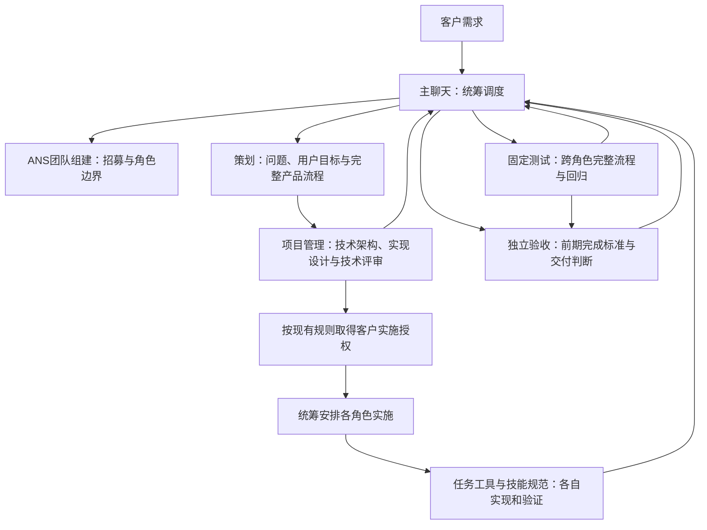

# ANS 项目架构与角色配合

更新：2026-10-19。ANS 产品由通用技能规则、任务执行工具、可选图谱和 Dashboard／同步能力组成，源码沿用现有目录。本页记录当前已明确的职责与文件所有者；程序实现和测试进度以各原作者报告为准。

唯一内置岗位为 **ANS团队组建**，承接原 ANS Governance 的同一治理职责，负责招募、角色卡和边界。统筹调度、策划、项目管理、任务工具、技能规范、固定测试和独立验收都是本项目实际角色。客户项目采用这些职责时，也须先建立自己的角色卡和边界，不能直接把模板当成权限。

图中的箭头表示需求、安排或证据交接，不授予文件写权。所有项目角色平级，`group` 仅作分类；没有 `groupDuty`、组长／组员派发或汇报层级。统筹直接逐角色确认授权、预约范围、安排执行并接收反馈；后续新需求先交策划形成产品／需求方案，再交项目管理做技术架构、实现设计和技术评审，取得客户实施授权后由统筹安排；招募和边界问题交 ANS团队组建，成果是否完成交独立验收。各上下文保持原固定身份，交接不切换角色。

| 所有者 | 当前职责与代码范围 | 阅读入口 |
| --- | --- | --- |
| ANS团队组建 | 维护实际角色卡、边界 MD／YAML 和治理变更记录；不实现产品业务、不接管调度或验收 | [本地治理边界](../../governance-boundary.md) |
| 统筹调度 | 默认主聊天；直接安排各角色、跟进依赖与阻塞、组织返工并向客户报告进度；不自行验收 | [角色卡](../../统筹调度/role-card.md) |
| 策划 | 形成问题、用户目标、完整产品流程与分支、输入输出、失败处理、范围和可选项方案；不写代码、技术架构，不调度或验收 | [角色卡](../../策划/role-card.md)、[边界](../../策划/boundary.md) |
| 项目管理 | 承接策划方案，负责技术架构、实现设计与技术评审，以及调查、契约和唯一项目工程法案；职责保留共享代码及对应测试，但实际写权仍以已授权边界为准，本仓库本轮不新增共享代码 | [本角色导航](../feature-map.md)、[边界](../boundary.md) |
| 任务工具 | 真实维护 `scripts/task_ops.py`、`scripts/coordination_store.py`、开发单测与既有 `scripts/validate_task_flow.py` 调用方；执行自身开发验证 | [角色卡](../../任务工具/role-card.md) |
| 技能规范 | 维护技能入口、用户指南和职责模板，准确说明工具已支持的行为，不代写其他角色产物 | [功能导航](../../技能规范/feature-map.md) |
| 固定测试 | 独立测试实际跨角色、完整流程和回归；维护专属 CLI 流程测试及自己的原报告，不修业务源码 | [角色卡](../../测试/role-card.md) |
| 独立验收 | 前期明确客户确认的完成标准；交付时核对产物和原测试证据，给通过、返工或证据不足；不代写测试结果 | [角色卡](../../验收/role-card.md)、[本轮标准](../../验收/docs/acceptance/2026-10-19_role-authority-split-criteria.md) |

本轮已批准将调度与验收在本地 CLI 中真正分权：调度凭证不能自行验收，独立验收结果满足现有证据门禁后才可释放依赖与形成完成结论。任务仍使用经审核的项目配置和单份 Markdown 记录，由程序加锁、原子写入；云端继续一个项目 Key。**固定测试已提交[正式原报告](../../测试/docs/change/2026-10-19_change_role-authority-split-validation.md)，独立验收已按标准 v2 判定 [C1–C8 全部通过](../../验收/docs/acceptance/2026-10-19_role-authority-split-result.md)。** 实际接口与验证由各原作者维护；本页仅链接其结果，不代表项目管理执行了测试或验收，也不代表已经发布、安装或启用真实项目任务。

- [项目工程法案](project-rules.md)：已确认的项目约束，区分职责决定与程序验证状态。
- [本轮角色分权方案](design/2026-10-19_design_role-authority-split.md)：设计、迁移与精确角色范围；实际验证和通过结论见上述原报告。

新增策划的路由面向后续需求；本轮已有技术方案仍归原作者，不要求策划重复撰写。策划、项目管理和统筹的交接不改变 CLI 分权契约，也不重复要求同版同范围已有客户授权。

- [任务操作指南](../../../references/task-operations.md)：以原作者同步的实际接口和状态为准。

其他云端、图谱和可视化能力沿用既有代码。此前候选分工不自动成为写权；新增源码职责或范围先由 ANS团队组建落实实际边界，不能从本页架构图推导授权。旧历史保留当时记录，不作为当前派发或验收权限依据。
