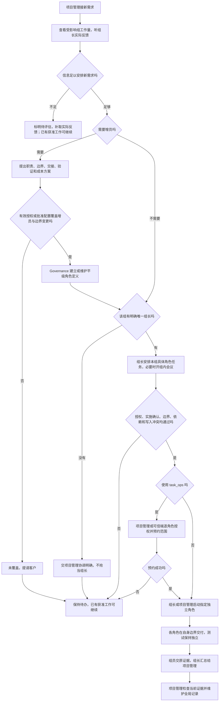

# 组长协调组内工作，项目管理评估工作量

例如，订单组来了一个新需求。项目管理先看这个组手上还有什么工作，听组长说明人手和阻塞；组长把已获准的组内任务安排给具体角色。每个人继续负责自己的业务文件，组长也继续写自己的业务。

客户已经确认本轮修改：

> 可以的，按这个修改技能吧。只有一个角色的组默认它是组长，多角色后组长负责开会、组内调度和汇报。项目管理接新需求时评估各组工作量，必要时提议增员，权限仍按各角色自己的边界。

## 本轮规则

组长是现有业务角色的额外协调职责，不另建组长角色。卡片除“组别”外增加普通 Markdown“组内职责：组长／组员”，英文模板可用 `groupDuty`。角色仍平级、上下文仍固定，组别和组内职责都不授予文件权限。组内人数按已接受的角色定义统计；同一角色启动多个上下文，不会增加组员或组长。

- 每个已确认组恰好一个组长。只有一个角色时默认该角色；新增成员后保留原组长。更换由 Governance 按客户授权维护卡。多角色组没有明确或唯一组长时，交项目管理协调，暂不开始需要组长的协调，不影响原本已获准、由项目管理安排的其他工作。
- 组长可以组织本组已获准任务的会议、拆分和安排、成员启动与汇报。每个成员仍在自己的独立角色上下文工作。普通组员不调度其他角色；组长也不能模拟组员身份、修改组员文件或扩大权限。
- 项目和跨组会议由项目管理安排；组内会议由组长主持。实际主持人只在自己已有白名单 `docs/meetings/` 写纪要，参与者只交自己的意见。不要求每个小需求都开会，会议共识也不授权业务代码。
- 组员把实际进展、失败和阻塞交组长，组长汇总给项目管理并保留原证据。测试仍独立，组长不能修改测试报告、隐藏失败或代替项目管理作全局阶段验证。
- 跨组协调、增员和改范围交项目管理或 Governance。同组也是不同角色，组长不获得组员私有 common、Model、公开契约或 `common/shared/` 的写入权；原共享代码所有者规则继续有效。

需要新增角色时，Governance 在获准后建立独立平级角色卡和边界。既有角色加入或调整组别只维护原卡。角色目录不搬迁，没有父子权限继承或组权限配置；工具的父子代理结构不改变角色权限。

## 如何安排新需求

项目管理结合受影响组正在做的任务、剩余工作、可用人手、依赖和阻塞评估工作量，听组长的实际反馈。缺信息就写“待评估”，不能编造工时，也不另建工作量数据库。

如果现有人手与分工可以承接，就安排组长组织已获准任务。确实需要增员时，项目管理先提出方案：说明新角色的业务职责、具体文件边界、与现有角色不重叠的分工、交接和验证，以及收益与成本。提议没有授权作用；先核对增员和边界变更授权，未覆盖才提请客户。已有有效授权或明确获批配置必须确实覆盖该角色定义与边界变更，普通成员的 `autoDispatch` 或组长字段不能替代。Governance 在获准范围内建立或维护角色定义，业务代码仍须具体方案确认与实施授意。

## 两级调度怎样接现有工具

组长选择、拆分并组织组内可执行任务；任务仍落到具体 `roleId`。启动前必须核对每个成员的客户授权或已批准配置、当前方案实施确认、自己的边界、依赖和写入冲突。这些检查不能被组长身份替代。

使用 `task_ops` 时，项目管理或可信操作端先按现有工具完成逐角色授权和范围预约。成功后，组长才启动指定成员，或由项目管理按组长计划启动。成员令牌只交指定成员；`coordinatorToken` 留在项目管理／可信端，组长不能领取它、写机器块、改执行配置或假称 CLI 已增加组长操作。全局记录和阶段验证仍由项目管理单写。

不使用该工具时，也按客户授权或已批准配置逐角色核对，保持独立上下文和原有实施确认、依赖及冲突规则。权限不足或实施尚未获准就保持待办，不能绕过检查来启动成员。

## 项目管理评审

结论：建议通过，沿用客户对本轮范围的明确确认。组内安排由最了解本组进展的角色负责，项目管理仍处理全局负载、跨组依赖与验收。相比全部细节都由项目管理安排，这能减少来回汇报；代价是需要清楚区分本组组织工作与全局工具操作。本轮用同一份集中指南解释这条边界，不增加角色层级或执行程序。

实际风险是旧规则仍写“所有工人不调度”“只有项目管理主持”，或新指南误让组长持有管理令牌。因此须同步角色卡执行原则、SKILL 的交接和会议入口、scheduler、bootstrap、assembly/test 例外、meeting 主持人与纪要所有者、project-role 的激活要求，以及 coordination 的反馈路径。完整职责集中在新增 `references/group-leadership.md`，入口保留短说明与可发现的链接。

对照[工程法案](../project-rules.md)：DOC-01 要求沿用现有 `docs/`，当前功能仍用原 `role-groups.md`，本轮另写变更历史；TASK-01 的逐角色授权、单写记录和证据要求保留，CLI 源码不改；DEPLOY-01 不受影响。受影响的是规范角色、组长／组员、项目管理与独立测试的文档使用流程，权限仍由各自 Section 1 决定。

## 实施与检查

以未提交的上轮工作树和技能候选摘要 `33655e2c5832b8a1b9d58fb0665d8bd613b4cb521ad0c1a76a464a93e1b56960` 为基线。上轮日期方案、变更和验证报告保留原记录，不能用上轮通过结果代替本轮检查。Governance 已维护本轮实际角色卡和边界；其他角色不代写。

| 固定角色 | 本轮交付 |
| --- | --- |
| 项目管理 | 本方案、实质评审和结果核对 |
| 技能规范 | 自身白名单内的规则与入口、[原当前功能](../../../技能规范/docs/feature/role-groups.md)、[本轮变更](../../../技能规范/docs/change/2026-10-14_change_group-leadership.md)和功能导航 |
| 测试 | 只读验证最终候选，写[本轮独立报告](../../../测试/docs/change/2026-10-14_change_group-leadership-validation.md) |

复用两位执行者原固定角色上下文。规范完成后，再用独立只读测试上下文判断三个任务情境，只给最终规则、原角色资料和任务，不提供预期答案；主测试核对实际回答并记录差异。本任务只改技能文档，不开实际会议、不新增执行配置或 `task_ops` 调度记录；项目管理本轮写入只限本方案。

检查单人成组的默认组长、增员后唯一组长、未定或重复组长待协调、组长业务仍限自己文件、未获准成员不能启动、会议实际 owner、跨组升级、管理令牌不共享、全局记录单写、负载评估不自动增员与独立测试证据。按实际场景作决策检查，明确哪些仅检查文字。候选完成后再检查入口冲突、链接、元数据与当前文件摘要。官方检查器缺 PyYAML 的限制如实保留，使用现有 Ruby YAML，不安装依赖。

## 结果

文档已修改，独立检查通过。测试核对了入口、角色与工具分工、流程分支、链接和元数据；另一个只读测试上下文在没有预期答案的情况下判断三个情境，主测试核对未发现实质偏差。审阅发现的旧会议表述、写入权措辞和流程问题已由原作者修复后复查。此次没有执行组长启动成员、会议或业务修改，情境判断只支持文档可理解性；官方检查器因缺 PyYAML 没能运行，Ruby YAML 检查通过。当前规则见[角色组别功能](../../../技能规范/docs/feature/role-groups.md)，输入、结果和限制见[本轮测试报告](../../../测试/docs/change/2026-10-14_change_group-leadership-validation.md)。
