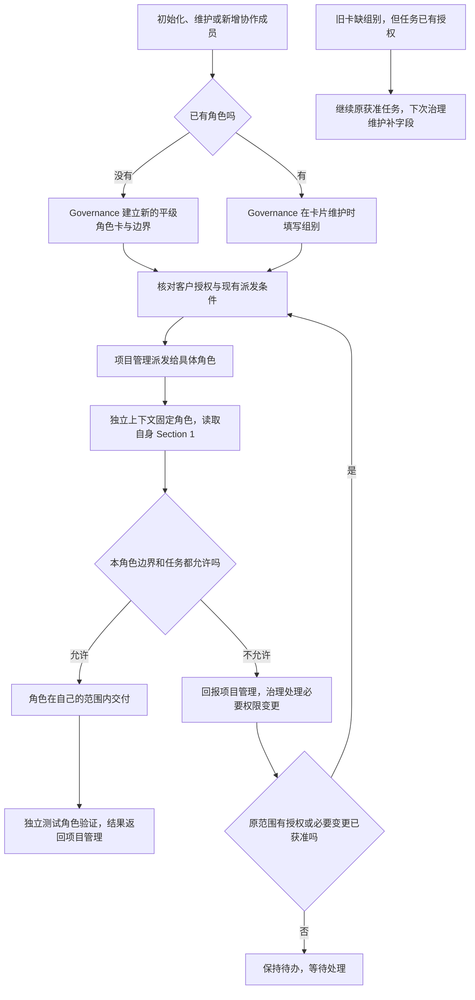

# 角色保持平级，用组别说明协作关系

用户想把经常一起工作的角色归到一组，方便看懂谁与谁协作。例如，项目管理和测试可以写“项目协作组”，技能规范可以写“技能维护组”。每张卡仍对应一个独立角色。读者看到组别后能理解协作关系，修改文件时仍要看执行角色自己的边界。

## 已确认的方案

本轮客户确认原话：

> 可以的，按这个修改技能吧，角色保持扁平，角色卡增加组别，权限还是按每个角色自己的边界来。

确认覆盖本轮技能文档更新与三个现有角色卡的组别补充。此前父子招募方案已经取消。这里记录最终方案，不重新恢复父子角色、组长、组权限、组 Key、数据库或 CLI 功能。

1. 角色保持平级。在角色卡模板增加 `group` / “组别”字段，值是项目按实际协作起的普通组名。组不是角色，也不形成上下级。
2. 相同组别不合并文件范围，不共享组员权限，不继承他人的权限。不同组的角色也可以在各自已授权范围内协作。权限仍只来自每个角色 `boundary.md` Section 1。
3. 角色目录沿用项目现有结构，不按组移动。组名不能用来推出写入目录，也不能用于自动创建角色或自动派发任务。
4. 已有角色加入或调整组别，由 ANS Governance 维护原卡，不复制角色和边界。需要新增角色时，才建立新的平级角色卡和独立边界；客户授权与项目管理派发沿用现有规则。开发角色不能自己改卡或扩权。
5. 每个上下文保持固定角色，项目管理仍负责跨角色协调与派发，测试仍在独立上下文验证。组别不改变这些职责。
6. 旧卡缺少组别时，已有获准任务可以继续。下次由 Governance 维护该卡时补齐，不能借字段升级扩大范围。
7. 这是技能文档的协作机制。组别不是工具授权字段；现有程序仍按具体 `roleId` 与独立写入集合检查。

## 用户怎样用

初始化或维护角色时，先说明角色职责与实际协作关系，由 Governance 把组别写进卡片。已有角色调组时维护原卡；确实需要新角色时才建立新卡和新边界，再按现有流程取得角色任务授权。项目管理把任务交给具体角色，接收者在新的独立上下文加载自己的卡和边界。它只修改该边界与本轮任务共同允许的文件。

如果角色在同组协作中发现需要改他人的文件，先把需求交回项目管理；缺角色、缺权限或归属冲突交 Governance 处理。如果只是跨组协作，而双方各自已有授权，就继续按原职责交接。如果旧卡没组别，继续原获准工作，并在下次治理维护时补字段。

## 项目管理评审

结论：建议通过。客户已经确认并要求实施同一范围，沿用该授权。

这个方案满足“按协作关系分组”的目标，改动集中在一个角色卡字段及其使用规则。现有独立权限、固定上下文与协调流程可以继续使用。相比此前父子招募，它不增加角色层级、权限继承或新的招募职责，也不需要改执行程序。父子招募已由客户取消，不作为本轮选装保留。

受影响入口是英文/中文技能入口、README、角色卡模板、项目管理与测试建卡说明、初始化流程、模块边界和调度指南。完整规则集中在 `references/role-card.md`；相邻入口引用规则并补上各自容易遗漏的建立或派发步骤，避免维护一份独立组权限文件。

与实际[工程法案](../project-rules.md)对照：DOC-01 要求沿用角色的现有 `docs/`，本轮的新功能和历史仍放在原角色目录；TASK-01 涉及执行工具和正式任务记录，本轮不修改程序或执行策略；DEPLOY-01 的云端部署不受影响。各角色新文档路径已由 Governance 纳入本轮边界。

主要风险是读者把组名误当权限，或模板有字段但初始化忘记填。本轮在边界、派发、项目管理建卡、测试建卡和初始化入口明确同一规则，测试角色按场景复核。文档规则不能替代工具或文件系统限制，组别也不是工具授权字段。

## 本轮分工与验证

基线为 Git `54ff933`。Governance 维护实际角色卡、边界和 changelog；其他角色不代写。

| 独立角色 | 本轮交付 | 前置条件 |
| --- | --- | --- |
| 项目管理 | 本方案与评审、结果核对 | 本角色卡、Section 1、项目工程法案与客户确认 |
| 技能规范 | 已授权入口与参考；[当前功能](../../../技能规范/docs/feature/role-groups.md)、[具体修改记录](../../../技能规范/docs/change/2026-10-14_change_role-groups.md)、功能导航 | 本方案已记录；自身白名单与本轮客户授权 |
| 测试 | 只读检查最终文档，写[独立验证报告](../../../测试/docs/change/2026-10-14_change_role-groups-validation.md) | 自身白名单；技能规范最终候选就绪 |

规范角色只修改自己的白名单文件。测试角色只读验证，再写自己的报告。本轮没有获准的 scheduling 或执行配置路径，采用本次明确授权的文档交接，没有 `task_ops` 派发记录。

验证要求：同组跨界仍拒绝；跨组各自有授权可协作；组名不授权；需要新角色时仍平级，旧角色调组不复制卡和边界；旧卡缺字段时继续原获准任务且仅 Governance 补卡；固定上下文和独立测试继续有效；英文/中文入口、建卡与初始化一致；调度使用具体 `roleId`；未获准的越界请求保持待办；文档链接有效；没有源码或旧 `test/game-engine` 角色变更。实际步骤和结果见[测试报告](../../../测试/docs/change/2026-10-14_change_role-groups-validation.md)。

## 结果

规范角色已完成入口、模板和相关指南，测试角色在独立上下文检查通过。文档规则、链接和元数据检查通过；临时配置实际调用现有工具函数，五类逐角色范围场景符合预期。它验证现有范围检查，没有证明代理必然遵守文字规则。官方技能检查器因缺 PyYAML 没能运行，Ruby YAML 检查通过。当前规则见[功能说明](../../../技能规范/docs/feature/role-groups.md)，具体证据和限制见[测试报告](../../../测试/docs/change/2026-10-14_change_role-groups-validation.md)。本轮仅更新技能文档，未发布或安装。
