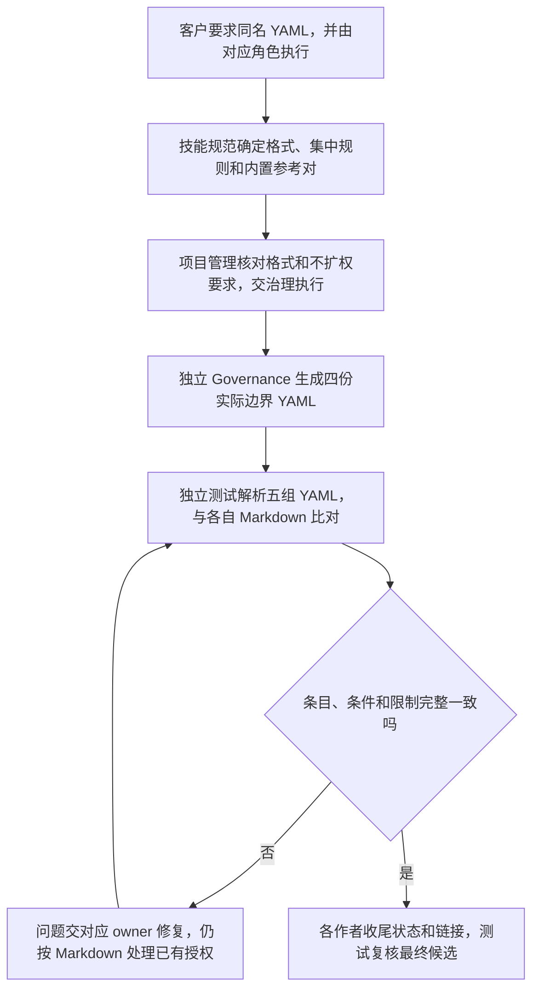

# 边界文档同时交付同名 YAML 副本

客户希望边界文档便于程序读取，同时保留现有 Markdown 阅读方式。客户原话是“这个边界文档需要同时生成一份 yaml 格式的，名字一样的”，并进一步明确“你应该让对应的角色干”。本轮已经获得文档和格式更新授权，不再请求一次方案确认。

## 交付规则

边界创建或调整时，同一次交付生成相邻、同名的 YAML：`boundary.md` 对应 `boundary.yaml`，中文文件名也只换扩展名。Markdown 仍是唯一维护和授权依据；YAML 是它的同步读取副本，不能分别改成两套范围，也不能挑更宽的一份执行。

规范角色负责选择简单的 YAML 结构。必须标明相邻 Markdown 源，并逐项保留 Section 1 的类型、路径、用途及原有条件和限制。单文件不能变成目录授权，条件目录不能变成无条件目录，未列路径仍默认只读。表格外影响范围的说明也要保留。内置边界中带备选文件或描述性路径的条目不能擅自展开成更宽的目录。

一致性检查不通过时，修复相应治理产物再重新核对。已有获准工作仍按 Markdown 边界处理，不从失配的 YAML 获得额外权限。现有 `task_ops` 仍读取 Markdown，本轮不改程序、执行配置、依赖或 CLI，也不把 YAML 声称为已接入的工具权限源。

## 对应角色的分工

基线是 `main` 的 `9cbd26b`。接手时已有 Governance 对三个角色卡、边界、changelog 和本地治理覆盖共十份文件的获准准备改动，作为受保护输入保留。

| 固定角色 | 本轮写入 |
| --- | --- |
| 项目管理 | 本方案、范围评审和最终结果核对 |
| 技能规范 | 技能中英文入口、README、角色卡和初始化路由、集中边界格式规则；`references/built-in-boundary.md` 与其 YAML 参考副本；自身[当前功能](../../../技能规范/docs/feature/boundary-yaml.md)、[本轮变更](../../../技能规范/docs/change/2026-10-16_change_boundary-yaml.md)和功能导航 |
| 独立 Governance | 三个实际角色的 `boundary.yaml` 和本地 `governance-boundary.yaml`；按规范选定的同一结构生成 |
| 测试 | 只读检查最终五组边界对，写[独立验证报告](../../../测试/docs/change/2026-10-16_change_boundary-yaml-validation.md) |

规范角色不能改实际角色边界或它们的 YAML，治理角色也不代改产品规范。普通格式指南不是项目边界，不为所有 Markdown 盲目生成 YAML。旧 `test/game-engine` 示例本轮不批量迁移。

## 项目管理评审

结论：建议通过，按客户已明确授意的范围实施。使用相邻副本能满足机器读取需求，也不改变现有按 Markdown 授权的规则。相比新增导出程序、权限库或配置，本轮只需要确定格式并同步交付，维护负担较小。

主要风险是副本漏掉条件或与源文件不同步。因此格式、内置参考与四份实际副本使用同一结构，并由独立测试实际解析、逐条核对和故意制造失配来验证检查能发现差异。YAML 不作为第二套维护来源，不因能解析就宣称权限一致或工具已支持。

对照[工程法案](../project-rules.md)：DOC-01 的角色 `docs/` 和当前功能／历史结构保持不变；TASK-01 的逐角色范围与执行记录规则不改；DEPLOY-01 的部署不受影响。并发槽位有限，先由规范角色返回选定格式和候选，释放槽位后由独立治理角色生成实际副本，最后才启动测试角色。

## 格式与验证结果

已采用规范角色选定的简单结构：`source` 指向相邻 Markdown，`section1.entries` 按表行保存类型、路径、用途和真实条件，`section1.notes` 按序保留表外权限说明。具体格式、反引号处理和原文保留规则以[集中指南](../../../../references/module-boundary.md#same-name-yaml-copy)为准；可对照[内置边界](../../../../references/built-in-boundary.md)与其[副本](../../../../references/built-in-boundary.yaml)。

测试需实际解析三角色、本地治理和内置参考五组 YAML，并核对表格条目、单文件／目录／条件目录、默认只读和非表格限制；临时模拟 Markdown 已改而副本未更新、条目遗漏或条件丢失，确认失配能被发现。辅助转换或检查脚本只放临时目录，不进入产品源码。系统 Ruby YAML 可用；如 Python 缺 PyYAML，报告实际限制，不安装新依赖。

文档和副本已由对应角色完成：规范角色更新规则与内置参考对，独立治理角色生成四份实际副本，测试角色独立核对五组边界。Ruby 解析并逐项检查的 68 个条目、15 项 notes 一致；十个内存失配负例均被发现，同步修改正例通过。审阅发现的内置说明遗漏和旧边界范围措辞已由原作者修正。现有 CLI 仍读 Markdown；本次验证不代表程序或文件系统权限拦截。流程见[当前功能](../../../技能规范/docs/feature/boundary-yaml.md)，输入、检查和限制见[本轮报告](../../../测试/docs/change/2026-10-16_change_boundary-yaml-validation.md)。本轮未推送或替换已安装技能。
