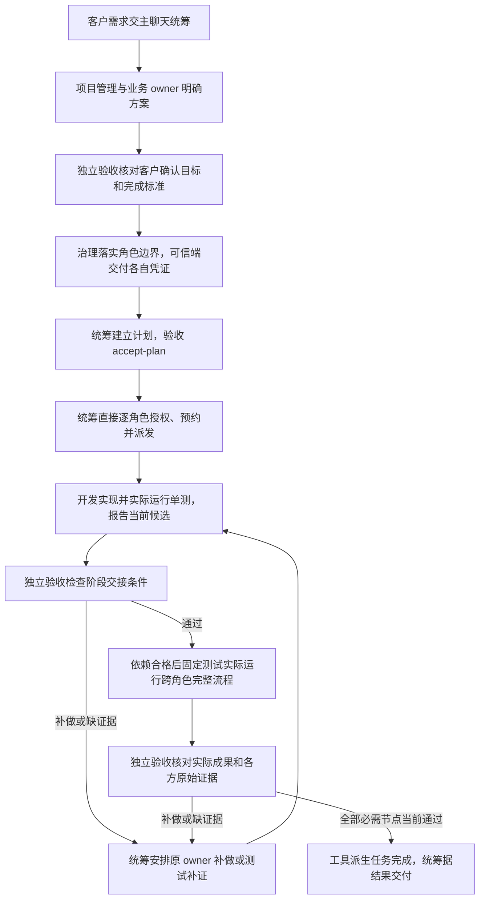

# 分开团队组建、统筹调度、架构设计与独立验收

用户把新需求交给主聊天后，应由统筹调度安排工作，由原项目管理负责架构和共享代码，由独立测试实际测试，再由独立验收依据客户确认的目标判断成果。安排工作的人不能拿自己的调度凭证把任务验收通过。

用户已确认上述总体分工，明确说“那就修改吧”，并要求对应角色执行。用户随后明确“组长对象去除掉”，以及“招聘和边界调整 用一个单独的内置角色，但是不是组长”。本版按这两项最新决定更新：取消组长／组员层级及 `groupDuty`，`group` 只作扁平分类；正式独立内置岗位名为 **ANS团队组建**，承接原 ANS Governance 的同一治理职责，不另留重叠治理角色，也不使既有治理上下文切换身份。本方案把该授权细化为可实施的工具和文件范围；不声称用户此前逐项签署了本文新提出的命令、字段和迁移细节。本文只完成设计，没有修改或测试程序，没有发布或安装。作者上下文固定为既有项目管理，不能在交接时变成统筹或验收。

基线：`main 6a7d4fe`。治理为本轮准备的角色边界改动是已授权输入，不属于作者的修改。实际工程约束沿用[项目法案](../project-rules.md)；管理职责导航见[feature-map](../../feature-map.md)。本文拟议行为实现后才进入各所属角色的当前功能说明，旧历史不批量改写。

## 1. 调查结论和最小改法

已读取 `scripts/task_ops.py`、`scripts/coordination_store.py`、`scripts/tests/test_task_ops.py`、`scripts/validate_task_flow.py` 及任务、组长、测试、初始化和方案评审指南。

现状有三个关键问题：

1. `init` 返回的同一个 `coordinatorToken` 能执行 `dispatch/revise/verify/recover`。现有单测和回放只证明 worker token 不能验收，未证明调度不能验收。
2. `verify` 检查当前产物、完成报告和真实运行日志后，直接把节点改成 `verified`、释放预约。没有独立验收身份、前期完成标准确认或“补做／缺证据”结论。
3. 旧工具没有检查任务状态的 schema。只在新工具检查版本，而继续保留旧认证字段，会让旧脚本绕回旧的自验收流程。

采用现有 JSON 执行配置、单份 Markdown 任务记录、文件锁、原子替换、检查执行和候选哈希。只增加独立验收凭证、验收预检和结论数据，以及旧版本写入隔离；不新建服务、数据库、消息系统或架构层。程序仍由 `task_ops` 单写记录；“独立验收”指决定来源独立，不是让第二个人手工改同一份状态文件。

## 2. 使用技能的项目采用什么职责

**正式独立内置角色为 ANS团队组建，承接原 ANS Governance。** 这是同一治理岗位的新名称，不是组长，也不是增加一个与旧 Governance 重叠的内置权力主体；既有治理上下文继续原固定岗位。统筹、项目管理、测试及验收等职责由模板落成项目自己的角色卡及边界，模板本身不授予项目权限。`group` 只作扁平分类，删除 `groupDuty`，不再建立组长／组员对象或层级。

| 职责 | 工作与结果 | 权限边界 |
| --- | --- | --- |
| ANS团队组建（原 ANS Governance，同一内置岗位） | 招募及设计岗位、维护角色卡和边界 MD/YAML；根据已授权增员需求增加角色；可设置扁平 group 分类 | 只维护治理产物，不做业务实现、不接管全局任务记录 |
| 统筹调度 | 主聊天接需求；直接向各角色取得现有任务、剩余工作、可用执行者和阻塞实况；安排执行、依赖、返工与客户沟通 | 自己的调度文档和受限工具操作；无独立验收权、无角色扩权或业务写入权 |
| 项目管理 | 保留调查、架构／集成方案、方案质量审核、项目法案和 `common/shared/`、对应测试与共享组件说明 | 自己的设计、共享代码和测试范围；不再兼任默认调度或最终验收 |
| 固定测试 | 实际执行跨角色、完整流程和受影响回归；保留失败、限制和原始证据 | 独占测试与报告范围，不修业务代码、不把测试通过等同客户验收 |
| 独立验收 | 前期把客户确认的完成标准具体化；交付时核对实际成果、开发和独立测试证据，给通过／补做／缺证据 | 自己的标准、验收结论文档和受限验收操作；不代写测试、不派发实现、不修改业务代码 |
| 开发／装配 | 开发写本角色代码和单元测试；装配接线、启动和构建检查；各角色直接接受统筹的逐角色授权、预约与派发，直接反馈进展和原证据 | 不派发其他角色，不领取他人的工作令牌或扩大自己的边界 |

主聊天默认绑定**统筹调度**。所有项目角色由统筹直接逐角色授权、预约和派发，直接向统筹提交进展、阻塞与原证据；独立测试保留原报告，同时供验收只读核对。统筹把架构问题交项目管理、权限和招募增员问题交 ANS团队组建、成果判断交验收，不代演这些角色。项目协作会议由统筹主持，架构评审由项目管理负责；主持人只写自己的授权会议路径。group 分类不参与权限判断、派发或汇报路由。

新项目先由 ANS团队组建 建立并交付这些适用的项目角色与边界，再在新上下文启动统筹。项目管理和法案仍按现有顺序建立，缺少法案不阻止已获准初始化。验收前期参与发生在派发实施前，不能等所有代码写完才补标准。客户原话、实际确认消息或可信操作端批准来源必须可追溯；AI 自己写的标准和算出的哈希不是客户批准。

既有上下文终身保持原身份。即使旧项目管理卡调整，当前上下文也不原地接收统筹或验收凭证；原协调任务在交接点停止，交给新统筹上下文。只传角色、边界、已有授权、任务与证据，不复制含旧角色身份的完整聊天来改变身份。没有并发能力就顺序使用独立上下文，不能合并身份。

## 3. 本源码仓库由谁真正执行

上述是技能安装到客户项目后的职责结构。下面是**开发 ANS 产品本身**的实际文件所有者；不能用前者代替本仓库的代码执行角色。拟新增真实的 `统筹调度`、`验收`、`任务工具` 三个项目角色，保留原项目管理、技能规范和测试。新角色先由 ANS团队组建 建卡、给边界，再由各自的新上下文执行。

| 本仓库角色 | 本轮精确写入集合建议 |
| --- | --- |
| 既有项目管理（本文作者） | 仅 `角色卡/项目管理/docs/design/2026-10-19_design_role-authority-split.md`；后续其原固定上下文可依另行交接更新已授权 `角色卡/项目管理/docs/architecture.md`、`角色卡/项目管理/docs/project-rules.md` 与 `角色卡/项目管理/feature-map.md`，如实记录完成后的结构 |
| 任务工具（新增开发角色） | `scripts/task_ops.py`、`scripts/coordination_store.py`、`scripts/tests/test_task_ops.py`、`scripts/validate_task_flow.py`；本角色 `feature-map.md`、`memo.md`、`docs/feature/task-authority.md`、`docs/change/2026-10-19_change_task-authority.md` |
| 测试（保留） | 新增 `scripts/tests/test_role_authority_flow.py`；`角色卡/测试/docs/change/2026-10-19_change_role-authority-split-validation.md`、其 `feature-map.md` 与 `memo.md`。新程序路径须 ANS团队组建 先加入边界，不能把当前只准文档复核的授权当作测试源码授权 |
| 验收（新增） | `角色卡/验收/docs/acceptance/2026-10-19_role-authority-split-criteria.md`、`角色卡/验收/docs/acceptance/2026-10-19_role-authority-split-result.md`、其 `feature-map.md` 与 `memo.md`；通过验收接口提交自己产生的结论 |
| 统筹调度（新增） | `角色卡/统筹调度/docs/coordination/2026-10-19_role-authority-split-handoff.md`、其 `memo.md`、`feature-map.md`；若正式启用 CLI，治理再把该任务精确 `docs/scheduling/<task-id>.md` 及相应运行路径落入执行边界。文档不预先虚构任务 ID，不手工制造任务记录 |
| 技能规范（保留） | 现有白名单内的中英文技能入口、README、职责和流程指南；具体必改文件见第 8 节。维护自己的功能与变更记录 |
| ANS团队组建（独立内置岗位，原 ANS Governance） | 本地 `角色卡/governance-boundary.md/.yaml`；各实际角色的 `role-card.md`、`boundary.md/.yaml`、`changelog.md`，包含新增三角色，以及被调整的原三角色 |

每个角色的 `docs/...` 均指其 `角色卡/<角色>/docs/...`，不是笼统目录授权。各角色自行维护自己的导航和 memo；角色卡、边界与治理 changelog 始终归 ANS团队组建。治理覆盖不得同时把本文、技能规范产品 references 或角色业务文档列给 ANS团队组建 写入；应清除本轮准备中这类重叠项。边界 MD/YAML 逐行保持一致，Markdown Section 1 仍是唯一权限来源。此轮不把 YAML 加进任务工具解析器。

本仓库没有现成 `common/shared/` 业务需要，不能为体现管理职责而新建空共享层；将来有真实共享代码才先给精确边界。本次不涉及其他旧候选角色、云端源码、构建依赖、旧 `test/game-engine` 生产源码或历史根 `doc/` 的批量改写。

## 4. 两种凭证怎样真正隔离

### 4.1 信任根与产生、保管

沿用客户／可信本地操作端审核 `.ans/project.json` 的工作流。在这份配置里新增 `acceptanceAuthority`：批准的独立验收角色 ID、实际角色卡与边界路径及其哈希、独立随机秘密的 SHA-256 摘要 `credentialHash`、允许的完成标准文档路径。角色卡和边界必须存在且与批准摘要一致；该验收角色不能兼任调度或被验收的执行节点角色。执行节点仍用原 `roles` 配置，不用名称包含“验收”猜身份。

可信本地操作端在调度上下文之外，用系统随机源产生至少 32 字节随机验收秘密，保存到自己的私密存储，只把摘要写进经客户认可的配置，把明文直接交独立验收上下文。不得放进仓库、共享记录、任务报告、云端项目 Key 或调度上下文；不在工具输出展示示例真凭证。配置与角色范围的客户确认来源由可信端保存和交付。**roleId、scope 字符串、摘要、AI 自述批准来源都不是客户身份认证。** 工具只是固定可信输入并检查持有秘密者。

调度 `init` 只能钉住配置中已有验收摘要，并生成／接收自己的 `schedulerToken`；它不产生、接受请求覆盖或返回验收明文。初始化时拒绝调度凭证与验收凭证使用相同摘要。验收角色及业务执行角色都不领取调度凭证。工作令牌由可信启动端直接交对应固定角色；调度只在授权预约流程中处理它，不得借该令牌替角色编造完成或测试证据。

不存在供调度调用的 `mint-acceptance`、`reset-acceptance`、`rotate`、临时降级或“忘记令牌即重置”命令。丢失或更换验收凭证需要可信操作端和 ANS团队组建 按客户授权更新配置、重新建立任务；不在旧任务覆盖认证根。旧任务的既有活动执行者须先停止／核对，不因新建任务自动解锁。

这不是同 OS 用户之间的隔离系统。能改源文件、审核配置、重写整个哈希链、读取其他上下文秘密或任意执行批准检查命令的可信操作端／同 OS 操作者仍在工具安全边界之外。独立上下文和实际工具／文件权限承担秘密保管；单纯在同一调度聊天保管两种秘密不能声称独立验收。云端继续一个项目 Key；项目 Key 或网页决定不能作为任何本地验收凭证。

### 4.2 命令权限与记录

新任务使用状态 `schemaVersion: 2`，配置结构可保留版本 1 并强制要求上述新字段。新代码统一拒绝对旧任务执行写命令，不以缺失字段回退。建议接口如下，名字是实施契约建议，不是既有功能：

| 命令 | 持有者／要求 | 能改变什么 |
| --- | --- | --- |
| `init` | 统筹／可信端，经审核配置、计划；独立验收摘要必须已存在 | 建立未批准派发的任务，返回调度明文一次；不返回验收秘密 |
| `accept-plan`（新增） | 独立验收；`acceptanceToken`、批准角色、预期状态与计划版本、标准引用和客户确认来源 | 核对目标／标准、节点、依赖与必需独立测试覆盖，固定当前计划可派发快照；不派发、不生成客户同意 |
| `dispatch`、`revise`、`recover` | 调度 `schedulerToken`；沿用逐角色同意与范围检查 | 派发／修订／只读恢复；不能验收或设置已完成 |
| `ack/run-check/report/stop` | 当前节点自己的工作令牌；原批次／版本限制继续有效 | 自己的确认、实际检查与反馈、停止确认；不能设 `verified` |
| `verify` | 仅独立验收 `acceptanceToken`；预期状态版本、节点、批次、候选、标准版本；`verdict` 与逐标准证据引用 | 记录 `pass`／`needs-work`／`missing-evidence`；只有 pass 且程序门禁全部通过才 `verified` |
| `status` | 只读、不返回任何明文或认证摘要 | 展示记录及当前证据是否有效；历史通过不等于当前有效 |

`accept-plan` 是小型前期门禁，复用一次 `Store.commit`。记录需求、设计和标准实际哈希、计划图快照哈希、全部必需节点及独立测试节点、验收角色定义哈希、客户确认来源引用和预期状态版本。标准引用必须在配置允许范围内。客户来源只作可追溯引用，不因填写了该字段变成程序已经认证客户身份。

首次 `dispatch` 必须有当前 `accept-plan` 记录。`revise` 仍只能在原角色／写集／检查范围内改变需求、设计及既有节点依赖，随后使计划预检过期；验收重新核对并记录前，不能继续派发、通过验收或释放新的依赖。这样调度不能自己删除依赖后绕过前期约定。节点增加、删除、角色／范围／检查或标准变化仍需审核配置和新任务，不偷偷扩展 `revise`。

### 4.3 防止旧脚本绕回旧权限

v2 状态不保留旧 `coordinatorTokenHash`，改为 `schedulerCredentialHash`；工作身份不保留旧 `tokenHash`，改为 `assignmentCredentialHash`，历史批次亦同。验收摘要单列，不复用任何调度／工作字段。新工具 `status` 对所有新旧认证摘要和历史凭证字段统一脱敏，任务记录只存摘要，无明文。

这两个旧字段必须真正删除，不能保留别名。基线旧脚本的协调命令因找不到 `coordinatorTokenHash` 拒绝；旧 worker 的 ack、run-check、report、stop 因找不到 `tokenHash` 拒绝。v2 渲染增加验收信息也会使旧的完整记录校验失败，但不能只依赖这个副作用。旧任务／记录读取仍使用原始 v1 渲染校验路径，避免新渲染把正常历史误判成篡改。

新调用方必须显式使用新凭证和命令；不接受 `coordinatorToken` 作为验收或调度别名。已有脚本调用方修改后重新授权建任务；不为“兼容”保留 coordinator 自验收入口。更早 JSON 多文件任务继续只读。

## 5. 从需求到交付的过程

阶段验收和最终成果验收共享 `verify`，但标准不同。开发节点通过表示它达到了可交给下游的明确条件；不能据此声称尚未运行的完整流程已经通过。最终完成必须覆盖 `accept-plan` 中明确的全部必需节点、独立测试节点和实际交付产物。跨角色任务必须有批准的独立测试节点；其生产者角色与被测开发角色不同，验收角色也不得是这些执行者。此轮任务工具与规范联合改动属于跨角色任务。

`verified` 继续作为节点通过状态，减少读取方改动。工具不增加让调度任意关闭节点／取消必需节点的通用接口；现有工具也没有 close/cancel 命令。任务完成状态由所有必需节点的当前有效 pass 派生；最后一次合格验收可一并提交完成结论。`status` 查询和后续派发／恢复重新计算有效性，不能只信存储的完成布尔值。候选、标准或必要证据过期时，历史结论保留，当前完成为 false，不能释放后续工作。

## 6. 状态、证据和依赖的硬条件

### 6.1 三种结论和预约

- 执行者 `complete` 仍只到 `awaiting-verification`，不得关闭任务。保留当前写预约，直到有效 pass 或执行者真实停止确认。
- `pass`：完成报告批次与当前候选一致、所有规定产物存在、已确认标准逐项满足、所有必需检查实际通过且仍有效、需要的独立测试节点满足生产者和覆盖要求。程序才设 `verified`、释放该节点预约、记录验收结果。
- `needs-work`：验收写出未达标准和证据；节点为 `blocked`，预约仍保留，统筹安排原 owner。执行者 `stop` 确认停止后才释放其写预约，再以具体 `retryReason` 重新派发。旧验收结论不能转成新批次通过。
- `missing-evidence`：记录缺哪些证据，保持 `awaiting-verification` 和预约；允许当前执行者按原范围运行补充检查、更新完成报告后再次申请验收。如需换人或修实现，先 stop 再重新派发。不能伪造“未测即通过”。

`stop` 只承认原执行者已停止、释放**写预约**，不关闭节点、不验收、不放行依赖；它也不能真实杀进程或证明进程停止。调度没有 stop 别人的专用后门。必须区分释放停止后的写预约和释放验收后的业务依赖，避免返工永久占用容量，也避免停止被说成完成。

### 6.2 证据来源与失效

复用 `run-check` 的配置固定 argv、无 shell 执行、1–300 秒超时、前后候选、真实退出码和日志摘要。补充由程序从已认证 assignment 得到的生产者 `roleId/workerId/nodeId/attemptId`、检查开始／结束时间和配置摘要；报告不能自行指定别人的生产者。固定测试的完整流程证据必须来自分配给测试角色的节点，开发者单测不能冒充独立测试。

验收记录绑定当前候选、节点／批次、有效需求／设计／边界／标准哈希、完成报告 ID、检查证据摘要、独立测试节点及其验收引用、验收身份与逐条标准结论。验收可解释人工观察和实际产物，但不能上传任意“成功日志”替代规定 `run-check` 证据，不能把被转述的测试报告改成自己执行的结果。所有验收请求携带预期 `stateRevision`，工具在锁内重读并比较，避免看完旧候选后把新候选验收。

在 verify、依赖派发和当前完成判断中复用同一个有效性检查，至少验证：

1. 配置、角色定义、需求、设计及标准仍与批准版本一致，当前计划预检有效。
2. 候选哈希覆盖节点与依赖闭包的 writeSet/readSet；检查 harness、fixture 和相关未改输入必须列入 readSet。命令和检查定义随配置固定。工具无法发现未声明的隐藏依赖，范围需架构／测试评审核对。
3. 每项规定检查确由当前批准生产者／批次执行；退出码为零、未超时、检查未改候选、完成报告仍对应候选，日志文件存在且摘要一致。
4. 直接及传递前置节点的验收和证据当前有效。不能只比下游候选哈希，漏掉祖先日志丢失、祖先验收过期或需求／角色变化。
5. 独立测试报告与其实际受测候选、环境和覆盖一致；必要输出未缺失，实际失败未被汇总隐藏。

需求／设计 `revise` 沿用实际依赖的传递影响集，清空受影响检查与当前验收、阻止下游派发；活动执行者继续保留预约并暂停，待 stop／新批次确认后复测。非影响节点保留原证据的理由必须显式记录并由独立验收在新的 accept-plan 中复核；其节点有效输入不能暗中换成新版本。删依赖也必须经过新的验收预检，不能通过调度自述 unaffectedReason 绕过。

检查脚本／fixture、源码、所依赖产物、规定环境或批准规则变更，以及换机器缺少本地日志，都使相应结果到期。现有工具没有按墙钟自动到期的规则，`recordedAt` 只是时间，不代表“永久有效”或“统一一小时有效”。本轮不擅自增加报告最大年龄；有客户明确时效要求时须纳入批准标准和工具实现范围。云端管理员决定一小时的规则不转换成本地测试或验收许可。

### 6.3 全局单写和失败恢复

所有调度与验收操作仍走 `Store.locked → 校验 → commit → atomic`，一次原子更新同一 Markdown 的可读部分和机器事件，不增加第二份人工总表。事件注明动作生产角色；多方可以请求操作，但只有工具写入且同一时刻一个 writer。验收结果文档是结论说明，任务事件是执行事实，不复制成可各自改状态的两个系统。

失败／缺证据是已认证验收者产生的正式结论，可写入历史；凭证错误、陈旧状态版本或伪造证据不能写成 pass。原子替换失败保持旧完整记录；重试先读状态，不补造未提交事件。`recover` 仍仅验证／返回已有完整记录，不重置令牌、不改已完成、不替验收作结论。Git 同任务冲突仍拒绝，不能自动选一方覆盖。事件哈希不是数字签名，也挡不住可信 OS 操作者重算所有记录。

## 7. 新旧项目迁移

新项目按照分开的角色建立；缺岗位由 ANS团队组建 给候选定义，既有授权有效时复用，不把模板自动变成授权。老项目先只读盘点卡、边界、旧 groupDuty 与组长层级、活动批次、任务和凭证；提出明确迁移范围，交客户或已有批准配置覆盖后再改。移除旧 groupDuty 与组长／组员派发、汇报层级，group 仅保留为扁平分类；角色直接接受统筹安排和反馈。不批量给老角色增权，不给旧项目管理追加验收秘密。

本仓库按以下顺序交接：

1. 既有项目管理产出本文；治理按本文准备新三角色的真实边界并同步 MD/YAML，消除重复所有权。先明确哪部分已获用户授权、哪部分尚为建议。
2. 新统筹上下文接管执行协调。旧项目管理上下文继续仅负责架构设计／评审，原调度记录和问题以交接文档传递；根主聊天若已绑定旧角色，也不能原地换身份。
3. 独立验收上下文准备标准并核对客户确认目标；可信操作端保管和交付秘密。任务工具角色实现程序，规范角色同步用户可读规则，二者不替验收生成通过结论。
4. 任务工具角色跑开发单测；固定测试角色通过真实 CLI、临时隔离项目做完整流程，出原始证据。验收检查实际差异与报告再给结论，统筹根据结论组织补做或交付。

旧 JSON 和 v1 Markdown 任务只读保留，旧通过结论标明其原流程，不能追认为独立验收通过。新工具不原地升级凭证或复制旧 verified 状态。继续未完成工作时，可信操作端先核对／停止旧执行者，以新 task ID、已审核配置、角色、计划和标准建立 v2，重新收集所需测试与验收；旧记录只作为历史引用。不能只因为旧任务变只读，就释放仍在写文件的执行者。

旧版本工具对旧任务仍能执行原来的能力，这是既存软件在同 OS 信任边界内的限制；迁移使用方应停用其旧执行入口。必须保证旧版本对 v2 不能写（第 4.3 节），不能声称新代码能远程撤销磁盘上的旧程序。旧 API 的调用失败应明确提示新凭证／新任务，不静默降级。

## 8. 实施文件与依赖

### 8.1 程序与测试

| 文件 | 必需改动 | 实际负责者 |
| --- | --- | --- |
| `scripts/task_ops.py` | v2 身份和 schema 检查；独立凭证门禁；accept-plan；三种验收结论；统一当前验收／证据／依赖闭包检查；完成派生；旧记录只读和脱敏 | 任务工具 |
| `scripts/coordination_store.py` | v2 可读标准、验收结论和任务当前结果；保持 v1 原渲染／校验路径、原子单写和哈希链；事件生产者 | 任务工具 |
| `scripts/tests/test_task_ops.py` | 改掉自动给 verify 填 coordinator 的 helper；新增与旧语义并存的开发单测，覆盖下节矩阵 | 任务工具 |
| `scripts/validate_task_flow.py` | 两套凭证真实回放；独立验收预检／阶段与最终结论；原 assembly 集成回放节点按真实测试职责配置为独立测试，不再让调度验收；保留原源码只读、先失败后修复和候选变化验证 | 任务工具 |
| `scripts/tests/test_role_authority_flow.py`（新增） | 子进程调用真实 CLI 的跨角色场景；验证新旧调用方、标准、失败／缺证据／返工／依赖与最终完成；记录覆盖限制 | 测试 |

旧二进制绕过验证可在测试临时目录用基线 `6a7d4fe` 的原 `task_ops.py`／`coordination_store.py` 做真实旧调用。测试报告记录实际取得这两份基线的命令及摘要；获取不到就把这项列为缺证据，不以模拟的新代码替代。为避免复制整套旧实现，本轮不新增常驻历史脚本夹具。测试的临时基线文件不成为产品执行入口。

保留 `scripts/tests/helpers/timer_regression.cjs`、`scripts/tests/fixtures/timer-repair.json` 和 `test/game-engine` 为只读输入。Dashboard 当前直接读取任务结构、仍接受既有状态名，无本轮写入需要；必须实际运行既有 Dashboard 回归确认可读和云端独立启动。若发现新增明确兼容故障，由统筹交真实 owner 和治理给定点范围，不能由任务工具顺手改云端源码。只读看板展示存储结论不等于新的授权判定，当前有效性以任务工具为准。

### 8.2 文档与治理

技能规范角色必改（均须在其实际 Section 1）：

- `SKILL.md`、`SKILL.zh.md`、`README.md`：真正修改默认主对话入口和绑定／交接路由。
- `references/project-role.md`、`references/scheduler.md`、`references/bootstrap-workflow.md`：拆开架构、调度与创建步骤。
- `references/team-formation.md`、`references/acceptance-role.md`：新增团队组建和独立验收职责；不宣称这些文档是凭证本身。
- `references/task-operations.md`、`references/coordination.md`、`references/group-leadership.md`：准确描述两套凭证、统筹直接逐角色派发／预约／汇报、单写、旧记录和各状态；group-leadership.md 只保留已废止层级的历史兼容说明，不继续授予组长权力。
- `references/proposal-review.md`、`references/documentation.md`、`references/test-role.md`、`references/testing.md`、`references/meeting.md`、`references/built-in-assembly.md`、`references/evidence.md`、`references/workflow.md`：修正旧的管理兼验收／调度描述，保留架构评审和客户实施授权区别。
- `references/role-card.md`、`references/module-boundary.md`、`references/built-in-boundary.md` 及其 `.yaml`：模板、岗位落地和边界约束；不扩大 ANS团队组建 对业务文件的默认权限。
- `角色卡/技能规范/feature-map.md`、`角色卡/技能规范/docs/feature/role-authority-split.md`、`角色卡/技能规范/docs/change/2026-10-19_change_role-authority-split.md`：新当前功能与历史，链接本文及最终实际证据。

`api-spec.md`、`entrypoint.md`、`feature-point.md`、`shared-directories.md` 等已获准指南只有实际仍引用“默认项目管理兼调度／验收”时才作相应定点修正，不借本轮修改五层或一般应用入口规则。角色工程法案／memo 指南仍归原所有者，找不到实际冲突不改。ANS团队组建 仅维护第 3 节实际治理文件；项目管理后续更新自己架构和法案，测试和验收各写自己的报告。不存在把本文列的全部路径一起给任一角色的授权。

## 9. 实际验证要求（均待实施后运行）

先运行针对 `scripts/tests/test_task_ops.py` 的开发单测，再由固定测试独立执行 `python3 -m unittest discover -s scripts/tests -v`、真实 CLI 流程和隔离 timer 回放。Node 使用实际支持 `stripTypeScriptTypes` 的路径，不在报告编造版本。每次报告记录候选 Git/diff 或内容摘要、工具基线、运行命令、环境、输入、标准版本、真实退出码、日志与未测范围。验收检查最终候选，不能沿用中途通过。

| 编号 | 必须实际证明的场景 |
| --- | --- |
| A1 | 初始化不返回验收秘密，缺已批准验收配置拒绝；调度与验收秘密相同拒绝；调度不能通过请求覆盖验收身份／摘要 |
| A2 | schedulerToken、worker token、项目 Key、伪造 roleId/scope 均不能 accept-plan 或 verify；acceptanceToken 不能 dispatch/revise；无 mint/reset 降级路径 |
| A3 | 没有前期预检不能 dispatch；需求／设计或依赖修订后预检过期；调度不能删依赖后自行释放节点 |
| A4 | 正常开发检查→完成报告→验收 pass→独立测试实际检查→验收 pass；最后所有必需节点当前有效才完成；调度没有直接 close 路径 |
| A5 | needs-work／missing-evidence 各写出真实结论；下游保持不能派发；补证或 stop／重新授权批次后再验收；stop 只释放写预约，不变成完成 |
| A6 | 缺产物、失败／超时检查、日志缺失／篡改、候选在检查或完成后变化、标准／角色／配置变化、陈旧 stateRevision 都拒绝通过；失败记录不可覆盖成无失败历史 |
| A7 | 开发单测或任意提交的外部成功日志不能冒充固定测试；独立测试生产角色／批次、受测候选、argv、环境与日志来自实际执行 |
| A8 | 已通过的祖先日志丢失或证据失效，即使直接依赖候选仍相同，也阻止下游；需求修订传递失效；非影响声明须由新预检复核 |
| A9 | v1／旧 JSON 只读，不原地扩权或承认旧验收；用真正基线旧 CLI 对 v2 的 dispatch、verify、ack、run-check、report、stop 均无法写入；新认证摘要在 status 脱敏 |
| A10 | 锁竞争、原子写失败、重复／迟到报告、Git 同任务冲突、跨任务合并、换机器日志丢失，原有保证不退化；recover 不变成权限恢复或验收入口 |
| A11 | Markdown 可读区与机器块一致；既有 Dashboard 回归和独立 dashboard/ 打包启动仍通过；云端一个项目 Key，不新增角色 Key |
| A12 | 实际固定角色上下文：旧管理只做方案，新统筹协调，开发做单测，固定测试产生自己的报告，独立验收引用原证据；所有角色直接由统筹派发／预约并汇报，group 不授权、不路由，无 groupDuty 或组长／组员层级；ANS团队组建独立负责招募和边界，不兼任统筹或验收 |

A1–A11 是程序行为与回归，A12 是实际角色协作，不能互相替代。timer 回放运行真实 Timer/GameLoop/Engine 路径，但不是浏览器启动或 TypeScript 编译覆盖。通过这些测试不能证明同 OS 恶意操作者无法改配置、不能证明 AI 永不违规、不能独立认证客户身份或证明所有隐藏依赖已申报。

## 10. 架构评审、选装与交接判断

项目管理建议采用上述方案。分开上下文但保留一个 coordinator 凭证不能满足要求；仅把旧凭证重命名 acceptanceToken 同样失败。独立秘密加已审核配置、前期预检与现有门禁复用，能用较小改动防止调度通过正常 CLI 自验收，又保留现有记录与检查模型。前期预检增加一次正式交接、v1 不原地升级需要重新建任务／收集证据，这是落实真实分权的明确成本。

DOC-01 的角色 docs 结构保持；TASK-01 的可核对记录、原子写和真实证据继续要求并补入独立验收来源；DEPLOY-01 不新增云端依赖。本文由管理作者完成架构判断，未冒称独立测试或最终验收。规范、任务工具、测试与新验收的独立评估应在实施交接中真实取得，出现实质差异由统筹交原作者修订，不把这份作者建议写成所有角色已经同意。

本轮必要范围是角色拆分、真实本地 CLI 权限隔离、状态／证据／依赖门禁与历史写入隔离、相应开发单测／独立流程／文档。本轮不安排发布、安装、云端 Key 改造或新身份服务。

本轮没有选装实现。墙钟 TTL、额外云端权限体系及自动升级旧任务均不纳入本次范围。

交接给 ANS团队组建 的下一步是精确建卡／范围与 MD/YAML 一致性；交接给新统筹的是按本方案安排各真实 owner、确认未被现有授权覆盖的实质决策、取得独立测试与验收。本文作者保持原项目管理身份，只交付此方案，未执行业务改动、测试、最终验收、发布或安装。

## 11. 用户新增决定：后续需求先由独立策划形成产品方案

用户在本轮既有技术方案完成后，另行明确要求由独立【策划】负责策划方案。已建立实际[策划角色卡](../../../策划/role-card.md)与[边界](../../../策划/boundary.md)。本节只补充新的后续路由，不把本轮已完成的架构方案改写成策划产物，也不要求策划再生成一份重复方案。

后续新需求由主聊天统筹接收并交独立策划。策划明确问题、目标用户与用户目标、成功后的行为、完整产品流程及真实分支、输入输出、失败处理、范围和可选项；策划交项目管理，后者负责技术架构、实现设计和技术评审。按已有方案评审及客户确认规则取得实施授权后，统筹才安排各角色实施；开发、固定测试与独立验收继续各自负责实现、自身测试、完整流程证据和最终成果判断。

策划是平级项目实际角色，由 ANS团队组建 维护其角色卡和边界；group 仍只分类。策划只在自己的授权文档范围形成产品／需求方案，不写业务代码、技术架构或工具接口，不派发、预约、代写测试或判断验收，也不取代项目管理的技术评审。已有同版同范围客户授权继续有效，不因增加岗位重复索取。规范角色将在自己的精确路径 `references/planning-role.md` 说明该职责，实际说明以该原作者交付为准。

本节不改变第 4–6 节 CLI 凭证、状态、证据和依赖门禁，也不增加代码 C1–C7 验收条件；只补充角色协作 A12／验收 C8 的后续需求路由。设计文件内容已变化，验收标准 v1 钉住的旧摘要不能静默替换；统筹应把本次实际新摘要及差异交原独立验收上下文，由其明示标准新版本和来源。本轮程序与测试进度以开发、固定测试和最终验收的原报告为准，本节不宣称最终完成。
