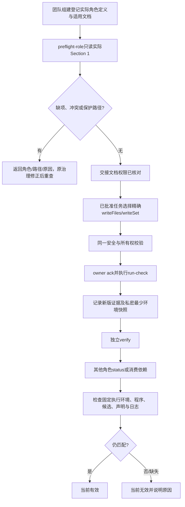

# 让角色工作文档进入受限任务，并按实际检查环境判断证据

版本 **D1-final-1（本轮D1定稿）**，对应[产品方案 P1](../../../策划/docs/design/2026-10-20_design_workflow-friction-product.md)。本文件由固定项目管理角色撰写；当前评审建议为 **recommend approval / ready-for-customer**，可供客户决定，尚不是客户批准或验收结论。当前唯一写入为本设计文件，未改程序、测试、旧库存文件、已安装技能或公共镜像，未初始化新任务。

一个已批准的角色任务准备更新自己的功能说明时，工具应能接受精确文件；团队组建漏列该文件的权限时，应在交接前指出缺项。检查通过后，另一角色从不同终端查看状态，应核对原检查实际使用的环境，而不是把查看者的 PATH 当作新的检查环境。本方案只修这三处已观察到的工作流问题。

## 1. 依据与基线

- 源仓库基线为 `main d95d006`；本轮既有治理改动和 P1 是工作区输入，不能覆盖或当作本角色实现。实际写权见[本角色 Section 1](../../boundary.md)。本次适用 [TASK-01、ROLE-01](../project-rules.md)；不改任务单写、批准、独立验收和失败历史约定。
- [库存实测观察](../../../../../ans-full-trial-2026-10-19-bqf0vjof/角色卡/scheduler/docs/handoff/2026-10-19_trial-observations.md)记录三个真实问题；[最终交接](../../../../../ans-full-trial-2026-10-19-bqf0vjof/角色卡/scheduler/docs/handoff/2026-10-19_final-handoff.md)记录旧任务、原测试与产物。本次不重新调查全部库存源码。
- 定点源码：`scripts/task_ops.py:30–89` 只认可 common/test 目录且整段拒绝 `role-cards/`、`角色卡/`；`211–245` 从查询进程重建环境后比较；`533–555` 执行检查和记录证据。`scripts/coordination_store.py:safe` 已拒绝路径穿越、符号链接和根外路径，可复用，不能绕过。
- 2026-10-20，PM 用**源仓库** `scripts/task_ops.py status` 对旧库存作只读基线复核：仅从其私密 `.ans/runtime/observed-check-environment.json` 恢复已有跟踪键，显式移除 absentKeys，不输出环境原值。返回版本 **93**、六节点 `currentAcceptanceValid=true`、`taskComplete=true`；调用前后 `docs/scheduling/inventory-full-trial.md` 摘要相同。这是旧环境下的旧结果复核，不能算本方案已通过，也没有为旧证据补快照。
- 本轮治理交接曾出现“摘要称补齐，实际角色 Section 1 未补齐”的情况，复读后由原治理纠正。因此预检读实际文件、实际登记和实际重叠，不能相信完成摘要。

## 2. 推荐结构与取舍

推荐在既有 `scripts/task_ops.py` 内增加**无任务写入的 `preflight-role` 命令**，并复用同一组解析、路径分类和重叠检查到新任务初始化及角色范围校验；不新增脚本、依赖、YAML解析器或第二套 JSON 存储。新环境证据仍写入原单份任务 Markdown，环境原值仅留私密 runtime。

| 选择 | 判断 |
| --- | --- |
| 只修文档提醒 | 不采用：交接摘要仍可能漏实际边界，角色文档也仍不能进入真实任务。 |
| 新建独立预检脚本 | 不推荐：同一授权规则会出现两个入口和两份实现；现有 task_ops 已有安全路径和角色验证能力。 |
| 开放整个角色根，或只删除两个目录前缀拒绝 | 不采用：会把治理卡、他角色和嵌套治理路径带入执行范围。 |
| 查询时忽略所有环境字段或只比较 Python 名字 | 不采用：实际程序、声明环境和运行资源变化仍须使证据失效。 |
| 为旧证据补录新快照 | 不采用：旧记录只有哈希，无法反推原值，不能追认。 |
| 实际执行时保存最少环境身份，查询时重核该身份 | 推荐：解决不同查询者 PATH 的摩擦，同时保留现有变化失效门禁。 |

这些是完成 P1 必需的改动，不搭载新功能选装。没有提出自动修边界、批量迁移旧角色、恢复私密环境、环境值上云等附加项。



## 3. 初始化与交接：检查什么、由谁决定适用性

### 3.1 同一配置中的角色登记

在现有配置 `schemaVersion: 1` 增加可选 `roleDefinitions` 映射，不新建清单文件。它登记本项目全部实际项目角色，包括不作为执行者的 scheduler、planning、PM、acceptance。每项使用真实 `roleId`，字段为 `card`、`boundary`、`requiredWorkDocuments`、`apiSpec`、`apiSpecReason`：

- `card`、`boundary` 是项目相对精确路径，需存在、可读、无符号链接、同属一个实际父目录；该父目录是此角色根。拒绝同一登记指向不同根、重复角色根和角色根互相嵌套。目录名、语言与 roleId 可以不同，不拼接 `角色卡/<roleId>`。
- `requiredWorkDocuments` 是职责确实需要的**精确项目相对工作文件清单**。最低包含实际角色根下 `feature-map.md`、`memo.md`、`functional-description.md`；后一份说明实际职责与定位，协作角色不用虚构代码层或业务功能。该列表只说明“需要检查哪些许可”，不授予权限，也不限制已获边界许可的未来日期文档。
- `apiSpec` 必填 `required` 或 `not-applicable`，`apiSpecReason` 必须有非空、可核对的职责依据。提供给其他角色使用的代码能力、共享能力或装配入口，取 required，并把本角色 `api-spec.md` 纳入所需清单；纯策划、调度、测试、独立验收等没有这类实际接口的角色可声明不适用。角色名本身不是适用性依据。规范owner须核对这与现行接口指南是否一致。
- `requiredWorkDocuments` 的 docs 文件根据角色实际交付明确列出，例如开发者当前功能页/本轮fix、策划本轮design、验收本轮criteria。**只有Section 1可授予目录**；清单不另发明目录通配。不强迫每个角色都有四个空历史目录，也不强制纯协作角色创建 Provider/Service 代码层。
- 形成/调整角色的 ANS团队组建根据已确认职责准备登记，交接时展示具体列表；原角色owner核对职责适用性。已审核配置固定内容哈希。程序不凭自然语言猜“这个角色应该有几个接口”，也不以缺省值掩盖未声明适用性。
- 执行配置 `roles` 中各角色、`acceptanceAuthority` 的 card/boundary 必须与登记一致，schedulerRoleId 也须已登记。登记之外不能申请角色文档写权。缺少角色登记不能被报成“所有角色已检查”；客户项目的全角色完整性由团队组建交接实际角色清单、统筹和验收核对，工具验证其提供的具体登记而不声称自动发现未登记角色。

`roleDefinitions` 是现有执行配置的一个小扩展；已有 boundary Markdown 仍是唯一权限源，YAML仍只是同步副本。适用性写入批准配置后，不再额外维护一个可编辑 JSON 库或从 YAML 授权。

### 3.2 真正机器入口与结果

拟议调用为 `python3 scripts/task_ops.py --root <project> preflight-role --request -`，请求仅 `{configPath: <现有配置路径>}`，无 `--task`、凭证、审批动作和写文件副作用。**在构造Store和进入locked之前分支**，不创建runtime、忽略文件、锁或日志。现有任务命令仍要求 --task；CLI只为此只读分支放宽参数。读取有完整 roleDefinitions 的候选配置及实际角色资料，输出：`status`、`permissionsComplete`、逐角色的具体缺项/重叠/保护路径、文档存在情况。成功退出0，缺项/冲突退出2。

预检使用同一个 Section 1 解析器和 canonical 检查；把 requiredWorkDocuments 与所有角色实际 Section 1 比较，验证“归本人且有许可”，不能只查路径出现在配置或治理覆盖表中。检查所有登记的工作许可，不仅检查当前 writeFiles，以免未选进任务的重叠先漏过去。缺文件内容可报告 `exists=false`，不把“授权齐全”谎称“文档已写完”：团队组建只能交治理资料，角色获接受后才由原owner补工作文档。预检不写这些文档，也不修权限。

新建/调整角色交接前必须运行；新配置启用 roleDefinitions 时，`init` 自动执行同一权限检查，失败不创建任务记录。后续角色边界改变仍按既有哈希门禁失效，不靠历史预检结果继续放行。旧配置没有 roleDefinitions 时保持旧语义，可继续旧代码任务；申请本轮新增角色文档能力必须提交含完整登记的新审核配置及新任务，不能静默扩宽旧任务。

Provider/Service 的 `abstract/`、`public/`、`impl/` 三目录及公开契约保持既有约束；此次工作文档预检不替代层规则，也不新增缺三目录/缺契约的通用架构扫描器。实际不退化证据是现有 `test_directory_grant_does_not_cover_sibling_or_broad_root`、`test_overlapping_directory_and_file_ownership_is_rejected`、`test_directory_scope_rejects_traversal_and_symlinks` 三个授权回归，以及库存 `test/integration/test_architecture.py` 两方法对当前源码无三元和相邻层public导入的核对；它们不被冒称为三目录缺失负例机器检测。

## 4. 精确工作文件授权与保护

### 4.1 允许的最小范围

roles_valid 保留精确代码文件、现有受限 common/test 目录规则。仅对登记过的本角色工作文档新增如下识别：

| 路径类型 | 边界可授予 | 每任务执行可授予 |
| --- | --- | --- |
| 角色根的 feature-map、memo、functional-description、适用 api-spec | 各自精确文件 | 必须精确列入批准配置 writeFiles 与节点 writeSet |
| 本角色 docs 下的精确工作 Markdown | 精确文件 | 同上 |
| 本角色 docs 的有界子树，如 docs/feature/、docs/design/，或已明确授予的本角色docs/ | 必须是实际角色根内的明确docs范围，不能给整个角色根 | 只选本轮精确文件，不允许目录进入 writeFiles/writeSet |
| 其他角色根/资料、治理文件、任务状态 | 不属于该执行角色工作文档许可 | 拒绝 |

只要 role根由 card/boundary 解析，`角色卡/库存存储/`、`role-cards/storage/`、项目约定的其他语言目录均可；文件名不为满足角色 ID 而改名。本轮不开放任意角色根附加文件、整个 role-cards 或角色卡目录；已明确归属某角色的docs仍是其根内的有界支持资料范围，目录许可不自动进入任务。

### 4.2 先建立保护集合，再判断许可

1. 用 safe 校验、规范化所有已登记角色及 acceptance 的 card/boundary；所有授权和候选路径都检查规范相对形式、`..`、`.`、绝对路径、反斜线及符号链接。尚未创建的文件也检查其全部已有父目录。不能先做字符串 startswith 就放行。
2. 保护集合包含**全部登记角色**的实际 card/boundary，boundary 同名 `.yaml`、角色根 `changelog.md`；登记路径即使不是标准名字或位于另一角色 docs 下面也仍受保护。拒绝不同角色根嵌套，拒绝工作文档树内的 `role-card.md`、`boundary.md`、`boundary.yaml`、`changelog.md` 这类治理命名。
3. `.ans/`、`docs/scheduling/` 及其子路径继续全局拒绝执行角色写入；这不改变统筹通过 Store 写任务状态的特权路径。项目治理覆盖文件不位于允许的本角色工作文档集合，仍不能申请。登记的治理精确文件若位于获准 common/test/docs 子树，也优先拒绝。
4. **目录授权也做保护相交检查**：目录包含受保护文件、包含/进入他角色根，或与另一角色的精确文件/目录许可相交均拒绝，不能等到当前 writeFiles 碰到该文件才发现。路径段分隔要正确，`docs/a/` 不覆盖 `docs/ab/`。同一角色精确文件落在自身已批准目录可去重，不视为跨角色冲突。
5. 对全部登记角色实际 Section 1 建立规范所有权，先查不重叠，再查配置 writeFiles 是其子集，再查计划 writeSet 是 writeFiles 子集。requiredWorkDocuments 只做“期望许可”检查，不能绕过任何这三层。
6. 保留实际变更路径、候选哈希、角色文件哈希、readSet、授权、ack 和报告门禁。本工具约束授权与证据，不声称具备 OS 文件沙箱；独立测试仍核对实际 changedPaths 与保护文件摘要。

## 5. 环境证据：执行者和查询者分开

### 5.1 新证据 v2

不升级旧任务状态 schema；在每条新检查证据增加 `environmentVersion: 2` 和 `environmentSnapshot: {path, sha256}`，其余 producer、attempt、configHash、candidate、日志摘要与验收关联继续保留。snapshot 是工具生成的私密 runtime 文件，不是一个由人维护的新配置体系。

run-check 在调用子进程前**只构造一次 actual env**（保留现有显式 env 覆盖和强制 PYTHONDONTWRITEBYTECODE=1），将该映射交给 subprocess，不能执行前后分别继承不同的查询者环境。以此映射计算固定跟踪键：PATH、PYTHONPATH、NODE_PATH、NODE_OPTIONS、LANG、LC_ALL、TZ、PYTHONDONTWRITEBYTECODE，以及 check.env 全部声明键。记录值或明确 absent，私密原值仅写 `.ans/runtime/check-environments/<task>/<attempt>-<check>-<nonce>.json`；父目录0700、文件0600，safe/原子写入，不接收调用者指定快照路径。

任务 Markdown 只写快照路径/摘要、跟踪键集合、environment 指纹、已批准声明的摘要和执行文件身份；v2不再写明文 declaredEnvironment 映射。不把完整 os.environ、私密原值、凭证写入Git、报告或status。现有 config.env 不适合放明文秘密；本改动不额外采集未跟踪键。

执行文件按 root cwd 与 actual PATH 解析；记录 canonical 实际文件路径及内容哈希。PATH 选择器最终使用的可执行文件应固定为该路径执行，避免“摘要检查了一个程序，subprocess又按另一PATH选程序”。若声明命令本身是符号链接，则记录声明路径到实际文件的解析结果，复核时必须得到同一实际路径和内容；不把开发机合法 Python 链接简单当作项目路径逃逸。root内输入文件仍遵循safe的符号链接拒绝规则。

检查结束后用**同一份捕获环境**再次解析执行文件、核对字节/平台和候选、日志，记录 environmentUnchanged；捕获快照写入失败、文件消失或执行文件在过程中改变时不能生成有效通过证据。工具代码/批准检查入口及实际读取配置、资源必须进入检查节点 readSet；间接调用的工具和资源若需覆盖，也作为批准的精确readSet输入，不宣称会自动发现任意动态依赖。

### 5.2 status / verify / 依赖消费重核什么

对 v2 证据，evidence_valid：

1. 继续检查当前批准配置、卡/边界、标准、requiredOutputs、候选（writeSet/readSet）、producer/attempt、报告、日志字节及原有验收引用。
2. 校验工具生成快照路径、私密文件存在、摘要与证据一致、键集合/absent语义符合v2。缺失或改动即当前无效，报告“执行环境快照缺失/变化”，不能回退到新查询者环境，更不能补写。
3. 在快照的原始跟踪环境和 root cwd 下重建检查身份；检查实际执行文件路径/字节、已声明env、平台/Python运行身份与原指纹仍一致。若当前工具运行平台/Python身份变化，仍可保守失效；此次只消除查询者无关 PATH 差异，不承诺跨机器复用。
4. 查询进程的 PATH、LANG等未用于重新运行检查，因此不参与v2当前有效性。它们不能替换快照。跨角色verify和依赖消费也调用这同一逻辑，不留下“status绿、dispatch拒绝”的两套判定。

因此，查看者仅换 PATH 且实际程序内容不变不会误失效；修改固定执行文件、声明环境/批准配置、快照、源码、资源/readSet或日志仍失效。若需要**更换任务实际检查环境**，只有现有状态机允许且仍active的assignment可以真实run-check并记录新快照，沿用既有candidate/attempt的完成报告门禁，由独立验收对新证据重新verify，绝不能沿用旧acceptance。本轮不新增report与environment/evidence的通用绑定机制，也不要求在candidate/attempt未变时仅因环境复测而强制废弃旧完成报告。verified节点已active=false，不能原批次重开或重跑；其环境复测使用新审核任务。修改check.env/批准配置同样须符合新审核任务规则，不能直接改configHash。不能把修改快照当成切环境操作。

继承但未跟踪的环境键、未声明文件/外部资源仍在现有模型之外；设计不把“所有机器状态都受证明”作为承诺。若检查需要额外变量，显式放入批准check.env；需要的配置/资源放readSet。保留已知环境校验，不以忽略一切env来解决PATH。

### 5.3 旧证据兼容

**仅没有 environmentVersion 字段的legacy证据**继续走旧 environment(root, check) 对比，必须在原环境复核，换PATH仍可能无效。`environmentVersion: 2` 的快照缺失、损坏、形状错误或摘要不匹配直接当前无效；未知版本也拒绝，绝不回退legacy或查询者环境。不得仅按可执行文件相同就从旧variablesHash推断“所有环境等价”。旧Markdown、批准、失败日志和所有历史事件原字节保留；不迁移、不补造、不重新签旧通过。

需要体验新判定时，使用含新登记/新配置的新受限任务，真实重新运行检查、报告和独立验收。私密快照丢失或换机器无法恢复时也按无效处理；新建复测任务而不是猜原值。本轮不提供快照恢复/上传工具。

## 6. 精确修改范围与所有者

下表是**拟议实施范围**，须对应owner评估、有效边界和客户实施指令后执行；它不是本次已写文件。除本D1外，现阶段不追加程序/测试授权。

| 所有者 | 实施候选文件 | 内容 |
| --- | --- | --- |
| 任务工具 | `scripts/task_ops.py` | 同一预检入口/登记与路径分类、精确工作文档授权、v2环境快照与兼容分支 |
| 任务工具 | `scripts/tests/test_task_ops.py` | 定点单元验证，覆盖预检缺项/冲突、路径保护、v2与legacy判定；不新建测试文件 |
| 固定测试 | `scripts/tests/test_role_authority_flow.py` | 独立真实CLI回归，覆盖新文档任务/跨角色与环境边界，保留原断言与失败历史 |
| 技能规范 | `SKILL.md`、`SKILL.zh.md` | 初始化/交接预检和精确工作文档能力的用户规则，保持中英文一致 |
| 技能规范 | `references/bootstrap-workflow.md`、`references/role-card.md`、`references/module-boundary.md`、`references/task-operations.md`、`references/team-formation.md`、`references/api-spec.md`、`references/scheduler.md` | 实际适用清单、MD权限唯一源、入口/配置新字段、环境v2及旧记录限制 |
| 任务工具 | `角色卡/任务工具/docs/feature/task-authority.md`、`角色卡/任务工具/docs/fix/2026-10-20_fix_workflow-gaps.md` | owner按实际实现更新当前流程与修复历史 |
| 技能规范 | `角色卡/技能规范/docs/feature/role-authority-split.md`、`角色卡/技能规范/docs/fix/2026-10-20_fix_workflow-gaps.md` | owner说明初始化/工具能力变化并链接本D1 |
| 固定测试 | `角色卡/测试/docs/design/2026-10-20_design_workflow-fixes-validation.md`、`角色卡/测试/docs/change/2026-10-20_change_workflow-fixes-validation.md` | 独立验证设计和实际原报告 |
| 独立验收 | `角色卡/验收/docs/acceptance/2026-10-20_workflow-fixes-criteria.md`、`角色卡/验收/docs/acceptance/2026-10-20_workflow-fixes-result.md` | 本轮标准与结论路径以其已接受Section 1实际路径核对，不由PM代写 |
| 统筹调度 | `角色卡/统筹调度/docs/coordination/2026-10-20_workflow-fixes-handoff.md` | 按其本轮实际授权路径维护执行交接，不因本表新增写权 |
| 项目管理 | 本文件 | D1、评审与批准简报；暂不改现行架构/法案把提案写成事实 |

实施不需要新增脚本、测试模块或改 `scripts/coordination_store.py`，不改依赖文件。若owner发现不能复用现有safe/atomic或需要新增文件，须先返回精确路径修订本D1并由治理处理，不在实现时临时扩scope。memo和feature-map仅在确有本角色导航/续接变化时由owner在其现有权内更新，不作为任意文档修改许可。

## 7. 库存隔离副本中的独立受限验证

选择 **B：字节核对复制**。验证根固定为旧库存内的新独立tool root：

`ans-full-trial-2026-10-19-bqf0vjof/validation/workflow-fixes-2026-10-20/`

把原20个库存源码/测试及必要角色输入按原相对布局复制到此根，记录复制基线，再按获准差额接受副本治理并记录执行基线；原20文件及未授权改变的输入保持冻结，最后运行原60项库存回归。复制不是新增库存业务实现。不能让argv引用父库存源码后宣称候选已覆盖；safe/readSet不跨根，不扩safe，也不增加外部依赖清单体系。另一合法选择是在原库存根建新taskId和独立配置，但其状态和权限更容易与旧任务混用，故不推荐。

### 7.1 复制载荷、源工具版本及精确归属

固定测试只在获准的新验证根内准备**只读测试载荷副本**，不编辑载荷内容、不取得原owner业务维护权。以下20路径来自实际最终候选清单，全部逐字节复制并进入两个节点readSet：

```text
.gitignore
README.md
main.py
src/interface/cli.py
src/models/product.py
src/pipelines/inventory.py
src/providers/abstract/json_store.py
src/providers/impl/json_store.py
src/providers/public/__init__.py
src/services/abstract/inventory.py
src/services/impl/inventory.py
src/services/public/__init__.py
test/assembly/test_startup.py
test/integration/test_architecture.py
test/integration/test_cli_end_to_end.py
test/inventory-cli/test_cli.py
test/inventory-cli/test_pipeline.py
test/inventory-service/test_inventory_service.py
test/inventory-service/test_product_model.py
test/provider-json/test_json_store.py
```

必要角色输入先作字节一致复制基线：库存九个实际角色 `scheduler`、`planning`、`project-management`、`acceptance`、`provider-json`、`inventory-service`、`inventory-cli`、`assembly`、`test` 各自实际根的 `role-card.md`、`boundary.md`、`boundary.yaml`、`changelog.md`、`feature-map.md`、`memo.md`、`functional-description.md`（逐一检查存在）；另复制最终候选清单frozenApprovedInputs的P1/D1/R1/C1/T1五个**实际路径**、frozenApiHashes四份API和 `角色卡/scheduler/docs/handoff/2026-10-19_final-candidate.json`。它们的原摘要/副本摘要进入准备报告。原 `.ans/project.json` 仅复制为 `baseline-inputs/original-project.json`，不能作为新配置直接覆盖或追用旧批准。

**Q1采用两份基线而非覆盖原摘要。** `baseline-inputs/copy-manifest.md` 先记录原件与初始副本逐文件相等；之后团队组建仅对副本治理文件作已授权差额，明确每项旧摘要/新摘要/理由/归属，并同步boundary.yaml和changelog。全部治理被接受后，记录第二份执行基线、再冻结manifest纳入readSet；它不是“修改后的副本仍等于原件”的声明。原20源码/测试及未变输入仍必须字节等于原件。manifest自身由任务readSet固定，不把它自己的哈希写回自身。

九角色是隔离副本实际完整登记；未被执行的角色仍受保护，roleDefinitions不能只含两个执行者。复制角色定义作为治理候选由独立团队组建逐项核对/接受；不激活九个运行上下文，不代写它们的新结论。若原输入缺少任何所需文件，返回实际缺项，由原owner/治理确认，不用补造内容让预检变绿。不得复制旧任务state、凭证、私密环境或失败日志进新任务。

**Q2不增加快照文件，复用已列计划/标准承接本轮批准内容。** 根内 `角色卡/scheduler/docs/handoff/2026-10-20_workflow-fixes-plan.md` 按分节原文收录客户实际确认的workflow P1、D1-final-1和QA-T1-draft-1，逐份记录源路径/版本/批准后实际摘要；不是只有链接或手写摘要。`角色卡/acceptance/docs/design/2026-10-20_design_workflow-fixes-criteria.md` 承接本轮C1原文和已明确的两节点阶段语义。plan.requirement与plan.design均引用该根内计划文件，用不同version字段标P1和D1-final-1，配置designFiles允许该实际路径；现有normalize_plan允许二者同路径。accept-plan.criteria引用根内标准实际路径/版本/摘要。两个节点readSet都含该计划、标准与冻结manifest；旧库存五文件仅是回归合同，不作为本轮workflow要求。批准后一次复制并固定；各文档按版本单向引用，计划快照由任务计算实际哈希，不要求源P1/D1/C1/QA互写哈希。

源工具两文件以新候选实际字节复制为 `validation-tools/task_ops.py`、`validation-tools/coordination_store.py`；新任务实际调用此副本，逐个摘要必须等于已审核源候选。两文件都进readSet，记录源基线d95d006及本轮实际diff/文件摘要，不能只写“最新工具”或用安装副本代替。运行中源工具候选改变需要重新复制、核对候选和真实复测；不能只刷新一个hash。源Python实际路径及字节由环境v2记录，源码复制不替代运行环境检查。

本轮实际新建/生成文件及其所有者如下；上列只读复制载荷也属于新根的明确准备范围：

| 归属 | 新验证根内的精确路径 | 用途/限制 |
| --- | --- | --- |
| 团队组建 | 上述九角色的四个治理文件副本 | 作为独立验证项目候选核对；新路径增加需要治理在副本内改boundary及同步YAML，原库存治理文件不动。 |
| 各实际角色owner | 上述各自三份core文档副本 | 冻结的既有上下文输入；不为本轮批量编写新功能或迁移旧资料。 |
| provider-json | `角色卡/provider-json/docs/change/2026-10-20_change_document-probe.md` | document节点唯一writeSet；原副本boundary已有docs/change目录许可，但仍须精确纳入新配置/计划。 |
| test（独立测试） | `角色卡/test/docs/change/2026-10-20_change_workflow-fixes-validation.md` | document-check唯一writeSet；先固定本轮方法/输入/覆盖及原证据去向，实际结果留工具日志、本人的report事件和源QA实际报告，不在正式检查后回写。 |
| acceptance | `角色卡/acceptance/docs/design/2026-10-20_design_workflow-fixes-criteria.md`、`角色卡/acceptance/docs/change/2026-10-20_change_workflow-fixes-result.md` | 隔离根的独立标准/结果，由实际独立上下文维护与verify；与源验收报告是不同项目，不复制结论。 |
| scheduler | `角色卡/scheduler/docs/handoff/2026-10-20_workflow-fixes-plan.md`、`.ans/project.json`、`docs/scheduling/<new-task-id>.md`（后者仅经task_ops） | 新配置、新计划、新任务；旧项目任何原批准都不自动变为此任务批准。 |
| 固定测试的准备载荷 | `baseline-inputs/original-project.json`、`validation-tools/task_ops.py`、`validation-tools/coordination_store.py`、`baseline-inputs/copy-manifest.md` | 原配置副本、源工具字节副本与复制校验报告；冻结后只能读，不能以测试角色修改其实现。 |
| test受控夹具 | `test/workflow-fixes/runtime-resource.txt`、`test/workflow-fixes/probe-config.txt`、`test/workflow-fixes/tools/check-probe` | 三个精确测试夹具，分别验证资源/config/readSet及实际执行文件变化失效；副本test边界需治理明确补这些路径，不能授整个test根。 |
| 工具生成的私密runtime | `.ans/runtime/check-environments/<new-task-id>/<attempt>-<check>-<nonce>.json`，以及Store原有任务锁/私密工作凭证 | 不放Git/报告，敏感值不输出；精确文件名由工具生成，不手工写证据。 |
| 工具生成的原证据 | `.ans/runtime/<new-task-id>/evidence/<attempt>-<check>-<nonce>.log` | 保留全部失败与成功原输出，不编辑日志。 |

花括号/通配没有进入任务写集合；上表角色集合和固定文件名在执行配置中必须逐一展开实际精确路径。source固定测试角色、隔离项目test角色各有自己的固定上下文和边界；源PM/QA不临时切换成库存Provider或验收。只读载荷复制不等于业务所有者变更。准备阶段先接受复制治理、脚本载荷/夹具及标准，再对两节点init；本D1不预造token、批准摘要或通过结论。

**没有新增编写的检查脚本。** 文档内容校验使用批准配置中显式 `python -c` 命令读取精确目标并断言；原60项用现有unittest入口和原模块运行。`test/workflow-fixes/tools/check-probe` 是环境负例的可执行测试夹具，不是另造业务或常驻工具。若原owner需要新增脚本/测试模块，先把确切路径和理由退回修订D1、治理授权后才写。

### 7.2 两个真实节点、检查和独立verify

新任务ID由实施前的统筹具体计划选定，以下 `<new-task-id>` 只是路径占位符，不能用旧inventory-full-trial。仅两个必需节点：

- `document` / provider-json：writeSet仅上述新文档。readSet含复制的20文件、必要角色/冻结输入、两源工具副本、标准、新配置、资源/配置夹具；不含本节点writeSet以外的新写入。真实dispatch→ack→写文档→run-check（实际读取文档并校验指定内容）→report complete。
- `document-check` / test：依赖document，writeSet仅上述test报告。readSet覆盖document全部writeSet/readSet；检查包含文档内容与权限核对、原60项回归及根内载荷/冻结manifest核对；父根原件前后保全由任务之外获准准备/收尾操作另证。accept-plan independentTests covers document。两个节点均由实际acceptance按C1及阶段语义独立verify；scheduler只消费有效结果，不能持验收秘密。

**Q4选择先固定方法报告、结果留原日志的较小顺序。** test本人ack后先写完上述唯一报告文件：记录本轮批准版本、冻结输入、六条具体argv/范围、预期核对项、失败处理和实际结果应到工具日志/本人report事件/源QA报告读取；不得预填“通过”。冻结该文件后才运行所有正式run-check（六组库存回归及文档/manifest断言），最后提交本人report complete和独立verify；不在其后往文件追加结果/日志链接，也不为凑报告提前重复跑60项。结果由工具原日志和完成报告事件承载，源QA实际报告汇总。若正式检查后确实改了此writeSet文件，候选已变，全部受影响正式检查重新运行，再按既有门禁完成/verify，不能沿用旧证据。

原60项为model7、provider7、service10、cli21、assembly6、integration9，不重复累加。复用原检查argv中真实单测/集成入口；配置展开六个具体检查及其60项覆盖，由原固定测试owner核对，并保留所有实际失败输出。检查运行于副本cwd，不导入父根库存实现。测试可能创建的临时数据只在新根或系统临时目录，输出落原工具日志；不允许改冻结载荷。既有源码/测试字节变动会失效，即使报告仍声称60项通过也不放行。

源工具自己的单元与独立CLI回归仍须分别真实执行，不能只用库存60项代替工作流修复测试。多语言/roleId与文件夹不同、跨角色/治理保护、目录重叠等用源测试文件中的隔离用例覆盖，不为测试命名差异再创建一套额外业务团队。实际独立验收须另有真实verify；自动化测试模拟的验收凭证只证明工具拒绝/接受路径，不能冒充客户项目验收。

| 必要场景 | 预期与证据 |
| --- | --- |
| core或本轮docs漏权，治理摘要与owner实际边界不符 | preflight退出2并指出具体owner/路径；不创建锁或任务；原治理修正后重查 |
| 无业务功能/无接口的协作角色 | apiSpec有明确不适用说明；不要求无用Provider/Service层文件 |
| 精确本角色工作文档 | 真实进入writeFiles/writeSet并完整ack/check/report/独立verify；目录许可不能代替任务精确清单 |
| roleId/中文或英文文件夹不同 | 按实际card/boundary父目录识别；源CLI隔离用例证明，不拼接roleId |
| 整角色根、目录进入writeSet、跨角色、治理MD/YAML/changelog、.ans、scheduling | 拒绝具体路径；已明确的自身docs范围内精确文件正常可选 |
| 未选入writeFiles的目录重叠、注册自定义治理文件、前缀相似、穿越/符号链接 | 提前拒绝相交/逃逸，不能靠当前没写该文件放行 |
| 查询者PATH不同，原实际文件与环境未变 | status/跨角色verify/依赖消费同判v2有效，不跑新检查 |
| executable字节/解析目标、声明env/配置、readSet资源/源码、原日志或快照变了 | 逐项负例均当前无效，指明变化对象；每个负例用独立fixture或恢复原载荷再真实重核，不改证据hash |
| 新run-check实际换环境 | 仅active且获准assignment可补检查，完成报告仍按既有candidate/attempt门禁；必须新独立verify，不能沿用旧acceptance；verified换环境使用新审核任务 |
| 私密快照缺失/旧hash-only | v2无效；legacy保留旧语义，不自动升级；旧93在已观察环境仍可只读复核 |

### 7.3 旧项目保全与结果界限

**Q3保全在工具任务之外完成。** 获准准备/收尾角色在新根外只读记录父库存原件的前后清单/摘要；任务内检查只读取根内冻结copy-manifest与根内载荷，不访问父根，不声称它能单独证明父根一直未变。源QA报告分别列明两种证据及各自证明范围。准备前记录原项目精确保全集：`docs/scheduling/inventory-full-trial.md`、原`.ans/project.json`、原`.ans/runtime/inventory-full-trial/`全部日志/失败输出/事件相关资料、冻结P1/D1/R1/C1/T1、四份API、最终候选快照列出的20文件、实际旧角色卡/边界和私密observed快照。机密值不输出，仅在私密保全记录存字节摘要。

验证后逐文件/完整目录清单比对，旧任务仍revision93；不得覆盖任何旧载荷或旧runtime文件。旧状态复核使用源工具与实际观察环境，不调用旧任务revise/dispatch/run-check/verify。唯一库存项目增加范围是本节新根。发现旧文件变化即停止报告，不靠回写掩盖。

成功需要源工具回归原输出、隔离副本内原60项的新原输出、两个真实文档节点证据、复制/旧文件保全比较及独立验收。旧库存曾通过或副本只跑了部分回归都不等于D1通过。此处全部是待验证设计，没有复制、init或运行。

## 8. 跨角色实质评审

本设计由PM本人撰写，未虚构第二个PM独立review。架构判断如下：改动位于已有任务授权/证据工具内部；复用同一检查逻辑可减少规则漂移；单份任务Markdown、角色固定身份与独立验收维持；不改应用五层调用关系或Provider/Service契约。新增配置登记和私密环境快照是必要成本，不能写成“只改两行”。

真实规范冲突需随本轮必改：现行 `references/role-card.md` 执行检查点/Deliverables/目录树把根changelog列为执行者交付，但同文件和实际治理边界又把其内容定为创建/边界调整/拆并。规范owner应统一改为治理独占、执行者历史落自身docs/change或fix；不是放开根changelog。`references/team-formation.md` 的治理职责定义与owner后续functional-description也须分清。原evidence通用指南没有与新行为冲突的算法或入口，本轮只在task-operations说明v2，不为凑同步额外改evidence。

主要风险：roleDefinitions必须真实完整，不能自动证明未登记角色不存在；路径保护要在目录层检查才不会漏嵌套治理；旧任务不能无损获得新环境语义；私密快照遗失会让新证据无效；动态外部依赖仍须显式readSet/env声明。最少文件方案避免新源模块，但task_ops内部将增加共享辅助逻辑和相应回归维护。

| 受影响owner | 已消费的独立意见与本次处理 |
| --- | --- |
| 任务工具 | [成文评估及D1针对性结论](../../../任务工具/docs/fix/2026-10-20_fix_workflow-gaps.md)支持第3/4/5节可在task_ops内实现、不改safe/Store、不增源模块；本定稿落实仅无版本legacy回退、active/verified状态机及不扩report绑定系统两处小修。 |
| 技能规范 | [独立评估](../../../技能规范/docs/fix/2026-10-20_fix_workflow-gaps.md)支持三项core默认、条件API、根治理changelog分离与实际交接路由；第3、6、8节已吸收其范围和真实规范冲突。没有把其意见冒称实现验收。 |
| 固定测试 | [QA-T1-draft-1](../../../测试/docs/design/2026-10-20_design_workflow-fixes-validation.md)判断B可实施，列Q1–Q4；第7节逐一闭合双基线、当前批准根内绑定、外部保全界限、报告先冻结顺序，并采用其真实授权/AST回归范围。 |
| 独立验收 | [C1](../../../验收/docs/acceptance/2026-10-20_workflow-fixes-criteria.md)明确WF-01—WF-06，已涵盖同一环境分流、B副本、两节点与Q1—Q4；引用版本，不要求互相哈希或再建审核文件。实施前按C1既有阶段语义accept-plan，实际通过仍由其本人判断。 |
| 团队组建与统筹 | 统筹已转达源第6节实际路径均在当前scope；副本治理差额和精确文件准备在客户授权后落实，不改旧治理、不从本设计直接派发。新taskId/凭证/配置由实际计划及可信端生成，不由PM预造。 |

**评审结论：recommend approval / ready-for-customer。** 原owner必要方向意见已经取得，真实不一致已在本定稿闭合，无剩余需要客户在两种技术方案间选择的实质争议。推荐复用现有工具和单配置的小改动：它直接覆盖P1三项用户结果，保护既有所有权、证据和状态机，不增加常驻组件或迁移旧记录。实际精确边界落实、真实检查与独立验收是实施步骤，不被此建议冒充完成。若实施发现材料性新行为/范围变化，再按原规则只修受影响决策；当前不再设置全文复审或文档互哈希循环。

## 9. 客户批准简报

1. **建议与结果。** 建议确认P1及本 **D1-final-1**：复用task_ops加入无任务副作用的角色文档预检、只允许本角色获准的精确文档进入任务，并让新检查按实际私密执行环境而非查看者PATH判断。推荐理由是三处修复均落在现有工具入口和门禁内，不开整个角色根、不删除环境校验、不增加源模块或另一套配置。
2. **风险、成本与验证。** 要改第6节的工具/原测试文件和规范，按原owner分工实施；在第7节唯一隔离副本复制并核对原20文件、角色输入和工具候选，运行原60项及源工具回归，走两个真实文档节点和独立verify。登记完整性仍需治理交接；私密快照丢失会要求复测，旧hash-only结果保留旧语义。原owner意见与QA Q1–Q4已闭合，当前无实质未决方案选择，**无选装项目**；没有实施、测试或验收通过。
3. **请求批准的确切范围。** 确认 **P1 + D1-final-1 + C1 + QA-T1-draft-1** 并指令按它实施：仅第6节逐名列出的源程序/测试/规范与各owner文档，以及第7节唯一隔离验证根、复制载荷、三个精确夹具、已列计划/标准/两节点文档与工具生成runtime。独立治理先落实副本精确边界和双基线，统筹后续按固定角色安排真实检查及独立验收；根内计划/标准冻结当前批准原文，不另增快照文件。范围不含旧任务/原20文件/原失败日志改写、旧证据追认、已安装技能或public修改、push、install或发布。客户确认并明确授意后才实施；当前交付仅为可批准方案。
